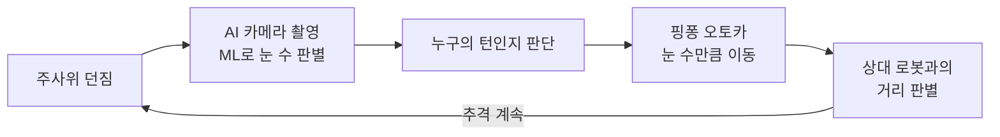

# 🎲 자율주행 해커톤 — 윷놀이 로봇

> 🎲 **IoT 모듈형 로봇 활용 AI 자율주행 모빌리티 해커톤 — AI 카메라 × 머신러닝 보드게임 로봇 (🏆 장려상/3등)**
>
> 한국로봇산업협회 주관 해커톤에서 2인 팀(17조 DP: 박성진·박하영)으로 "AI 카메라와 머신러닝 알고리즘을 활용한 보드게임 로봇"을 개발해 장려상(3등)을 수상했습니다. 교육용 로봇의 핵심인 '접근성과 재미'를 보드게임으로 풀어낸 프로젝트입니다.

> 📷 **사진 자리** — 시연 사진·발표 사진을 넣어주세요.

## 📋 개요

| | |
|---|---|
| **대회** | IoT 모듈형 로봇 활용 AI 자율주행 모빌리티 해커톤 (한국로봇산업협회, 2023) |
| **팀·주제** | 17조 DP (박성진·박하영) — AI 카메라와 Machine Learning 알고리즘을 활용한 보드게임 로봇 |
| **플랫폼** | PingPong 모듈형 로봇 (서보·스테퍼 모듈, Python SDK) + AI 카메라 |
| **수상** | 🏆 장려상 (3등, 2023.07) |

## 🎯 기획 배경

핑퐁로봇의 가장 큰 활용 분야는 교육인데, 교육에서 중요한 것은 **접근성과 재미**라고 판단했습니다. 남녀노소 참여 장벽이 없고 다양한 분야 교육에 활용 가능한 콘텐츠로 **보드게임**을 선택해, "어려워하는 코딩과 로봇을 보드게임으로 더 쉽고 재미있게 교육한다"를 컨셉으로 잡았습니다.

## 🎬 게임 시나리오

주사위를 던지면 AI 카메라가 주사위 눈의 수를 판별하고, 그 수만큼 핑퐁 오토카가 전진하며 상대 오토카를 따라잡는 추격전 방식의 보드게임입니다.



## 🛠️ 개발 내용

- **주사위 인식·숫자 판별** — 해커톤에서 실시한 기계학습 강좌를 기반으로, AI 카메라 이미지에서 주사위 눈을 판별하는 머신러닝 모델을 학습·적용 (이미지 정합·비교 프로그램 직접 제작)
- **게임 로직** — 턴 관리(누구의 턴인지 확인) → 판별된 수만큼 이동 명령 생성 → 이동 후 상대 로봇과의 거리 판별로 승부 판정
- **하드웨어 제어** — PingPong Python SDK(servo/stepper operation, motor protocol)로 모듈형 로봇의 주행을 제어
- **한계 인식과 개선안** — 특정 환경·특정 주사위만 인식되는 일반화 한계, 카메라-컴퓨터 통신 속도 문제를 스스로 도출하고, 2배속 모드·미션 칸·음성인식 팀명 등록 등 확장 기획까지 발표

## 🌱 배운 것

비전 모델의 "환경 일반화" 문제를 처음 몸으로 겪었습니다 — 조명·배경이 바뀌면 무너지는 인식률을 보며, 이후 KETI에서 합성 데이터셋으로 일반화를 해결하는 접근(첨단로봇 과제)의 문제의식이 여기서 시작됐습니다.

## 🧰 기술 스택

`머신러닝 이미지 분류` `AI 카메라` `PingPong 모듈 로봇` `Python SDK` `게임 로직 설계`

```javascript

```
