# 📡 AI-RAN

> 📡 **AI 기반 휴머노이드 로봇 서비스 개발 (현대제철 대상)**
>
> 온디바이스 처리와 AI-RAN 엣지 연산을 결합한 하이브리드 구조로, 제철소 현장의 레거시 설비 복구·컨트롤 패널 조작·통제구역 순찰 및 침입 감지 서비스를 휴머노이드로 구현하는 프로젝트입니다.

## 📋 프로젝트 개요

| | |
|---|---|
| **대상 현장** | 현대제철 (위즈코어 협력) |
| **수행기관** | KETI 지능로봇연구실 |
| **핵심 구조** | 온디바이스 처리 + AI-RAN 엣지 판단/명령/로그 (하이브리드) |
| **상태** | 🟢 실기 개발 진행 중 — 순찰·사람 감지 실구동 검증(2026.08.04) · GR00T N1.5 VLA 정책 E-STOP 버튼 누르기 실기 완주(2026.08.19) |

> 📷 **대표 사진 자리** — 현장 실사 사진, 휴머노이드 로봇, 모사환경 구축 사진을 넣어주세요.

## 🎯 기획 배경 — 왜 이 과제를 시작했나

제철소에는 사람이 접근하기 어렵거나 반복적인 설비 점검·복구 작업이 많습니다. 본 과제는 휴머노이드가 레거시 설비를 물리적으로 복구하고, 이상 상황에 대응하며, 통제구역 침입을 감지하도록 하되, 고용량 센서 데이터를 전부 무선 전송하기 어려운 제약을 **온디바이스 + AI-RAN 하이브리드**로 풀어냅니다.

기획 단계에서 제가 정리·주도한 핵심 의사결정은 다음과 같습니다.

- **현장 확인 없이는 시나리오 확정 불가** 원칙 수립 → 현장 실사 → 모사환경 조기 구축 → 서비스 범위 단순화 순서로 진행 방향 확정
- **DT(디지털트윈) 범위 제외 결정** — 계약 범위상 로봇 측 정밀 DT는 현대제철 공간·설비 데이터 제공이 필요해 현실적으로 어려움 → 간이 검증용 모사환경 수준으로 범위 확정
- **화재·연기 시나리오 제외** — 휴머노이드 비전만으로 연기 감지는 부담 과중 → 사람 침입 감지·추적 중심으로 축소

## 🧑‍💻 나의 역할 · 기여

프로젝트 회의를 정리해 3개 서비스 시나리오를 현실적인 수행 범위로 단순화하는 방향을 도출하고, AI-RAN 연동을 하이브리드 구조로 재설계하는 논의를 문서화했습니다. 현장 실사 준비와 액션 아이템(현장 접근·GPU 서버·카메라 정보 요청 등)을 정리했습니다.

## 🎬 전체 시나리오 (3개 서비스)

### 시나리오 1 — 레거시 설비 이상 감지 및 물리 복구

제철소의 DOS 기반 레거시 장비가 멈췄을 때 휴머노이드가 재부팅하고 운영 프로그램을 다시 올리는 시나리오입니다. 핵심 쟁점은 “재부팅만으로 끝나는가 vs DOS 부팅 후 키 입력까지 필요한가”였고, 긴 타이핑은 로봇 수행이 어려워 **핫키·짧은 배치파일명·단순 키 입력 방식으로 제한**하는 방향으로 단순화했습니다. 기존 방식과 맞지 않으면 우리 방식(배치파일)으로 교체하는 전략입니다.

### 시나리오 2 — 이상 설비 현장 대응 및 물리 복구

로봇이 현장 컨트롤 패널의 버튼·스위치를 직접 조작해 설비를 복구하는 시나리오입니다. 데모에는 고장 장비가 아니라 **누르면 LED·상태가 바뀌는 살아있는 패널**이 필요하다는 점을 도출해, 현대제철 측 미사용 컨트롤 패널 제공을 협의했습니다.

### 시나리오 3 — 통제구역 순찰 · 침입 감지 및 자율 대응

로봇이 통제구역을 **순찰**하며 주변을 스캔하다가 사람을 감지하면 즉시 정지·대응하는 시나리오입니다. 확장형은 로봇 2대가 고정 ROI 안에서 감시 구역을 분담하고, 침입자 감지 시 추적하거나 다른 로봇에 핸드오버하는 군집 구성입니다.

> 컨트롤 패널 버튼 조작(시나리오 2)과 **순찰(시나리오 3)이 함께 본 과제의 개발 범위**이며, 아래 두 절이 각각의 실제 개발 내용입니다.

> 화재·연기 감지, 정밀 디지털트윈(DT)은 휴머노이드 비전·범위 한계로 제외 확정

## 🔧 AI-RAN 하이브리드 구조

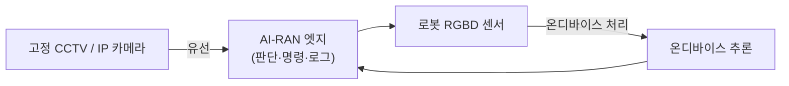

업링크 약 52 Mbps 한계로 RGBD·라이다 등 고용량 데이터를 전부 오프로딩하기 어려워, 로봇 RGBD는 온디바이스로 처리하고 고정 카메라는 유선으로 AI-RAN에 연결, AI-RAN은 엣지 판단·명령·로그를 담당하는 역할 분리 구조로 확정했습니다.

## 🚨 순찰 · 사람 감지 개발 — AI Worker(YOLO) 실구동

> 🚨 본 과제의 개발 범위는 컨트롤 패널 버튼 조작만이 아니라 **통제구역 순찰**까지 포함합니다. 그 순찰 기능의 첫 실동작 구현으로, ROBOTIS AI Worker(FFW) + YOLO11 조합의 로봇이 스스로 주변을 스캔하며 사람을 감지하고 즉시 정지·재개하도록 만들어 **실제 로봇에서 구동 검증까지 마쳤습니다.** 온디바이스 인식·정지 로직을 먼저 확보하고 그 위에 AI-RAN 엣지 판단 계층을 얹는 순서로 진행합니다.

### 개발 목표

핵심 동작은 한 문장으로 정리됩니다 — **제자리에서 좌우로 스웨브 베이스를 회전시키며 주변을 스캔하다가, 사람이 3프레임 연속 검출되면 즉시 정지하고, 사람이 2초간 사라지면 원래 스캔 방향으로 복귀한다.** 시간 제한은 두지 않고 사람 홀딩·워치독·Ctrl-C로만 종료한다.

### 환경 · 하드웨어

| | |
|---|---|
| **로봇** | ROBOTIS AI Worker (FFW), 모델 ffw\_sg2\_rev1 |
| **컴퓨트** | NVIDIA Jetson AGX Orin 32GB, JetPack 6.x |
| **머리 카메라** | ZED Mini (USB) |
| **구동부** | 3모듈 스웨브(조향 3+구동 3), Dynamixel YM080/YM070/PH42/RH-P12-RN/XH540/XH430 |
| **소프트웨어** | ROS 2 Jazzy · rmw\_fastrtps\_cpp · Python 3.12.3 · PyTorch 2.7.0 · Ultralytics 8.4.115 (YOLO11) |

> ⚠️ RMW는 선택이 아니라 종속이다 — 로봇 프로세스의 /proc/\<pid\>/environ 을 읽으면 RMW\_IMPLEMENTATION 이 애초에 설정되어 있지 않다. 따라서 ROS 2 Jazzy 기본값인 rmw\_fastrtps\_cpp(DDS)가 적용되고, zenoh\_daemon 이 떠 있어도 로봇 노드들은 그것을 쓰지 않는다. 겉보기 설정과 실제 동작이 다를 수 있다는 것을 실측으로 확인했다.

### 시스템 구조 — 로봇 컨테이너는 건드리지 않는다

로봇이 원래 띄우는 컨테이너 7개는 그대로 두고, 별도 컨테이너에서 ROS 2 노드를 띄워 같은 도메인(ROS\_DOMAIN\_ID=30)에 붙는 방식으로 설계했습니다. 로봇 측 코드를 한 줄도 수정하지 않는 것이 안전 설계의 전제입니다.

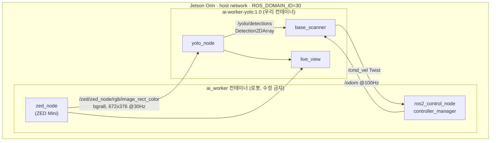

노드는 3개(+진단 도구 2개)로 나눴습니다 — `base_scanner`(베이스 회전 스캔→사람 검출→정지, 실구동 검증 완료), `yolo_node`(범용 검출기, Detection2DArray 발행), `live_view`(영상+회전각+검출 상태 실시간 표시), 그리고 로봇 없이 시험 가능한 `fake_camera`.

**핵심은 다이나믹셀 버스 3개다.** 하드웨어 컴포넌트가 3개이고 각각 다른 시리얼 포트를 쓰는데, `ros2_control_node` 하나가 세 포트를 동시에 연다.

| 컴포넌트 | 포트 | DXL ID | 담당 |
|---|---|---|---|
| **ffw\_sg2\_follower** | /dev/follower = ttyUSB4 | 1-8, 31-38, 61, 62, 81, 101/103/105 | 팔·그리퍼·리프트·머리 + 바퀴 조향 |
| **ffw\_sg2\_base** | /dev/ttyUSB0 | 102, 104, 106 | 바퀴 구동 |
| **ffw\_sg2\_sensor** | /dev/ttyUSB1 | – | 센서 (미사용, unconfigured) |

> 🛑 제자리 회전에는 버스 두 개가 모두 필요하다 — 조향은 follower, 구동은 base에 있다. 둘 중 하나라도 죽으면 스웨브 회전이 불가능하다. 특히 follower가 죽으면 조향축이 사라져 바퀴를 못 돌리는 상태로 회전을 명령하게 된다. base\_scanner 의 프리플라이트가 두 컴포넌트를 모두 검사하고, 하나라도 active가 아니면 시작 자체를 거부한다.

### 작동 원리 — 상태 머신

카메라가 살아있어야 움직이기 시작하고, 다섯 가지 경로 중 무엇으로 끝나든 정지 명령을 낸다.

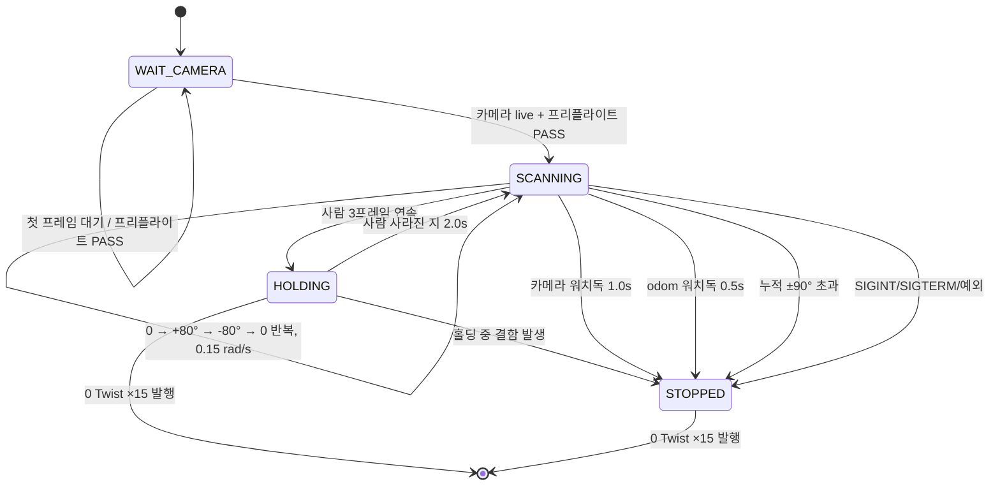

**사람 검출 — 왜 3프레임인가.** 클래스 0(person), conf ≥ 0.5인 프레임이 연속 3회 나와야 확정한다. 한 프레임이라도 사람이 없으면 streak는 0으로 리셋된다. 단발 오검출로 로봇이 멈추는 것을 막기 위함이며, 실제 실구동에서 conf=0.63짜리 단발 검출이 streak reset(1→0)으로 기각된 뒤 진짜 3연속이 나왔을 때만 확정되는 것을 로그로 확인했다.

**사람이 사라지면 다시 돈다 — 홀딩과 재개.** 사람이 확정되면 정지 후 홀딩 상태가 되고, 2.0초 연속으로 사라지면 멈춘 지점에서 원래 향하던 웨이포인트를 향해 스캔을 재개한다. 2.0초는 3프레임 확정보다 훨씬 길게 잡아, 임계값 근처에서 깜빡이는 검출 때문에 로봇이 멈췄다 갔다를 반복하지 않도록 했다. 단, 재개는 **사람 정지에만 적용**된다 — 카메라 워치독·odom 워치독·누적각 초과·시그널·예외로 인한 정지는 전부 종료 상태이며, 결함이 난 로봇이 스스로 다시 움직이는 일은 없다.

**회전각 추정 — 두 추정기 중 큰 쪽을 쓴다.** `/odom`(엔코더 피드백)을 1차로 쓰고, 명령한 각속도를 시간 적분한 개루프 추정을 교차검증으로 함께 굴려 절댓값이 큰 쪽을 채택한다. 어느 한쪽 추정기가 고장나도 오차가 더 일찍 멈추는 방향으로만 작용하게 하기 위함이며, `--execute` 모드에서는 `/odom`이 없으면 움직이지 않고 거부한다 — 피드백 없이 ±90°를 보장할 수 없으므로 맹목적 추측항법은 하지 않는다.

**정지 — 명령이 먼저, 로그가 나중.** `_stop()`은 ① 시그널 마스킹 → ② 0 Twist 15회 발행 → ③ 로깅 순서로 동작한다. 0 Twist를 15회 반복 발행하는 이유는 구독자 QoS가 BEST\_EFFORT라 한 번은 유실될 수 있어서이고, 정지 시퀀스 중 SIGINT/SIGTERM을 마스킹하는 이유는 2차 Ctrl-C가 정지 시퀀스를 중간에 죽이지 못하게 하기 위해서다. 로깅을 마지막에 두어, 로거가 예외를 던져도 정지 명령은 이미 나간 상태가 되도록 했다.

### 안전 설계 — 컨트롤러가 속도를 제한하지 않는다

> 🛑 로봇 설정에 enabled\_speed\_limits: false, angular.z.has\_velocity\_limits: false 로 되어 있다. 선언된 max\_velocity: 1.7 은 적용되지 않는다 — 우리가 보낸 Twist가 그대로 통과한다. 그래서 `base_safety.py` 의 모든 값은 모듈 상수이며 파라미터·launch 인자·CLI로 덮어쓸 수 없게 만들었다 — 코드의 상수가 유일한 제한 장치다.

| | |
|---|---|
| **최대 각속도 / 실제 명령** | 0.20 rad/s 선언 · 실제 0.15 rad/s로 여유 확보 |
| **스캔 반환각 / 하드 리밋** | ±80°에서 반환 · ±90°가 하드 리밋 (10° 여유) |
| **워치독** | 카메라 1.0s / odom 0.5s |
| **절대 타임아웃 / 재개 조건 / 정지 발행** | 없음(운영자 결정으로 해제) / 사람 사라짐 2.0s 무검출 / 0 Twist 15회 |

반환점을 하드 리밋(±90°)이 아니라 ±80°로 둔 이유는, 두 값을 같게 두면 정상 동작이 매번 비상 정지선을 아슬아슬하게 타 관성·지연으로 조금만 넘어가도 안전장치가 오작동처럼 걸리기 때문이다. 10° 여유를 둬서 정상 동작과 이상 정지를 분리했다. 다중 관문 구조로 시작 전(프리플라이트 — 하드웨어·컨트롤러 모두 active 아니면 시작 거부, 첫 카메라 프레임 수신 전에는 절대 움직이지 않음), 명령 생성(`make_twist()`가 선속도를 하드 제로화, 병진 명령 자체가 불가능), 명령 발행 직전(`check_twist()`가 최종 검사, 위반 시 예외), 실행 중(워치독 2종 + 누적각 ±90°), 홀딩 중(결함 발생 시 종료 상태로 승격, 재개하지 않음), 종료 시(어떤 경로든 `_stop()` 통과) 까지 6단계 관문을 뒀다.

### 구현 상세 — 실제로 부딪힌 함정과 대응

이 컨테이너에는 파이썬 인터프리터가 두 개 있고, 그 사실이 설계를 크게 좌우했다.

| 인터프리터 | NumPy | torch | cv\_bridge |
|---|---|---|---|
| **/usr/bin/python3** | 1.26.4 | 없음 | 동작 |
| **/opt/venv/bin/python3** | 2.4.3 | 2.7.0 | 깨짐 |

**① 인터프리터 충돌 → venv 파이썬으로 명시 빌드.** colcon이 기본으로 `#!/usr/bin/python3` 셔뱅을 만들어 `ModuleNotFoundError: ultralytics`가 났다. `/opt/venv/bin/python3 -m colcon build --symlink-install`로 venv 파이썬을 명시해 해결했다.

**② cv\_bridge를 쓰지 않는다.** cv\_bridge의 컴파일된 확장이 NumPy 1.x로 빌드돼 있어 venv의 NumPy 2.4.3에서 `KeyError: 16`으로 깨진다. numpy를 다운그레이드하면 torch 2.7.0이 위험해지므로 — 건드리지 말라고 못박은 지점이 바로 그것이다. 그래서 cv\_bridge를 버리고 `image_utils.py`에서 `sensor_msgs/Image`를 헤더+평탄 버퍼로 직접 reshape해 변환했다. bgra8(ZED)과 rgb8(RealSense) 모두 지원한다.

**③ 리맵 함정 — 머리는 걸리고 베이스는 안 걸린다.** `ffw_sg2_follower_ai.launch.py`가 `/head_controller/joint_trajectory`를 `/leader/joystick_controller_left/joint_trajectory`로 리맵한다. 즉 그 토픽은 리더암 teleop 소유다. 반면 `/cmd_vel`은 어떤 launch 파일에도 리맵이 없고, 실측으로도 구독자가 `swerve_drive_controller` 하나뿐임을 확인했다.

**④ S6-Overlay가 컨테이너 환경변수를 삼킨다.** `docker run -e RMW_IMPLEMENTATION=...`을 줘도 셸 안에서 빈 값이었다. 이미지에 `S6_KEEP_ENV=1`을 넣어 해결했고, 스크립트에서는 추가로 셸 안에서 직접 export했다. `HOME=/root`도 반드시 함께 필요 — 없으면 rcl 로깅 초기화가 실패해 ros2 명령이 아무 출력도 못 낸다.

### 사용 절차 — 순서대로 통과, 하나라도 실패하면 다음 단계로 넘어가지 않음

| # | 확인 | 명령 / 기대값 |
|---|---|---|
| **1** | 로봇 스택 기동 | Talos UI 또는 s6. `ffw_sg2_ai.launch.py` 를 손으로 추가 실행하지 말 것 |
| **2** | 하드웨어 컴포넌트 | ros2 control list\_hardware\_components → base·follower 둘 다 active |
| **3** | 컨트롤러 | ros2 control list\_controllers → swerve\_drive\_controller active |
| **4-6** | 회전 피드백·카메라·검출 성능 | /odom \~100Hz, /zed rgb \~30Hz, /yolo/detections ≥5 FPS |
| **7-8** | dry-run → 실구동 | NOT PUBLISHED 로그 확인 후 execute:=true |

### 실제 로봇 실구동 검증 결과 (2026-08-04)

120초 동안 정지·재개 4회를 실제 로봇에서 확인했습니다.

| 정지(사람) / 재개 |
|---|
| **4회 / 4회** |
| **실행 시간 119.5s · 추론 속도 20.8 FPS (뷰어 동반 시 모델 2개 로드로 26→20.8 저하)** |

**streak 미달 폐기 8회가 특히 중요합니다.** 1/3이나 2/3까지 갔다가 사람이 프레임을 벗어나 리셋된 경우들로, 오검출 방지 로직이 실전에서 반복 작동했다는 증거입니다. 종료 후 확인 결과 `/cmd_vel` 발행자 0, `/odom` twist 전부 0.0으로 정지 상태가 완전히 유지되었고, 하드웨어 컴포넌트 2개와 `swerve_drive_controller`는 모두 active를 유지했습니다.

첫 실구동(단일 정지 검증)에서는 `PREFLIGHT PASSED` 이후 `conf=0.92→0.82→0.84`로 3연속 검출되어 `PERSON CONFIRMED after 3 consecutive frames`가 찍히고 0°→+25.35°까지 회전 후 정지, 추론 속도 26.18 FPS(요구치의 5배)를 기록했습니다.

### 알려진 한계 — 덮지 않고 기록

> 🛑 다이나믹셀 버스가 간헐적으로 불안정하다 — 하루에만 세 컴포넌트가 각각 다른 시각에 죽었고(base/sensor/follower), 성공한 구동 2분 뒤 유휴 상태에서도 한 번 더 났다(FastBulkRead Rx Fail). 이번 성공을 버스가 고쳐졌다는 근거로 삼으면 안 되며, 두 개의 서로 다른 FTDI 칩에 걸쳐 발생하므로 물리 계층 점검이 필요하다.

- **머리 피치 고정** — 베이스만 도는 설계라 피치 각도가 그대로 유지된다. 사람 키에 맞지 않으면 검출이 어렵다.
- **IMU 없음** — 회전 피드백은 /odom 하나뿐이다(ffw\_g40\_imu 미설치). odom이 끊기면 0.5초 안에 정지한다.
- **시간 제한이 없다** — 절대 타임아웃을 해제했으므로 사람 홀딩·워치독·Ctrl-C 중 하나가 걸리기 전까지 무한히 돈다. 무인 운용은 권장하지 않는다.
- **모델 로드 \~24초** — 실행 후 첫 프레임 추론까지 지연이 있다. 뷰어가 함께 뜨면 모델이 두 개 로드된다.

### 남은 개발 · 다음 단계

순찰 개발의 1단계인 **자율 스캔 → 사람 감지 → 안전 정지 → 재개**는 실제 로봇에서 동작을 확인했고, 인식-정지 안전 로직이 실전에서 안정적으로 동작함을 실측 로그로 입증했습니다. 남은 개발 범위는 다음과 같습니다.

- **주행 순찰로 확장** — 현재의 제자리 회전 스캔을 경로 기반 순찰 주행으로 확대
- **다중 로봇 ROI 분담 · 핸드오버** — 로봇 2대가 감시 구역을 나누고 대상 이관
- **감지 후 추적 동작** — 정지에서 멈추지 않고 침입자 추적까지
- **AI-RAN 엣지 연동** — 온디바이스 정지 로직 위에 판단·명령·로그 계층 결합

### 추적 모드 확장 — ByteTrack 락온 · mp4 녹화 (2026-08-05)

정지·재개 검증 이후, 감지한 사람을 놓치지 않고 따라가는 **TRACKING 모드**를 추가했습니다.

- ByteTrack(`model.track`) 기반 락온 후 베이스 회전으로 추종, 대상 상실 시 그 지점부터 ±80° 스캔 재개(절대 상한 → 스캔 구간별 상대 상한으로 변경), 최대 추적 180초, `--record`로 mp4 녹화. 추적 시 28.5 FPS
- 카메라별 실측: RealSense 424×240 29.5\~30.2 FPS, ZED-M 672×376 27.1\~28.2 FPS, GPU 사용률 15\~27% (병목은 CPU 1코어)
- noVNC 기반 읽기 전용 라이브 뷰어, 운영자 진입점 `run_scan.sh`(`--check` / dry-run / `--execute --record` / `--recover`)에 6항목 자동 점검 내장
- ZED Mini "고장"의 원인이 수동 실행한 중복 launch와의 USB 경합임을 규명, 정리 후 1회 시도로 기동

## 🎮 버튼 조작 개발 — Isaac Lab Mimic 학습 데이터셋 (1,000 에피소드)

> 🎮 개발 범위의 다른 축인 현장 컨트롤 패널의 버튼·스위치 직접 조작(시나리오 2)을 실물 패널 없이 먼저 학습 데이터화하기 위해, ROBOTIS FFW SG2를 Isaac Lab에 올려 **4색 버튼 중 빨간 버튼 누르기** 시연 1,000 에피소드를 생성했습니다. 스크립트 IK로 소스 시연 20개를 만들고 Isaac Lab Mimic으로 50배 증강하는 구조이며, 실기 데모 이전에 정책 학습용 데이터 파이프라인과 그 품질 기준을 먼저 세우는 단계입니다. (생성 2026-08-06 · 정리 리포트 2026-08-10 · 브랜치 `feat/sg2-press-red-button`)

### 결과 요약

| | |
|---|---|
| **에피소드 / 트랜지션** | 1,000개 (전부 성공 시연) · 199,024 트랜지션 (평균 199.0스텝) |
| **생성 성공률** | 100% (1,000/1,000, 재시도 0) |
| **라벨 정합** | 1,000/1,000 — 마커가 기록한 타깃 슬롯과 최종 EEF 최근접 버튼이 완전 일치 (비대각 성분 0) |
| **데이터 크기** | 9.9 GB (cam\_head 188×336 관측 포함) |
| **이미지 결함** | 🔴 cam\_head 프레임 평균 51% 소실 — 조명 리셋 누락 (아래 결함 ① 참조) |

### 파이프라인 — 어떻게 1,000개가 됐나

스크립트 IK로 슬롯당 5개씩 소스 시연 20개를 수집하고, 서브태스크 주석을 거쳐 Isaac Lab Mimic으로 1,000개까지 증강했습니다. **병목은 소스 수집 단계 하나뿐**이었고 이후는 전량 통과했습니다 — 소스 시연 수집(스크립트 IK) 26.3%(20/76) → 서브태스크 주석 100%(20/20) → 소규모 증강 100%(20/20) → 본 증강 100%(1,000/1,000).

소스 수집 성공률이 낮은 원인은 슬롯 3의 lateral traverse 추종 실패(성공 5/57)가 지배적이었으며, 실패 시도는 데이터셋에 포함되지 않으므로 최종 데이터 품질에는 영향이 없습니다.

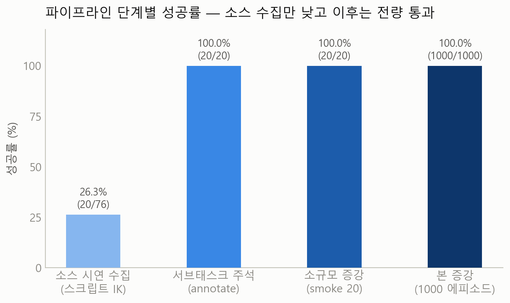

> 그림 01 — 파이프라인 단계별 성공률

### 무결성 — 검증으로 확인된 것

저차원(관절·EEF 포즈) 기준의 검증은 모두 통과했고, **상태 기반 정책 학습에는 현재 상태 그대로 사용 가능**합니다.

- **라벨 정합** — 슬롯 0/1/2/3 각각 264·235·239·262개, 혼동행렬 비대각 성분 0. 마커 라벨과 실제 동작이 1,000개 전부 일치합니다.
- **버튼 도달 깊이** — 전 에피소드가 성공 임계 35mm 안쪽(최대 31.4mm, 평균 30.5mm)에 들어왔습니다.
- **EEF 궤적 수렴** — 슬롯별 궤적 종점이 타깃 버튼 위에 정확히 수렴합니다.
- **궤적 증폭 없음** — 에피소드 평균 스텝 이동량이 생성 6.8mm vs 소스 6.7mm로 동급. Mimic 변환이 궤적을 증폭하지 않았습니다.

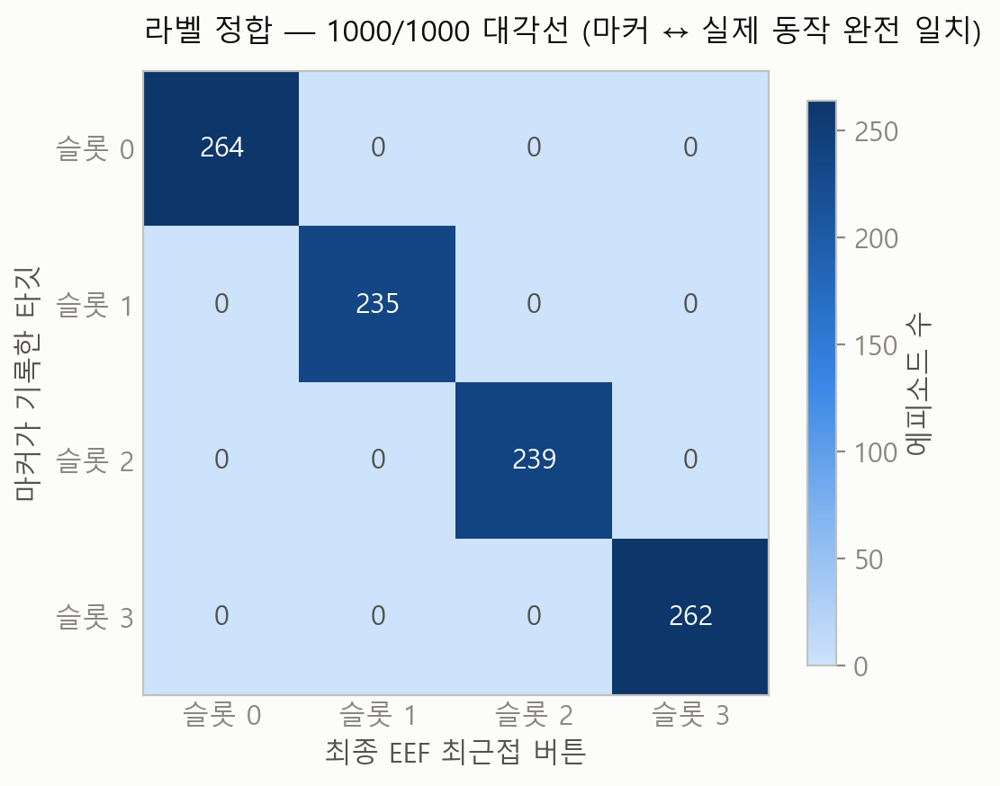

> 그림 08 — 라벨 정합 혼동행렬. 마커 타깃과 최종 EEF 최근접 버튼이 1,000 에피소드 전부 일치 — 비대각 성분 0.

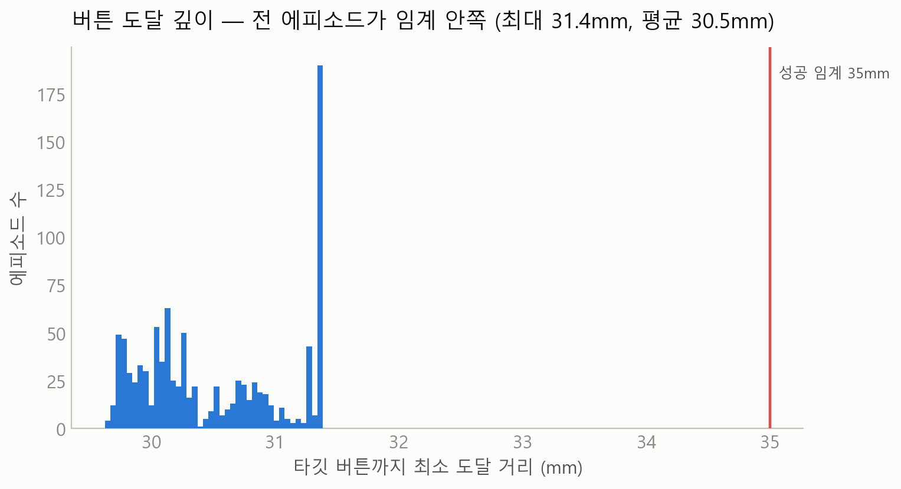

> 그림 09 — 타깃 버튼까지 최소 도달 거리. 전 에피소드가 성공 임계 35mm 안쪽(최대 31.4mm).

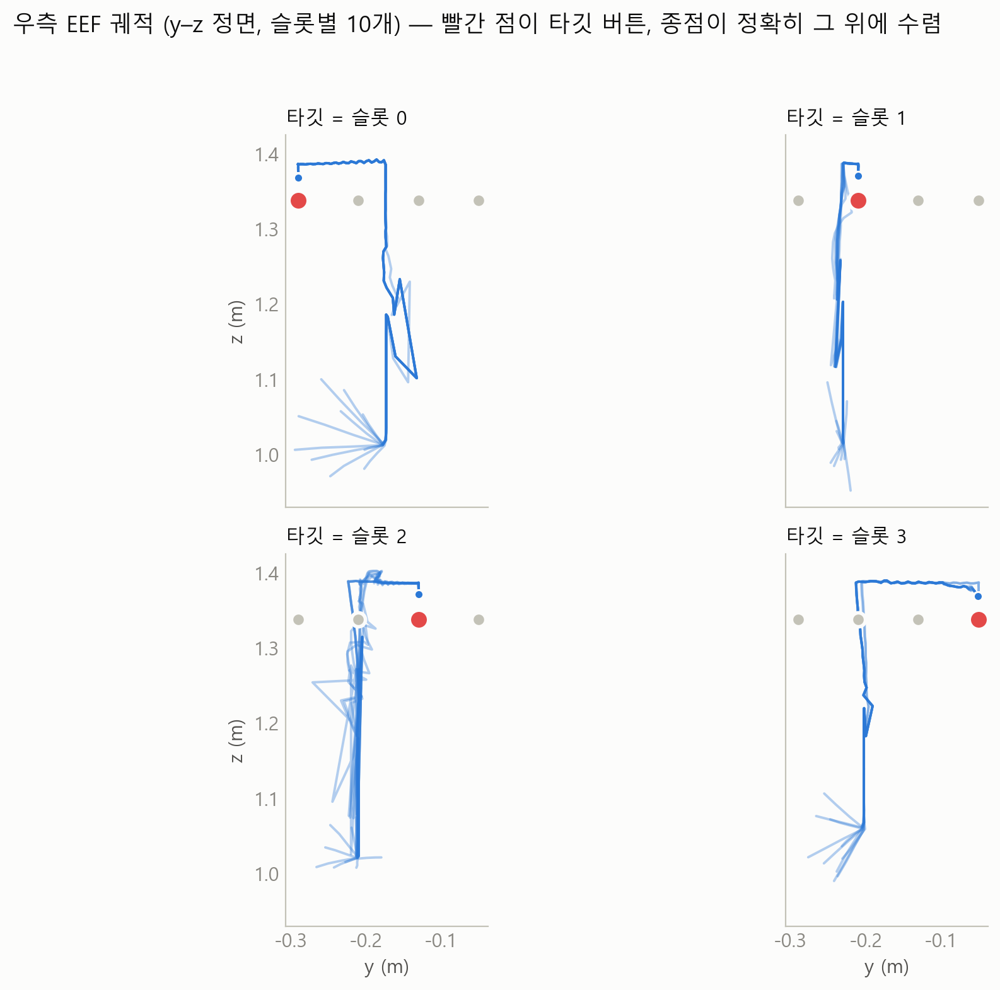

> 그림 07 — 슬롯별 우측 EEF 궤적(y–z 정면, 슬롯당 10개). 빨간 점이 타깃 버튼, 종점이 그 위에 수렴.

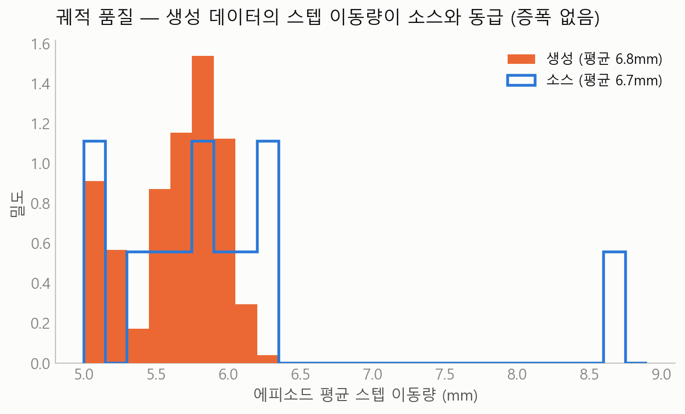

> 그림 06 — 에피소드 평균 스텝 이동량. 생성(6.8mm)이 소스(6.7mm)와 동급 — 증폭 없음.

### 분포 — 데이터의 모양

| | |
|---|---|
| **타깃 슬롯 균등성** | 26.4 / 23.5 / 23.9 / 26.2% — 설계값 25%±1.5%p, 균등 기준(최대 점유 50% 미만)을 크게 상회 |
| **에피소드 길이** | 소스 160\~218스텝(평균 180.6) → 생성 191\~207스텝(평균 199.0) — 생성 쪽이 더 좁다 |
| **슬롯별 길이** | 슬롯마다 전 에피소드가 단일 길이(207/197/201/191) — 결정적 재타이밍의 흔적 |
| **스텝별 이동 프로파일** | 스텝 \~50–65 구간의 과도 진동을 소스에서 그대로 상속 (≤4mm/스텝 IK 제어 진동) |

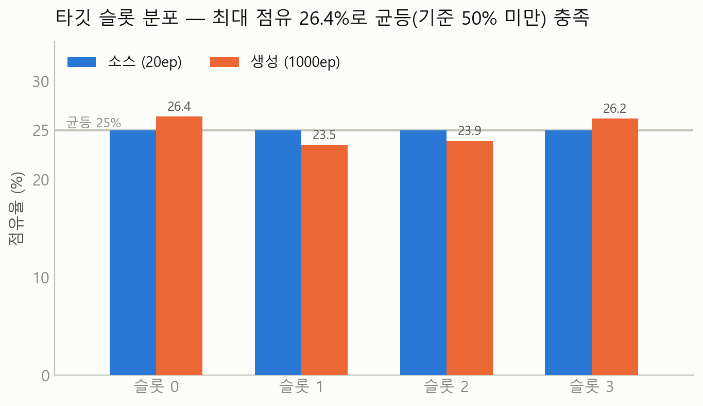

> 그림 02 — 타깃 슬롯 점유율. 최대 26.4%로 균등 기준(50% 미만) 충족.

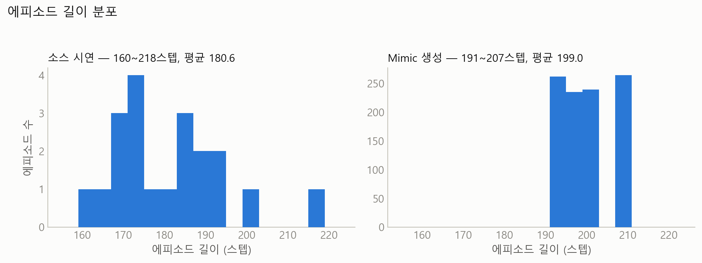

> 그림 03 — 에피소드 길이 분포. 생성(191\~207)이 소스(160\~218)보다 좁다.

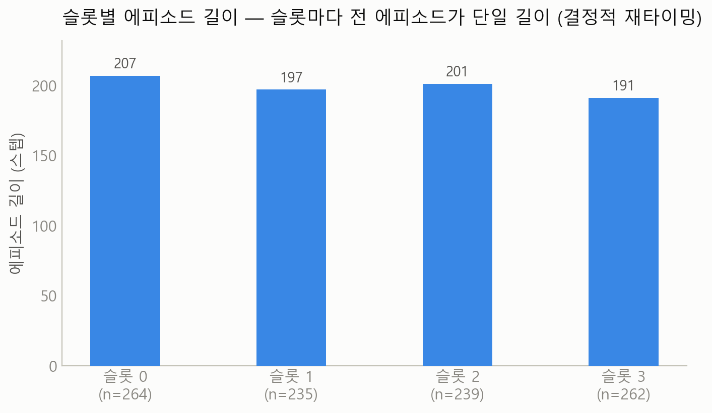

> 그림 04 — 슬롯별 에피소드 길이. 슬롯마다 단일 값(207/197/201/191) — 행동 다양성 축소의 근거.

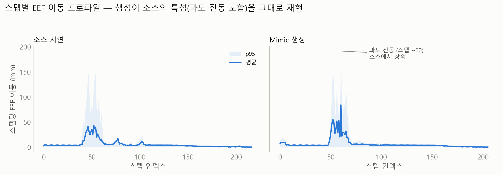

> 그림 05 — 스텝별 EEF 이동 프로파일. 스텝 \~50–65의 과도 진동을 소스에서 상속.

### 결함 — 이번 정리에서 새로 발견한 것

카메라 프레임을 전수 표본 조사하면서 두 가지가 새로 드러났습니다. 저차원 데이터는 둘 다 무관하지만, **이미지 기반 학습 전에는 ①을 반드시 고쳐야 합니다.**

> 🛑 **① 조명 리셋 누락 — cam\_head 프레임 평균 51% 소실 (신규·중대)**
>
> 돔라이트가 `/World/light` 전역 프림 하나라, 리셋 이벤트 `randomize_scene_light` 가 모든 env의 조명을 동시에 바꾼다. num\_envs=4 병렬 생성에서는 이웃 env가 에피소드를 끝낼 때마다(\~50스텝 간격) 진행 중인 에피소드의 화면이 과노출/저노출로 날아간다. 표본 40 에피소드에서 평균 51.2%(30.5\~77.3%)의 프레임이 빈 화면, 에피소드당 밝기 점프 평균 20회. **동시 녹화된 에피소드들의 빈 구간 패턴이 동일한 것이 전역 원인의 직접 증거다.**
>
> 수정 권장: 돔라이트를 `{{ENV_REGEX_NS}}` 아래 per-env 프림으로 옮기고(배경 큐브 머티리얼도 per-env 인스턴스화 확인) 재생성.

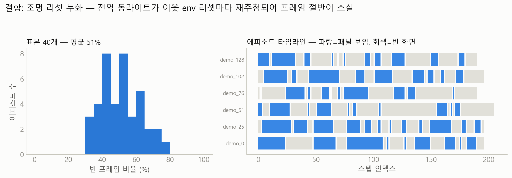

> 그림 11 — 빈 프레임 정량화. 왼쪽: 표본 40 에피소드의 빈 프레임 비율 분포, 오른쪽: 에피소드 타임라인(회색=빈 화면).

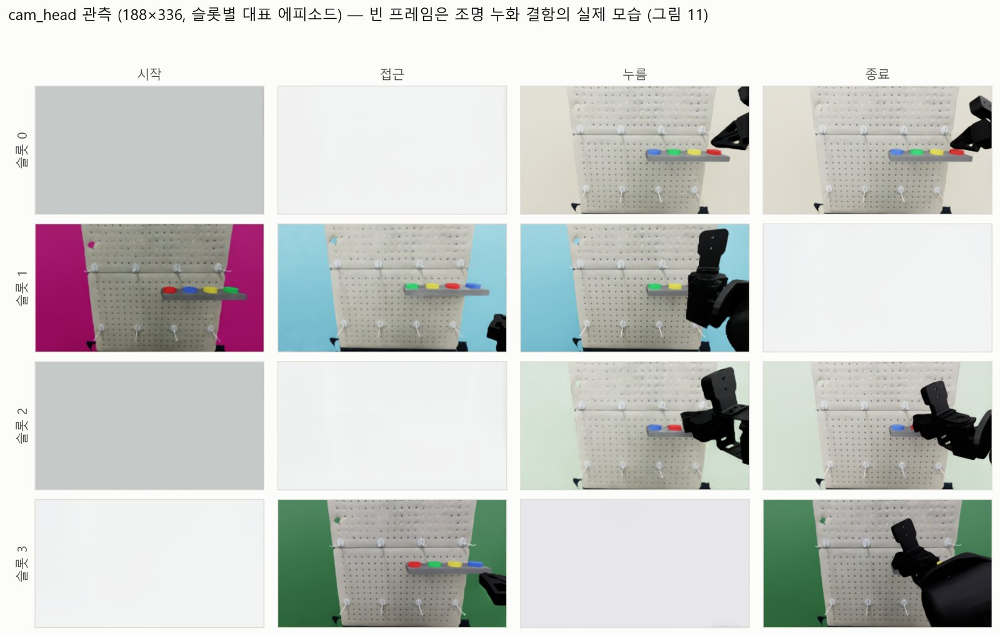

> 그림 10 — cam\_head 실제 프레임(슬롯별 대표 에피소드 × 4단계). 빈 프레임과 배경색 변화가 결함의 실제 모습이다.

> ⚠️ **② Mimic 세그먼트 선택이 슬롯별로 결정적 — 행동 다양성 축소 (신규)**
>
> 생성 길이가 슬롯당 단일 값이라는 것은 소스 20개 중 사실상 슬롯당 1개만 행동 패턴에 기여했다는 뜻이다. 색 순열·시작 자세·(의도치 않은) 조명 다양성은 유지되나 궤적 모양의 다양성은 설계 의도보다 좁다. 재생성 시 세그먼트 선택 전략을 확인할 것.

- **③ 과도 진동 상속 · 슬롯 3 수집 난이도 (기지)** — 둘 다 HANDOFF §5에 계속 기록이 있다. 전자는 정책 성능이 낮을 때 첫 번째 용의자, 후자는 최종 데이터 품질과 무관(실패 시도는 미포함).

### 산출물

| 파일 | 에피소드 | 용도 |
|---|---|---|
| **`datasets/button_src.hdf5`** | 20 (슬롯당 5) | 소스 시연 |
| **`datasets/button_annotated.hdf5`** | 20 | 주석본 — Mimic 입력 |
| **`datasets/button_smoke.hdf5`** | 20 | 파이프라인 확인용 |
| **`datasets/button_1000.hdf5`** | 1,000 | 본 데이터셋 (9.9GB) |

절차·명령 `docs/dataset-generation.md` · 본문 상세 `docs/dataset-report.md` · 그림 재현 `tools/dataset_stats.py` → `tools/plot_dataset_report.py`

### 시나리오 2와의 연결

이 데이터셋은 시나리오 2의 "컨트롤 패널 버튼 조작" 동작을 시뮬레이션에서 정책 학습이 가능한 형태로 만든 첫 산출물입니다. 저차원 기준으로는 검증이 끝났으므로 상태 기반 정책 학습을 바로 시작할 수 있고, **비전 기반(VLA) 학습으로 넘어가려면 조명 리셋 결함을 고쳐 재생성하는 것이 선행 조건**입니다. 이후 현대제철 측 실물 컨트롤 패널이 확보되면 실기 데이터와의 sim-to-real 격차를 측정하는 순서로 이어집니다.

## 🧠 버튼 조작 실기 ① — lerobot 모방학습 (ACT · SmolVLA) 오프라인 학습 파이프라인

> 🧠 실물 AI Worker(FFW-SG2 rev1)에서 리더 암 텔레옵으로 수집한 **E-STOP 버튼 누르기 데이터셋** `AI-RAN/ffw_sg2_rev1_Press_Estop`(카메라 3대, 59 에피소드 · 23,466 프레임)을 인터넷이 없는 Jetson AGX Orin 안에서 학습·추론까지 돌렸습니다. (2026.08.13\~08.14)

### 위장된 DNS 에러의 근본 원인

- 증상은 `NameResolutionError: huggingface.co`였지만 진짜 원인은 **로컬 데이터셋 인덱스 불연속**. `info.json`은 `total_episodes: 60`인데 parquet은 59개 — 0번 에피소드를 지우고 메타를 안 고쳐 `LeRobotDataset`의 파일 검증이 실패하자 **조용히 HF Hub 다운로드로 폴백**해 네트워크 에러처럼 보인 것
- 재넘버링 스크립트 작성: parquet 파일명 + 내부 `episode_index`/`index` 컬럼 + `episodes.jsonl`/`episodes_stats.jsonl`/`total_frames`까지 일괄 정정. 노트북에 pyarrow가 없어 **스텁 모듈로 합성 픽스처를 만들어 15개 검사를 통과**시킨 뒤 컨테이너에서 실행, 원본은 보존

### 오프라인 학습

| 정책 | 내용 | 결과 |
|---|---|---|
| ACT | ResNet18 ImageNet 가중치를 노트북에서 받아 `TORCH_HOME` 경로에 주입, `HF_HUB_OFFLINE=1`로 CLI 학습 | 52M 파라미터, loss 14.0 → 2.7 (500스텝), 0.44 s/step |
| SmolVLA | `SmolVLM2-500M` 백본 + `smolvla_base` 사전학습(md5 검증 후 호스트 마운트 캐시에 배치), physical\_ai\_manager WebUI로 20,000스텝 학습 | 100M 파라미터, 첫 100스텝 loss 1.96. 로봇 전원 차단으로 8,000스텝 중단 → 체크포인트 Resume, 12,000스텝 loss 0.041 |

- WebUI가 "Training is already in progress"로 막힌 원인은 학습 스레드가 HF HEAD 요청 재시도(파일당 \~23초)에 갇힌 것 → `docker-compose.yml`에 `HF_HUB_OFFLINE=1` 추가로 모델 로드 **5분+ → 7.5초**
- 컨테이너 레이어(`TORCH_HOME`)와 호스트 마운트(`~/.cache/huggingface`)의 **영속성 차이**를 정리해 컨테이너 재생성 시 가중치 소실을 방지

### 추론 디버깅 — "카메라만 받고 액션이 안 나옴"

- 코드 분석으로 카메라 메시지 수가 토픽 수와 다르면 `predict()`에 도달하지 않음을 확인 → ZED 헤드 카메라가 **광고만 되고 Publisher 0**인 상태임을 `ros2 topic info`로 확정, 재부팅 후 3대 모두 \~30Hz 복구
- 로봇을 움직이지 않는 프로빙 스크립트로 정책 출력을 읽어 **VLA가 머리·리프트를 학습 초기 자세로 스스로 맞춘다**는 것을 검증(`head_joint1` 0.693, σ 0.001 기준(오차 0.001\~0.003)
- 바퀴가 미세하게 계속 움직인 이유는 22차원 액션의 마지막 3개(`linear_x/y, angular_z`)가 **속도 명령**이라 0.001 수준 잔여값이 누적되기 때문임을 데이터 통계(\|값\| > 0.01 비율 0.2\~0.4%)로 설명

## 🚀 버튼 조작 실기 ② — GR00T N1.5-3B 엣지 추론 배포 · 실기 E-STOP 버튼 누르기 완주

> 🚀 Isaac Lab 시뮬 시연으로 H200 서버에서 파인튜닝한 **NVIDIA GR00T N1.5-3B** VLA 정책을 **GPU 서버 없이 Jetson AGX Orin 위에서 직접 추론**시키고, 모델을 버전 교체할 수 있는 상설 스택으로 만들어 실물 로봇에서 버튼 누르기 전체 사이클을 완주했습니다. ROBOTIS `physical_ai_server`의 GR00T 지원이 껍데기만 있는 미구현 상태(GitHub main 동일)임을 확인하고 독립 스택을 설계했습니다. (2026.08.14\~08.19, v5 갱신 08.28)

### 3계층 구조

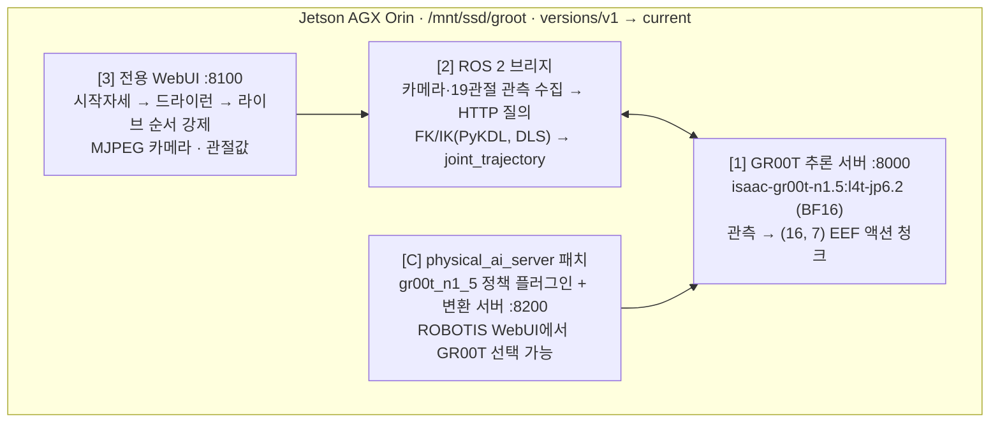

### 구축 과정에서 해결한 것

- **에어갭 Jetson에 환경 구축**: 인터넷·sudo가 없어 노트북에 표준 라이브러리 HTTP 프록시 + `ssh -R` 역터널로 pip/GitHub 접근 확보. 도커 데몬 프록시 설정이 불가(재시작 시 로봇 스택 다운)해 **NGC 레지스트리 API로 베이스 이미지 레이어를 직접 받아 로드** (`l4t-jetpack:r36.4.0`, 9.8GB, `docker load`). USB(FAT32) 4GB 제한으로 잘린 모델은 H200에서 rsync 7.1GB 재수신 후 12개 파일 크기 대조
- **상류 Dockerfile 버그 4건 패치** (`orin.Dockerfile`): 존재하지 않는 `pytorch3d==0.7.8` aarch64 휠 핀(→ v0.7.9 CPU 소스 빌드), HTTP 서버 모드 의존성(`json_numpy`·`uvicorn`·`fastapi`) 누락. 이미지 17.6GB, 빌드 약 50분
- 번들이 지목한 Isaac-GR00T 커밋은 Thor(Blackwell) FP8 전용이라 Orin(Ampere)엔 무의미 → **BF16으로 먼저 띄우고 실측**, TensorRT는 옵션으로 보류
- **지연시간 실측**(워밍업 3 + 20회): 평균 **433ms**, 중앙 437ms, σ 17.7ms. 청크 예산 800ms(16스텝 × 50ms)의 **54%** → TensorRT 불필요 판정. 이미지 JSON 직렬화 300ms → base64 전환으로 스텝당 26ms
- **관측 정합 검증**: FK로 계산한 EEF 포즈가 학습 데이터와 **3\~4.4mm** 일치 → 관측 파이프라인 무결 확인
- **시작 자세를 데이터에서 추출**: 학습 1,000 에피소드 첫 프레임 중앙값으로 시작 자세 정의(`head_joint1` 0.695rad, 5\~95% 폭 0.017rad), bringup 자세에서 최대 131.8° 이동을 8초 단일 궤적으로 수행, 미도달 시 추론 차단(OOD 방지)
- 운동학 체인이 `base_link → lift → arm_base → arm_r 7축`이라 **리프트를 분리하고 7축만 IK**. 브리지 컨테이너는 `--ipc=host`·`--network=host` 필수(FastDDS SHM·브리지 네트워크 격리)

### "자세가 튄다" — IK 특이점 문제

- 모델의 EEF 궤적은 스텝당 4.2mm로 부드러웠으나, Newton-Raphson IK가 7축 여유자유도 + 손목 특이점(joint5/6/7 ≈ 0)에서 해를 갈아타 최대 **15.7\~92 rad/s** 발산(한계 4.8)
- 시뮬 측이 Isaac Lab `DifferentialIK`(DLS)를 쓴 것을 확인 → **감쇠 최소자승(λ=0.05) + 스텝당 0.12rad 클램프**로 최대 2.4 rad/s 이내 확정

### 실기 라이브 구동과 안전장치 (2026-08-19)

| 사건 | 원인 | 추가한 안전장치 |
|---|---|---|
| 버튼 누르기 성공 후 112초간 계속 누름 → `arm_r_joint4` Dynamixel **Overload 0x5** 492회 | GR00T는 "완료" 출력이 없음. 학습 에피소드 길이(6.3\~6.6초)의 17배 실행 | **에피소드 지평** 400스텝/20초 · **자동 복귀**(시작 자세) · **막힘 감지**(추종오차 0.25rad 0.6초) |
| 두 번째 과부하 16,098회 | 버튼이 눌리며 자리를 내주므로 추종오차가 작아 막힘 감지로 못 잡음 | 실측 기반 **전류 안전망**(joint1\~6 effort 100 초과 0.8초, joint7 200 초과) · **도달 감지**(EEF z ≤ 0.815 & 0.4초간 3mm 미만 이동 → 즉시 종료) |
| 학습 대비 2배 느린 도달 | 프리페치가 0.4초 낡은 관측을 사용 | 동기 실행 전환 → z=0.80 도달 400 → 267스텝 (33% 단축) |
| 복귀 시 버튼과 간섭 | 학습 데이터는 누른 자리(z=0.795)에서 끝남 → "복귀는 모델이 아니라 우리가" | **EEF 수직 10cm 리프트(3초) → 접기(7초)** 2단 복귀 (FK → DLS IK 경유점) |
| ZED 카메라 프레임 유실 88건 | 3회 재현 후 확정: **FastDDS 공유메모리(SHM) 전송**이 컨테이너 경계에서 압축 이미지를 유실 | FastDDS XML 프로파일로 SHM 비활성·UDP 강제 → 29.95Hz 안정 수신 |

> ✅ **최종 결과 — 전체 사이클 완주**: 시작 자세 이동 → 라이브 추론 → **250스텝(12.5초)에 버튼 도달 감지** → 자동 정지 → 10cm 리프트 → 시작 자세 복귀. `arm_r_joint4` 최대 전류 45.4(상한 100의 45%), 과부하·막힘 없음. 확정값과 근거는 `versions/v1/VERSION.md`에 기록.

> 📷 **영상 자리** — E-STOP 버튼 누르기 실기 영상, 전용 WebUI 화면, DYNAMIXEL Wizard 버스 스캔(2026-08-04) 스크린샷

### 모델 버전 이력

| | v1 (`groot_estop_n15_v2`) | v5 (`groot_estop_n15_v5`) |
|---|---|---|
| 학습 데이터 | Isaac Lab 시연 320ep (버튼 미접촉 결함) | 물리 누름 시연 1,000ep (목표 x+3cm 시프트로 수정), 10k 스텝, loss 0.0139 |
| 시뮬 성공률 | 55% (100회) | **84%** (200회, denoising 4 → 16) |
| 실기 | **라이브 완주 (08.19)**, 엣지 지연 433ms | 배포 준비 완료(`versions/v5`, 배포 스크립트), 7.1GB 전송 중 중단 — 미완 |

- 같은 데이터 규약으로 **PUMP-PRESS 태스크** v1/v2도 H200에서 학습됨. 관측은 헤드 카메라 1대 + 관절 19개 + 양팔 EEF 포즈, 액션은 16스텝 청크, DataConfig `FFWSG2DataConfig`(embodiment `new_embodiment`)
- 학습 서버 → 노트북 → 로봇 2단계 rsync 중계 스크립트와 `versions/vN` + `current` 심볼릭 링크로 모델 버전 관리

### 알려진 한계 · 다음 단계

- **v5 배포 미완** — 모델 전송 9%에서 중단. denoising 16으로 지연이 최대 4배 늘 수 있어 800ms 예산 초과 여부 실측과 TensorRT FP16 전환 검토 필요
- **반복 성공률 미측정** — 실기 완주 1회 검증 후 통계적 성공률 측정 미착수
- **다이나믹셀 버스 간헐 불안정** — 서로 다른 FTDI 칩 두 개에 걸쳐 `BulkRead Rx Fail` 발생, 물리 계층 점검 필요
- 브리지 카메라 콜백 간헐 정지는 SHM 문제 해결 후에도 원인 미확정으로 기록

## 🗓️ 주요 일정

- **7월** — 현대제철 현장 방문 (서비스 1·2·3 현장 확인)
- **7월 중순\~8월** — 로봇 도입
- **9월 말\~10월** — 기능 구현 병행 개발
- **11월 말** — 검수 / **12월\~1월** — 데모

## 🧪 개발 준비 · 장비 검토

- **모사환경 조기 구축 전략** — 현장 실사 후 개발 시작하면 늦다는 판단으로, SW 개발(내부 실험실) → 모사환경 데이터 수집·실험 → 현장 데모 순서로 진행. 후보지(판교 — AI-RAN 연계 유리 / KETI 광명 — 로봇 실험 유리)를 비교 검토해 AI-RAN 설치 문제로 판교 사옥 진행으로 계획
- **온디바이스 연산 한계 대응** — 기본 탑재 AGX Orin 수준으로는 VLA 모델 구동이 제한적 → 외부 GPU 서버 활용 또는 경량 모델 전략 병행 검토, 판교 GPU 서버 사용 절차 확보 추진
- **장비 검토** — 알레그로 핸드(5지) 사용 여부, 레거시 모니터 LED 방식, 로보티즈·IP 카메라 사양 및 AI-RAN 통신 방식 정보 수집

## 📎 주요 산출물

- **회의록** (AI-RAN, 0702) — 시나리오 확정·단순화, 하이브리드 구조 설계, 액션 아이템 6종(현장 실사 준비, KPI 수정안 회신, GPU 서버 요청, 카메라/AI-RAN 정보, 핸드 선택, 모사환경 위치) 정리

## 🧰 기술 스택

`휴머노이드` `AI-RAN` `엣지 컴퓨팅` `온디바이스 AI` `VLA` `순찰·침입 감지·추적` `YOLO11 · ByteTrack` `ROS 2 Jazzy` `Isaac Lab` `Isaac Lab Mimic` `모방학습 데이터셋` `NVIDIA GR00T N1.5` `lerobot · ACT · SmolVLA` `Jetson AGX Orin` `PyKDL · DLS IK` `Fast DDS` `에어갭 운영`
