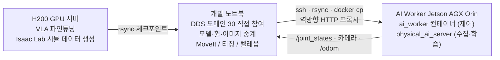

# 🤖 휴머노이드 실증사업

> 🤖 **스마트폰·차량용 디스플레이 IDC 제조공정 AI 행동모델 기반 휴머노이드 실증**
>
> 사람이 하던 IDC 오븐 베이킹 라인의 수작업을 휴머노이드가 대신 수행하도록, 현장 동작을 11단계로 분해하고 VLA(Vision-Language-Action) 행동모델을 학습·실증하는 과제입니다. 저는 공정 정의·보조장치 설계와 VLA 학습용 데이터셋 구축 체계 설계를 담당하고 있습니다.

> 📷 **대표 사진 자리** — 휴머노이드(FFW-SG2) 운용 사진, 시뮬레이션 캡처, 현장 모사 플랫폼 사진을 여기에 드래그해 주세요.

## 📋 프로젝트 개요

| | |
|---|---|
| **과제명** | 스마트폰·차량용 디스플레이 IDC 제조공정 AI 행동모델 기반 휴머노이드 실증 |
| **수행기간** | 2026. 06. 01 \~ 2026. 11. 30 (6개월) |
| **수행구조** | 주관 스템코 · 참여1 한국전자기술연구원(KETI) · 참여2 숭실대학교 |
| **실증현장** | 스템코 본사(충청북도 청주시) IDC 오븐 베이킹 라인 인접 구역 |
| **로봇 플랫폼** | ROBOTIS AI Worker FFW-SG2 휴머노이드 |
| **나의 역할** | 공정 정의·자동화 검토 문서 총괄 작성 · 11-Step 동작 구조화 · 보조장치(안정화·정렬) 설계 · VLA Human Video Dataset 구축 체계 설계·운영 |

## 🎯 기획 배경 — 왜 이 과제를 시작했나

스마트폰·차량용 디스플레이에 들어가는 IDC(Inductor Coil) 부품은 오븐 베이킹 공정을 거칩니다. 이 라인에는 트레이·랙 이송, 오븐 투입·배출, 8EA·약 16kg 중량물 BOX 핸들링처럼 **반복적이면서 근골격계 부담이 큰 수작업**이 몰려 있습니다. 기존 산업용 로봇(고정형 로봇팔)으로는 좁은 통로 이동 + 다품종 파지 + HMI 버튼 조작을 모두 커버하기 어렵기 때문에, **범용 휴머노이드가 사람의 작업을 그대로 대체할 수 있는지**를 실제 현장에서 검증하는 것이 이 과제의 출발점입니다.

기획 단계에서 정한 실증 범위의 핵심 판단은 다음과 같습니다.

- 공정 범위를 **오븐 베이킹 투입 공정(공정 A) + 배출·후처리 공정(공정 B)** 통합 실증으로 설정
- PCB 낙장 개별 파지는 고정밀 force 제어·전용 그리퍼가 필요해 **2단계 고도화 공정으로 분리** (본 실증에서 제외) — 실증 성공 가능성을 높이기 위한 범위 관리
- KETI는 참여기관1로서 **플랫폼 운용 · 데이터 수집 파이프라인 · AI 행동모델 배포·검증 · 수집 방식별 비교평가**를 담당

## 🎬 전체 시나리오

### 시나리오 ① — 오븐 베이킹 라인 실증 공정 (4단계 핵심 스텝)

주관기관 현장의 수작업을 분석하고 휴머노이드 자동화 구성을 시뮬레이션으로 검토한 결과, 위 4단계는 아래 **11개 세부 동작(11-Step)** 으로 구성됨을 확인했습니다. 이 11-Step이 KETI 현장 모사 플랫폼 설계와 에피소드(Episode) 단위 데이터 수집 설계의 기준이 됩니다.

| Step | 동작 | 세부 내용 | 대응 핵심 스텝 |
|---|---|---|---|
| 01 | Tray 수취 | 상단 5단 Rack에서 Grasp | ① 트레이 이송 |
| 02 | Tray 이동 | 이동경로 주행 | ① 트레이 이송 |
| 03 | Tray Open | Door/Tray 조작 (오븐 도어 개방) | ② 오븐 투입·배출 |
| 04 | 적치대 이동 | 작업 위치 정렬 | ③ 적치대 투입 |
| 05 | 볼스패드 수취 | 정렬된 위치 Pick | ③ BOX 핸들링(부자재) |
| 06 | 작업대 이동 | 작업대 위치정렬 | ③ BOX 핸들링 |
| 07 | 볼스패드 정리 | Pad 정리 | ③ BOX 핸들링 |
| 08 | 제품 적치대 이동 | Shelf 접근 | ③ 적치대 투입 |
| 09 | 제품 반출 | LOT 구분·선입선출(FIFO), 8EA·약 16kg 취급 | ③ BOX 핸들링 |
| 10 | 적치대 이동(작업대) | 작업대 기준 적치대 이동 | ③ 적치대 투입 |
| 11 | 적치 준비작업 | Tray 위치정렬 | ① 트레이 이송 마무리 |

> 📷 **사진 자리** — 11단계 동작 흐름 시뮬레이션 캡처 (수작업의 휴머노이드 자동화 구성 검토)

### 시나리오 ② — 카트 핸들링 연속 공정 (whole-body mobile manipulation)

기존 작업대 중심 데이터셋이 손·물체 위주였다면, 본 과제에서는 **전신 이동과 조작이 결합된** 시나리오를 추가로 정의했습니다: **문 열기 → 보관된 카트 꺼내기(문턱 통과) → 카트 밀어 이동 → 제품 양손 파지·카트 적재**로 이어지는 연속 시나리오입니다.

| Task | 공정 의미 | 핵심 학습 요소 |
|---|---|---|
| cart\_push | 카트 밀기 | 양손 파지, 이동 경로, 카트 heading, 목표 정렬 |
| door\_open | 문 열기 | 손잡이 접근, 당김/회전, 문 열림 방향 |
| cart\_pullout | 카트 꺼내기 | 문턱 통과, 후진/회전, doorway clearance |
| product\_loading | 제품 카트 적재 | 제품 양손 파지, 들어올림, 적재면 정렬 |
| scenario\_cart\_retrieval\_loading | 전체 연속 시나리오 | 문 열기→카트 꺼내기→이동→적재 순서 수행 |

## 🛠️ 개발 내용 — 내가 수행한 것

### 1) 공정 정의 및 자동화 검토 문서 (0706)

현장 수작업을 분석해 4단계 핵심 스텝 → 11개 세부 동작으로 구조화하고, KETI 수행 범위(플랫폼 운용, 데이터 수집 파이프라인, 실로봇 배포·검증, 비교평가 보고서)를 정의했습니다. 사업계획서상 에피소드 실패 유형에 **"이동 중 흔들림"** 이 명시된 점에 착안해, 대차·작업대 등 설비의 흔들림을 로봇 정밀 파지·정렬의 핵심 리스크로 규정하고 11-Step 각각에 대해 리스크와 대응 장치를 도출했습니다.

| Step | 로봇 작업 시 예상 리스크 | 필요 자동화 요소 (보조장치) |
|---|---|---|
| 01 Tray 수취 | Rack 비고정 시 파지 순간 미세 흔들림 → 파지 오차 | Rack 하부 고정 브래킷 + 레벨링 풋 |
| 02 Tray 이동 | 대차 위 Tray 미끄러짐, 이동 중 대차 흔들림 | Tray 논슬립 가이드/스토퍼, 대차 Wheel Brake |
| 03 Tray Open | Door 개폐 반력으로 오븐 흔들림 | 오븐 바닥 앵커 고정, Door 개방각 스토퍼 |
| 04 적치대 이동 | 이동식 적치대 정지 위치 오차 → 정렬 실패 | 바닥 위치 마커(AprilTag), 도킹 지그(고정 핀/슬롯) |
| 05\~07 볼스패드 | 패드 흐트러짐 → Pick 위치 불일치, 정리 중 산개 | 볼스패드 정렬 슬롯 지그, 정렬 가이드 홈 상판 |
| 08 제품 적치대 | Shelf 흔들림·기울어짐 | Shelf 고정 브래킷 |
| 09 제품 반출 | 8EA·약 16kg 중량물 취급 시 진동·처짐 | 하중 분산 대차, 바퀴 락, 강성 보강 |
| 10\~11 정렬 구간 | 바닥 요철 흔들림, 정밀 정렬 오차 누적 | 이동 경로 유도선, 정렬 스토퍼/게이지 지그 |

이 검토를 바탕으로 보조장치를 **A. 이동체(대차) 안정화**(바퀴 락, 도킹 지그, 하중 분산 프레임, 아웃트리거) / **B. 고정형 설비 안정화**(레벨링 풋+앵커, 고정 브래킷, 방진 패드) / **C. 위치 정렬·인식 보조**(AprilTag 마커, 유도선, 슬롯 지그, 정렬 스토퍼) 3개 카테고리로 재분류해 리스트업했습니다.

### 2) VLA 학습용 Human Video Dataset 구축 체계 설계

휴머노이드가 작업 순서와 손·물체 관계를 학습할 수 있도록, 사람 작업 영상을 **ego/front/side/top 4시점**으로 촬영하고 계층적으로 라벨링하는 데이터셋 체계를 설계했습니다. 두 개의 데이터셋(작업대 중심: 박스 접기·PCB Pick&Place·툴 교체 / 카트공정: whole-body)의 전달문서를 작성해 인턴 3인 운영 체계로 구축을 진행하고 있습니다.

- **파일명·ID 체계**: `{task}_{index}_{camera}` 규칙으로 raw video → edited video → annotation JSON → bbox JSON → trajectory JSON → metadata.csv가 하나의 video\_id로 연결되는 인덱스 구조 설계
- **Step Label 체계**: 작업별 동작 단위 표준화 (예: PCB Pick&Place는 approach\_pcb → grasp\_pcb → lift\_pcb → move\_to\_tray → align\_to\_slot → place\_pcb → release\_pcb → verify\_position 8단계)
- **라벨 대상 정의**: 공통(person·양손·target\_zone·floor\_marker), 카트(handle·body·4바퀴), 문(handle·frame·hinge·open\_area), 제품(grasp\_area·loading\_area) 등 객체 사전 정의
- **Trajectory 기준**: floor\_marker 좌표계 기준 카트 중심·heading, 문 열림 각도(door\_angle\_deg), 제품 위치 등 상태 변화 기록 — 초기 수동 추정에서 AprilTag/ArUco 기반 자동 추출로 확장하는 로드맵
- **QC 체계**: 촬영로그(shooting\_log) → 검수리포트(qc\_report) → OK/NEEDS\_REVIEW/NG 3단계 상태 관리, 실패 영상도 failure\_reason과 복구 동작을 라벨링해 학습 데이터로 활용
- **운영 설계**: 인턴 A(촬영·환경 세팅)/B(편집·annotation)/C(bbox·QC·메타데이터) 3인 분업과 하루 업무 흐름·일일 산출량 기준(원본 30\~50개, annotation 20\~30개 등)까지 정의

### 3) Isaac Lab 기반 강화학습 시뮬레이션 구현 (humanoid\_cart\_vla\_sim — 직접 개발)

Isaac Lab 위에 자체 패키지 `humanoid_cart`를 구현해 카트 핸들링 시나리오를 RL 태스크로 정의했습니다.

- **패키지 구조** — `assets/`(cart·factory·humanoid·props USD 자산 정의) + `tasks/`(cart\_push·cart\_pullout·sg2\_reach·sg2\_grasp·factory\_nav) + `data/`(demo\_dataset: HDF5 데모 읽기/쓰기) + `scripts/`(train·play·collect·convert)
- **cart\_push 환경 설계 (ManagerBased 구조)** — 관측은 본체 속도·중력 투영·관절 상대위치/속도·이전 행동에 **로봇 좌표계 기준 카트 위치(cart\_pos\_in\_robot\_frame)·카트 heading·목표 커맨드**를 결합하고, 각 항에 Uniform 노이즈(관절속도 ±1.5 등)를 주입해 sim-to-real 강인성을 확보했습니다
- **보상 설계** — cart\_progress(+5.0)·cart\_target\_tracking(+2.0)·hands\_near\_cart(+1.0, 양손 파지 유도)·도착 보너스(+10)·생존(+0.5) vs 전도 패널티(-50)·자세(-1.0)·action\_rate(-0.01)·관절 속도/가속도 정규화 항으로 구성. 종료 조건은 로봇 높이 0.45m 미만(넘어짐)·카트 기울기 0.7rad 초과(전복)
- **PPO 학습 (rsl\_rl OnPolicyRunner)** — Actor/Critic MLP \[512, 256, 128\]+ELU, lr 1e-3(adaptive, desired KL 0.01), γ 0.99, GAE λ 0.95, clip 0.2, entropy 0.005, 5 epochs×4 mini-batches — cart\_push·factory\_nav·sg2\_reach 태스크별 학습 런 수행
- **파지 태스크 파라미터화** — sg2\_grasp.yaml 하나로 물체 종류(brush·driver·scissors 등 6종)·좌우 팔·배치 좌표·파지 전략(hang: 수평 접근/top: 하강)·approach/grasp/retreat 오프셋·리프트 관절 목표까지 제어. 진단 과정에서 말단 z가 0.11m 높게 남는 문제를 lift\_command 보정(-0.0993→-0.22)으로 해결
- 11단계 동작의 자동화 구성 검토 시뮬레이션 영상 제작 (0713)

### 4) Human Video → 학습 데모 변환 파이프라인 (convert\_human\_[video.py](http://video.py) — 직접 개발)

사람 작업 영상에는 로봇 관절 액션이 없기 때문에, annotation JSON과 trajectory JSON을 읽어 **고수준(high-level) 데모**로 변환하는 파이프라인을 개발했습니다.

- obs = \[person\_xy(2), cart\_xy(2), cart\_heading cos/sin(2), target\_xy(2), contact(1)\] — **9D**
- action = \[person\_vx, person\_vy, cart\_yaw\_rate\] — **3D** (다음 스텝까지의 이동/회전을 유한차분으로 산출)
- 불규칙 샘플을 고정 fps(30)로 열 단위 선형보간 리샘플하여 HDF5(DemoWriter)로 기록
- 이 데모는 ① 고수준 정책 BC(Behavior Cloning) 학습, ② 시뮬 RL의 보상 트래킹 레퍼런스 두 가지로 사용되도록 설계 (Isaac 없이 conda 환경에서 동작)
- 보조 도구: 키보드·스크립트 데모 수집(collect\_demos\_keyboard/scripted), 텔레오퍼레이션 수집(collect\_teleop), BC 학습(train\_[il.py](http://il.py)), 공장 레이아웃 3D 뷰어 등 스크립트 15종 작성

### 5) FFW-SG2 실기 플랫폼 운용 환경 구축 — 1단계 현장 모사의 사전 검증 (2026.08\~09, 진행 중)

> 🦾 KETI가 맡은 **플랫폼 운용 · 데이터 수집 파이프라인 · 실로봇 배포 사전 검증**을 위해, 인터넷이 차단된 Jetson AGX Orin 기반 AI Worker FFW-SG2를 노트북 한 대로 운용하는 환경을 구축했습니다. 리더-팔로워 텔레옵 고장 진단, MoveIt·티칭·핸드티칭 도구 제작, 키보드 기반 전신 텔레옵 노드 개발, 문 열기(팔+바퀴) 학습 확장 검토까지 수행했습니다.

#### 세 장비의 역할 분담

로봇에는 인터넷이 없고 노트북에는 GPU가 없으며 학습 서버는 원격에 있어, 노트북이 모든 것을 중계하는 구조로 운용했습니다.

#### DDS 통신 환경 · 오프라인 운영

- ROBOTIS `ai_worker`는 2.0.0부터 zenoh가 기본이지만, 로봇 프로세스의 실제 환경변수를 읽어 **로봇 노드는 Fast DDS로 동작** 중임을 확인. DDS 기반 마지막 릴리스인 **태그 1.3.2**를 노트북에서 소스 빌드(colcon 12패키지)해 같은 `ROS_DOMAIN_ID=30`에 직접 참여. 시뮬은 도메인 31 + 로컬호스트 전용으로 분리
- 로봇 측 s6-overlay 서비스 구조 파악. `s6-svc` 단독 호출은 로그 파이프 문제로 exit 111이 나므로 `s6-rc -u change` 사용 규명
- HF Hub·PyTorch 가중치는 노트북에서 받아 rsync/scp/`docker cp`로 주입, `HF_HUB_OFFLINE=1`·`TORCH_HOME`과 컨테이너 레이어 vs 호스트 마운트의 **영속성 차이**를 정리. eMMC 보호를 위해 NVMe에 캐시·모델 디렉터리 구성
- **로봇 RTC 배터리 방전**으로 시계가 4개월 어긋나 MoveIt이 `Didn't receive robot state` 후 rviz2 segfault → sudoers NOPASSWD 1회 등록 + **편도 지연 보정 동기화 스크립트**로 오차 **0.016s** 달성
- 운영 스크립트 13종(`00~12_*.sh`: 설치·udev·빌드·통신 점검·시뮬·실기 MoveIt·시계 동기화·저속 주행·그리퍼·티칭·씬 재생·핸드티칭)으로 "명령은 짧게, 로직은 스크립트로" 원칙 적용

#### 리더-팔로워 텔레옵 진단 — 3회에 걸친 근본 원인 규명

| 증상 | 근본 원인 | 조치 |
|---|---|---|
| 텔레옵 토크가 안 걸림 (08.05) | 오른쪽 리더 버스(`/dev/right_leader`)가 전 baudrate에서 무응답 → 리더 서비스 s6 크래시 루프 (U2D2는 인식됨, 전원/케이블 추정) | 하드웨어 이슈로 분리, MoveIt·티칭 도구를 대안으로 구축 |
| `COMM_ERROR: no status packet` (09.02) | 동일 시리얼 포트를 여는 launch 인스턴스 중복(수동 launch + UI 서비스가 `/dev/follower` 동시 점유) → `ros2_control_node` 반복 사망 | 프로세스 트리 조사 후 중복 정리, SG2용 `pack_position.yaml` 신규 작성해 패킹 자세 진입 |
| 휠은 되는데 팔이 안 움직임 (09.07) | 리더 브로드캐스터 소스 분석: `auto_mode=STOPPED`로 시작하며 **양쪽 그리퍼 트리거를 2.0초 이상 동시 유지**해야 활성화. 로그 타임라인에서 0.27/0.19/1.67초로 모두 미달 입증. 조이스틱 경로(휠·머리·리프트)는 게이트가 없어 휠만 움직인 것 | 2초 유지 → `Auto mode ACTIVATED`, 리더/팔로워 관절값 3회 샘플 일치로 추종 확인 |

#### Gazebo + MoveIt 시뮬레이션 · 실기 조작

- `realsense2_description` 누락 → sparse clone, Nav2 전용 `dual_laser_merger`를 제거한 커스텀 launch 작성
- **DART 관절한계 잠김 버그 규명**: 초기값 0이 한계 경계와 일치하는 `arm_l_joint2 [0, 3.14]`·`arm_r_joint2 [-3.14, 0]`·`lift_joint [-0.5, 0]`이 gz\_ros2\_control에서 전혀 움직이지 않는데도 컨트롤러는 SUCCEEDED 반환. ros2\_control xacro에 sim 전용 `initial_value`(±0.05)를 추가해 해결
- `/move_action`에 joint constraint goal을 보내 Plan → Execute → 시뮬 반영을 자동 검증하는 E2E 스크립트 작성
- **실기 MoveIt 연결**: follower 컨테이너의 arm\_l/arm\_r/head/lift FollowJointTrajectory 4개 액션 서버에 연결, `/joint_states` 100Hz 확인 후 팔 실기 구동 성공

#### 티칭 · 씬 재생 · 핸드티칭 도구 — 11-Step 동작 사전 검증용

- `teach.py`: 19관절 자세를 YAML로 저장·재생(save/goto/list/del), 텍스트 씬 파일(포인트명·이동시간·대기시간)로 시퀀스 재생
- **핸드티칭(직접교시) 모드**: 컨트롤러 비활성화 → 토크 해제 순서(복귀는 역순)로 팔 튐 없이 손으로 자세를 잡아 저장 → 5개 포인트(왼팔+리프트 동작 시퀀스)로 씬 재생 데모 완성
- 그리퍼는 SRDF 그룹이 없어 RViz로 불가 → 팔 컨트롤러가 그리퍼 관절도 담당함을 확인해 스크립트화

#### 키보드 전신 텔레옵 노드 (`ffw_teleop/keyboard_teleop.py`, 09.08)

카트 핸들링 시나리오처럼 **이동과 조작이 결합된** 동작을 리더 암 없이도 시험하기 위해 휠·머리·리프트·팔을 한 키보드로 조작하는 노드를 개발했습니다.

- 기존 Tk 조그·조이스틱 컨트롤러 소스와 URDF를 분석해 토픽 리매핑과 관절 한계 파악 후 **TDD로 구현(pytest 17개)**
- w/s/a/d/q/e 휠 주행(20Hz, 키 해제 0.3초 후 자동 정지), i/k/j/l 머리 조그, r/f 리프트, m/n 양팔 굽힘(-90°)·원위치 3초 궤적, 속도 스케일 키. `/joint_states` 현재값 기준 조그 + URDF 한계 클램프, 전 값 ROS 파라미터화
- `ament_flake8` 통과 · 가짜 `/joint_states`를 띄운 **pty 기반 스모크 테스트** · 로봇 컨테이너 내 빌드·pytest 통과까지 배포 완료

#### 문 열기(팔 + 바퀴 동시) 학습 확장 타당성 검토 (09.14)

시나리오 ②의 door\_open·cart\_push처럼 **전신 이동 조작**을 VLA로 학습하려면 액션에 바퀴 3차원이 필요합니다. GR00T는 액션 키를 자유 정의(`action.base_motion` 선례, 현재 19차원/상한 32차원)하고 `physical_ai_server`가 이미 `/odom`·`/cmd_vel`을 기록하므로 가능함을 확인. 필요 수정 4곳(DataConfig에 `base_vel` 추가 후 파인튜닝, lerobot→GR00T 변환기 바퀴 컬럼, 정책 브리지 `/cmd_vel` 출력, 실기 텔레옵 데이터 수집)을 정리했습니다.

> 📷 **사진·영상 자리** — 핸드티칭 후 씬 재생 영상, RViz/MoveIt 실기 조작 화면, 키보드 텔레옵 주행 영상

## 📈 추진 계획

| 단계 | 시기 | 내용 |
|---|---|---|
| 1단계 현장 모사 | 2026.07\~09 | KETI 실험실 현장 모사 플랫폼(IDC 대차·트레이 거치대·오븐 모사 지그) 제작, 수집 파이프라인·deploy 사전 검증 |
| 2단계 현장 실증 | 2026.09\~11 | 스템코 실증 라인 deploy + LOT 단위 연속작업 현장 적용성 검증 |
| 3단계 재학습 반복 | 2026.10\~11 | 현장 실패 에피소드 재수집·재학습 사이클, 수집 방식별 비교평가 보고서 |

## 🏆 성과 및 산출물

- **공정 정의 및 자동화 검토 문서** — 11-Step 세부동작 정의, Step별 안정성 리스크 분석, 보조장치 A/B/C 분류 리스트업 (2026.07.03)
- **VLA Human Video Dataset 전달문서 2종** — 작업대 데이터셋 + 카트공정(whole-body) 데이터셋의 폴더 구조·파일명 규칙·Step Label·QC 기준·인턴 3인 운영 체계 설계
- **자동화 구성 검토 시뮬레이션 영상** (0713) — Isaac 기반
- **코드** — humanoid\_cart\_vla\_sim, IsaacLab, robotis\_lab
- **실기 운용 환경** (2026.08\~09) — DDS 통신·오프라인 운영 스크립트 13종, Gazebo/MoveIt 시뮬(DART 관절 잠김 패치), 티칭·씬 재생·핸드티칭 도구, 키보드 전신 텔레옵 노드(pytest 17개), 텔레옵 근본 원인 규명 3건, 문 열기 학습 확장 검토
- 데이터셋 설계가 **에피소드 단위 수집 → 재학습 사이클**의 기준으로 채택되어 1단계 현장 모사부터 적용 중

> 📷 **사진·영상 자리** — 데이터셋 촬영 장면(4시점), 시뮬레이션 영상 캡처, 현장 모사 플랫폼 구축 사진

## 🧰 기술 스택

`휴머노이드` `VLA` `Isaac Lab` `멀티모달 데이터셋` `Mobile Manipulation` `ROBOTIS FFW-SG2` `AprilTag` `데이터 QC 체계` `ROS 2 Jazzy` `Fast DDS` `MoveIt 2` `Gazebo` `ros2_control` `Jetson AGX Orin` `직접교시` `TDD`
