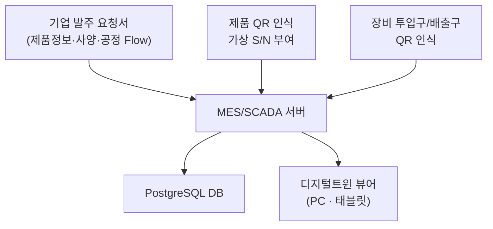
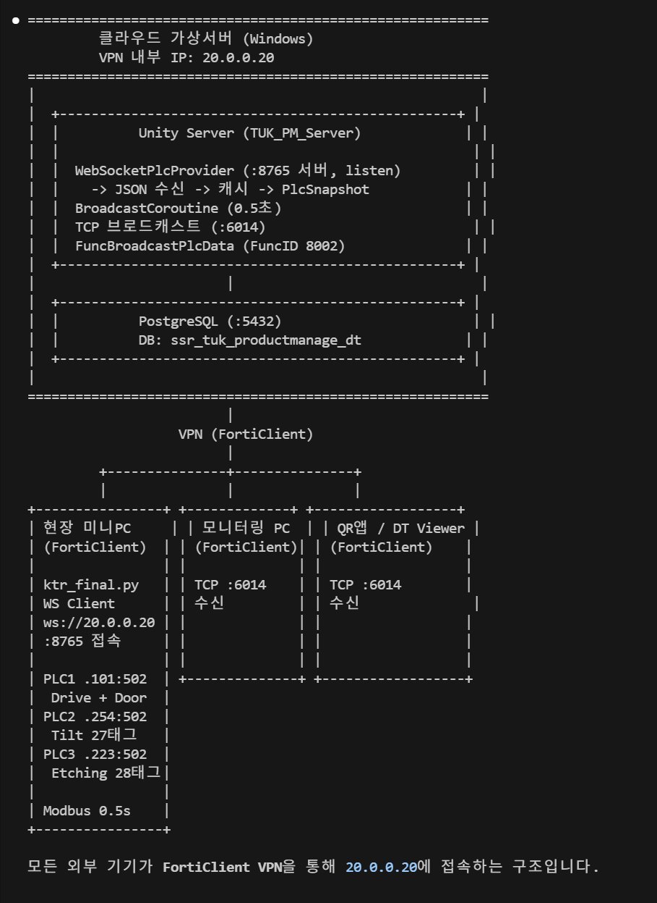
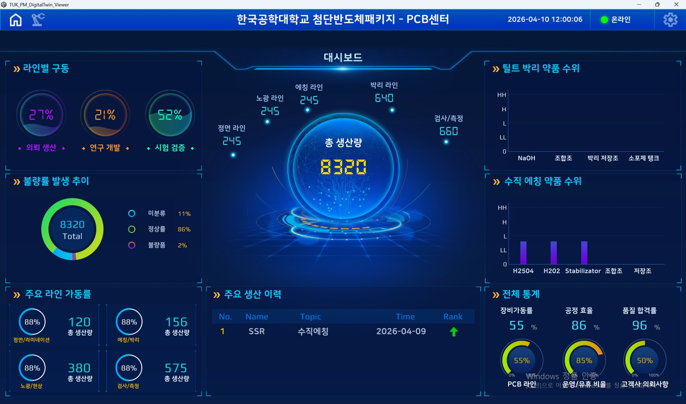
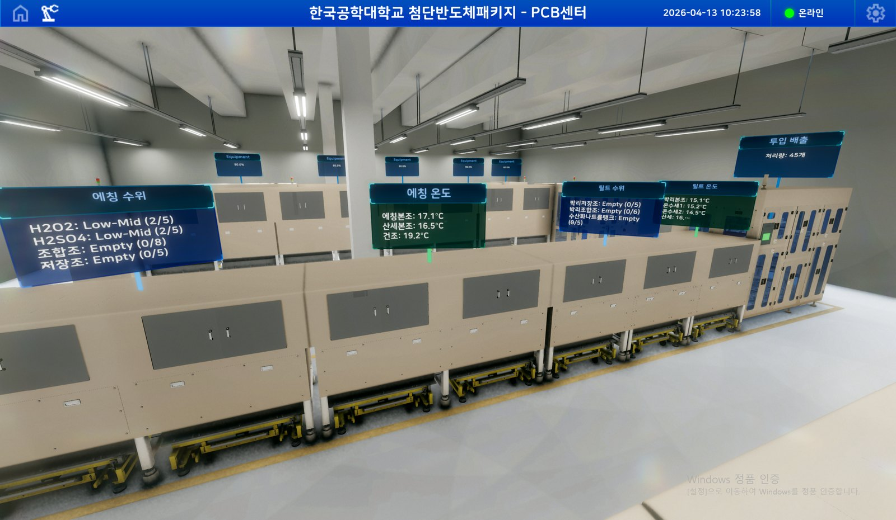
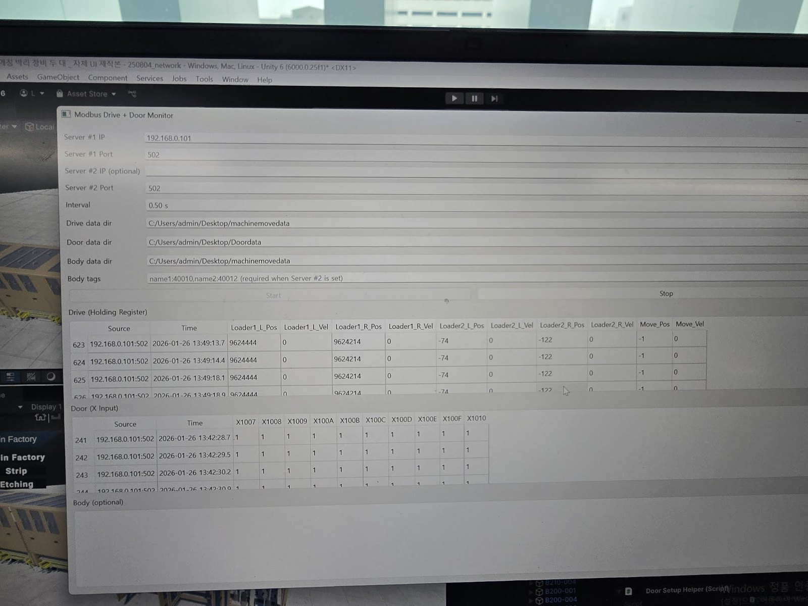

# 🏭 한국공대 프로젝트

> 📱 **한국공대 제품관리 플랫폼 구축 (QR 기반 제품관리 + 디지털트윈)**
>
> 한국공학대학교 PCB 장비 공정을 대상으로, QR 코드로 제품을 추적·관리하는 시스템과 이를 3D로 시각화하는 디지털트윈 모니터링 환경을 구축한 프로젝트입니다.

## 📋 프로젝트 개요

| | |
|---|---|
| **대상** | 한국공학대학교 PCB 장비 공정 (노광실 장비 등) |
| **핵심 시스템** | QR 기반 제품관리 시스템 + KETI 제품관리 디지털트윈(Digital Twin) |
| **서버 연동** | MES/SCADA 서버 · PLC 연동 · PostgreSQL DB |
| **담당** | 박하영 (현장 출장·자료조사·개발현황 보고·시연) |

> 📷 **대표 사진 자리** — 현장 출장 사진, TruView 캐처, 디지털트윈 화면을 추가로 넣어주세요.

## 🎯 기획 배경 — 왜 이 프로젝트를 시작했나

한국공학대학교의 PCB 라인은 양산 라인이 아니라 **기업 의뢰를 받아 테스트·실험을 수행하는 시설**입니다. 그래서 양/불 판정보다는 “어떤 기업의 어떤 기판이 어느 공정을 어떤 조건으로 거쳤는가”라는 **이력 추적**이 핵심 요구사항이었습니다. 하지만 현장 조사 결과 작업 지시서·작업 과정 기록이 파일·수기 중심으로 흩어져 있고 정리된 엑셀 데이터조차 없는 상황이었습니다. 이에 제품에 부착한 QR 코드를 장비 투입구·배출구에서 인식해 공정 흐름을 자동 추적하고, MES/SCADA와 연동해 관리하며, 3D 디지털트윈으로 시각화하는 통합 제품관리 플랫폼을 기획했습니다.

## 🔎 현장 조사 — 공정·데이터 분석 (출장 수행)

여러 차례 현장 출장을 통해 라인 구성과 데이터 현황을 직접 조사했습니다.

- **라인 구성 실측** — 노광기 2대, 라미네이터 4대, 프리히터, PEB, 육안검사실 배치를 조사하고 통로 폭(900\~1,800mm)을 실측해 무인이송(AMR) 선회 가능성을 검토
- **공정 원리 정리** — 프리히터(기판 50\~70°C 예열로 기포·들뜸 방지) → 라미네이터(가열 롤러로 PR 필름 압착) → 노광기(UV로 회로 패턴 전사, Positive/Negative PR 구분) → PEB(90\~110°C 열처리로 선폭 균일성 확보) 순의 공정 체인을 문서화
- **데이터 현황 조사** — 현미경 관측실의 회사별(A\~D) 이미지 데이터 유형, 작업 지시서 관리 방식, 자체 작업과정 기록 데이터를 분석 → “이미지 수집 중심 + 수기 기록” 현황을 확인하고 QR 기반 자동 이력화의 필요성을 도출
- **실제품 수급 경로 확인** — 패키징·테스트용 실제품은 기업 직접 컨택 또는 학교 자체 제작본으로 수급해야 함을 파악, 시연 시나리오 설계에 반영

## 🎬 전체 시나리오

1. **기업 발주** — 기업이 제품 정보·수량·사양·공정 Flow를 담은 발주 요청서를 서버에 등록
2. **제품 등록** — 입고 제품의 QR 인식 → 가상 S/N 자동 부여(generate\_unique\_serial\_no) → 공정 Flow 지정 → MES/SCADA 업로드
3. **공정 진행 추적** — 장비 투입구 QR → 제품 QR → 배출구 QR 순서로 스캔하면 “어떤 제품이 어떤 장비에 언제 들어가고 나왔는지”가 DB에 자동 기록
4. **실시간 시각화** — PC 뷰어·태블릿(Android APK)에서 3D 디지털트윈으로 제품 위치·공정 진행률을 확인
5. **이력 조회** — 완료 후 제품별 공정 이력이 PostgreSQL에 누적되어 품질·이력관리에 활용

## 🧑‍💻 나의 역할 · 기여

한국공대 현장을 여러 차례 방문해 장비 구성·공정 흐름을 조사하고 출장 보고서를 작성했으며, QR 기반 제품관리 시스템의 데이터베이스 설계와 API 함수 구조를 정리한 개발 현황 요약 보고서를 작성했습니다. 시연 시나리오와 QR 시연용 자료를 준비해 현장 시연을 지원했습니다.

## 🔧 시스템 아키텍처

### QR 기반 제품 관리 흐름

1. **기업 발주 요청서** — 제품 정보/수량, 사양, 공정 Flow를 서버에 등록
2. **작업 제품 등록** — QR 인식 → 가상 S/N 부여 → 공정 Flow 설정 → MES/SCADA 업로드
3. **작업 제품 관리** — 장비 투입구 QR → 제품 QR → 배출구 QR 인식으로 공정 진행 추적

### 데이터베이스 설계

| 테이블 | 역할 |
|---|---|
| work\_info | 작업 정보 관리 |
| process\_info | 공정 정보 관리 |
| progress\_tracking | 작업 진행 상황 추적 |
| daily\_sequence | 날짜별 시리얼넘버 생성 (generate\_unique\_serial\_no) |

### 구현 상세 — Unity 디지털트윈 클라이언트/서버 (C# 소스 기준)

디지털트윈은 Unity 프로젝트(KETI\_ProductManage\_DigitalTwin)로 구현되어 있고, 네트워크 계층이 기능 단위 RPC 모듈로 분리되어 있습니다.

- **네트워크 계층** — JSON-RPC 스타일 메시징(JSONObject/JSONRPCObject) 위에 기능별 Func 모듈을 둔 구조: `FuncExecuteWorkFlow`(공정 실행 흐름 제어, 37KB 핵심 모듈) · `FuncGetWorkInfo`/`FuncGetWorkInfoFromLog`(작업정보·이력 조회) · `FuncGetProcessInfoList`/`FuncGetWorkFlowList`(공정·플로우 목록) · `FuncDeleteWorkInfo`/`FuncDeleteProcessInfo`(삭제) 등 — TCP 서버(포트 6014)와 통신하며 PostgreSQL을 백엔드로 사용
- **매니저 계층** — `DBManager`(DB 연동) · `QRManager`(QR 인식→S/N 매핑) · `NetworkManager`(세션 관리) · `MachineData`(장비 상태 모델) · `ToastManager`/`MenuManager`(UI) — SingletonBase 패턴으로 설계
- **데이터 모델** — `WorkInfo`·`ItemProcess`·`ItemProcessFull`·`ItemWork`·`ItemParameter`로 작업-공정-진행상태를 객체화해 DB 스키마(work\_info·process\_info·progress\_tracking·daily\_sequence)와 대응
- **멀티플랫폼** — `AndroidManager`·태블릿용 NetworkLoading으로 Android APK 빌드 대응, AR 모듈(ARButtonSetup 등)로 현장 AR 뷰 지원, AutoBuildSetting(ABS\*)으로 씨·빌드 설정 자동화

### 디지털트윈 시스템 구성

| 구성요소 | 설명 |
|---|---|
| KETI\_ProductManage\_DigitalTwin | Unity 기반 디지털트윈 소스 |
| PM\_DT (Android APK) | 태블릿용 디지털트윈 뷰어/작업 앱 |
| Viewer (Windows) | PC용 디지털트윈 시각화 뷰어 |
| Server (Windows) | TCP 서버(포트 6014) + PostgreSQL 연동 |

## 📎 주요 산출물

- **개발 현황 요약 보고서** (260105) — QR 등록 시스템, DB 설계, API 함수 구조
- **현장 출장 보고서·출장 요약** (0126, 0129)
- **시연 시나리오 · QR 시연용 자료 · 장비 작동순서/PLC 연동 정리**

- **자료조사 · 구조 사진 · TruView 영상·사진 정리 · 모델링 5종**
- **디지털트윈 빌드** — Unity 소스, Android APK, Viewer/Server 실행본

## 🧰 기술 스택

`QR 추적` `Unity 디지털트윈` `MES/SCADA` `PLC` `PostgreSQL` `Android` `TCP 서버`
