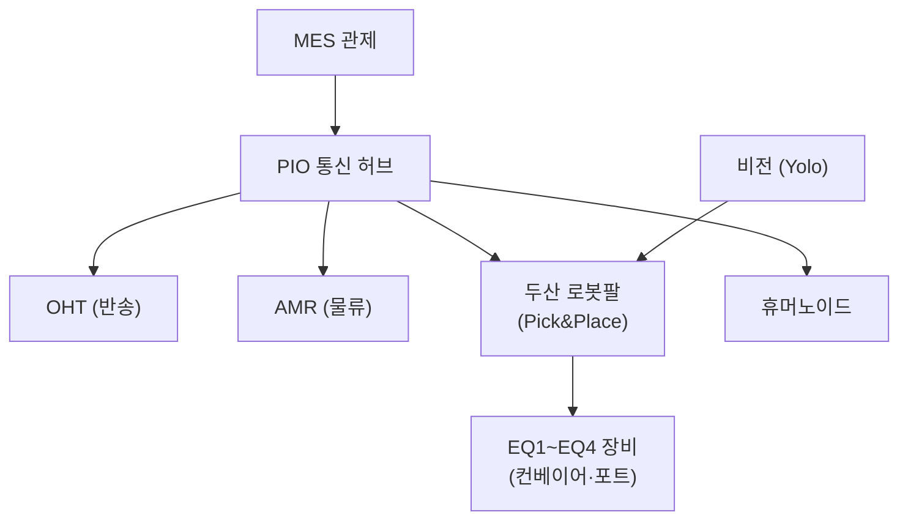
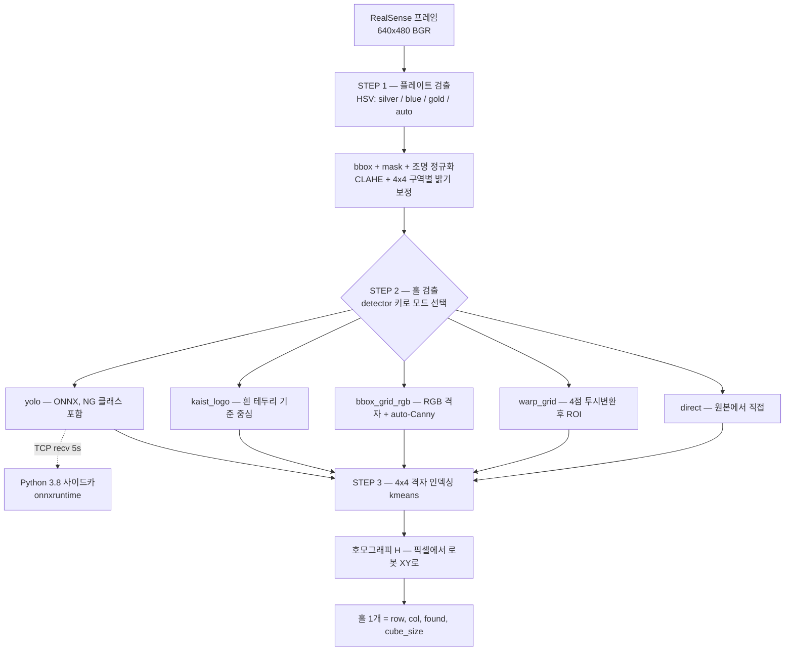
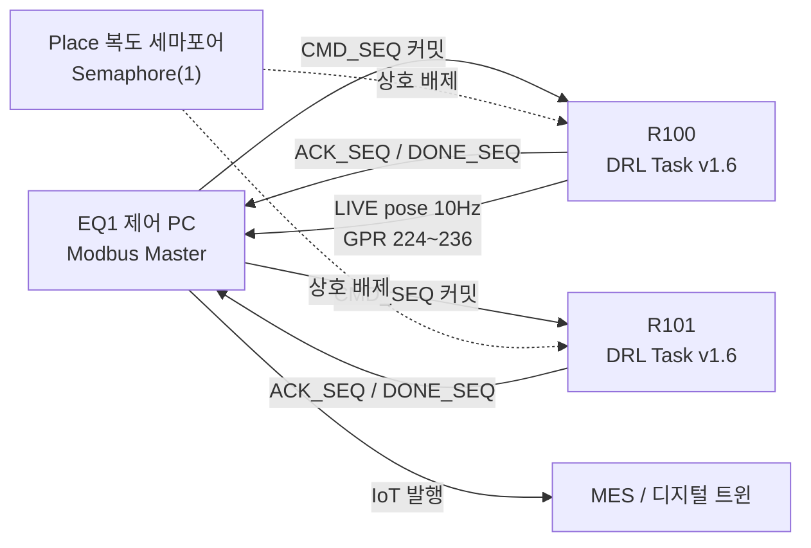

# 🤖 KAIST-KAIROS

> 🏆 **KAIST·과기부 피지컬 AI 다크팩토리 플랫폼 'KAIROS' — 반도체 테스트베드**
>
> PIO 통신으로 AMR·OHT·휴머노이드·로봇팔을 통합하고 MES로 관제하는 반도체 다크팩토리(무인공장) 플랫폼을 구축하고, 과학기술정보통신부 장관 앞에서 실환경 시연한 대규모 프로젝트입니다. 상상로보틱스(SSRobotics)와 협력했습니다.

## 📋 프로젝트 개요

| | |
|---|---|
| **과제** | KAIST·과학기술정보통신부 주관 피지컬 AI 다크팩토리 플랫폼 구축 (KAIROS / 카이로스 테스트베드) |
| **수행기관** | KETI 지능로보틱스연구센터 · 상상로보틱스(SSRobotics) 협력 |
| **담당** | 박하영 — PIO 통신 기반 장비 통합, MQTT 프로토콜 5종 구현, 비전 기반 Pick&Place, 듀얼 로봇 제어, 시연·리허설, 안정화·연속운전 |
| **시연** | 과기부 장관 실환경 시연 (2026.03.23 오전 리허설 / 오후 시연) |
| **상태** | 🟢 시연 완료 → 안정화·연속운전 검증 완료 (2026.09 기준) · 다수 대기업 협력사업으로 연계 |

## 🎯 배경 및 목표

반도체 제조 라인의 '다크팩토리(무인공장)'를 실현하려면 서로 다른 장비(OHT, AMR, 휴머노이드, 로봇팔)가 하나의 관제 흐름 안에서 협력해야 합니다. 본 과제는 PIO 통신을 기반으로 이 이종 장비들을 통합하고 MES로 관제하며, 비전으로 불량을 판정·처리하는 자동화 공정 라인을 구축해 실환경에서 생산성 향상을 검증하는 것을 목표로 했습니다.

## 🧑‍💻 나의 역할 · 개발 내용

### 1) PIO 통신 기반 이종 장비 통합 제어 구조 설계

EQ1\~EQ4 장비별 OHT 포트·AMR 포트의 IO Map을 설계하고, Load/Unload 요청·READY·BUSY·COMPLETE 핸드셸이크 시퀀스를 정의했습니다. OHT-MTL, OHT-S1\~S8, AMR 포트, 컸베이어(롤러) 구동 IO까지 하나의 관제 흐름으로 통합했고, 모든 통신은 프로그램 종료 없이 재접속 가능한 구조로 설계하고 GRID 형태 UI로 강제 송출(테스트)을 지원했습니다.

### 2) 비전 기반 Pick&Place · 불량 판정

두산 로봇팔과 비전을 결합해 **Pick&Place 알고리즘**과 **Yolo 기반 불량 판정·분류**를 구현했습니다.

### 3) 장비 간 통신 병목 해결

장비 간 통신 타이밍 불일치로 발생하는 공정 병목 문제를 **로그 분석과 장비 매뉴얼 검토**로 추적·해결하며 공정 프로세스 안정성을 확보했습니다. MES 시스템 개발과 기반 통신 시스템 구축을 담당했습니다.

### 4) 시연 운영·문서화

상상로보틱스 협력으로 현장 출장(3회)을 수행하며 시스템을 통합했고, 오전 리허설→오후 장관 시연(2026.03.23)을 직접 수행했습니다. EQ/EQ4 운용 매뉴얼을 노션으로 문서화해 인수인계 체계를 만들었습니다.

## 🔧 시스템 구성

### 카이스트 POC — 장비·통신 구성 (IO Map)

- **EQ1\~EQ4** 장비별 OHT 포트·AMR 포트와 PIO 통신 (Load/Unload 요청, READY, BUSY, COMPLETE 등 핸드셰이크)
- OHT-MTL, OHT-S1\~S8, AMR 포트, 컨베이어(롤러) 구동 IO까지 통합 제어
- 모든 통신은 프로그램 종료 없이 재접속 가능한 구조로 설계, GRID 형태 UI로 강제 송출(테스트) 지원

## 📈 주요 성과

- 이종 장비(OHT·AMR·휴머노이드·로봇팔)를 PIO 통신 단일 관제 흐름으로 통합
- 비전 기반 Pick&Place + 불량 판정 자동화 라인 구축
- **과학기술정보통신부 장관 앞 실환경 시연**으로 공정 생산성 향상 검증
- 시연 이후 상위 프로토콜을 5종(PCP·RCP·DCP·DHP·IoT)으로 확장해 MES·디지털 트윈 연동 완성
- **EQ2 스테이션을 이식·안정화하고 통합 UI·복구 로직의 원형을 만들어 EQ1으로 역이관** — 4계층 셸 구조·Pause/Resume·Error Resume·DHP 포맷이 여기서 먼저 나와 전 호기 공통 표준이 됨 (순수 작성 코드 22,977라인)
- **EQ4 검사·불량배출 라인을 별도 구축** — 롤러 컨베이어·바코드 스캐너 연동, 캐리어 ID 추적, 공정 3모드(ROBOTRUN 1·2·3), YOLO 기반 크기 자동 판별 (순수 작성 코드 33,738라인)
- **EQ3 스테이션을 EQ1에서 이식·재설계** — 포트 2개·로봇 1대의 최소 구성에 맞춰 단일로봇 순차 워커를 새로 작성하고, 자재 입구(S4301)와 완성품 출구(S4302)가 서로 반대 논리로 도는 **PCP 이중 사이클**과 작업을 끊지 않는 **중간 재장전**을 구현 (순수 작성 코드 25,392라인)
- 비전을 **교체 가능한 검출기 5종 + JSON 튜닝** 구조로 재설계해, 현장 조명·플레이트가 바뀔 때 코드 수정 없이 대응 가능하게 함
- 모션을 **15구간으로 분해하고 구간별 실위치 검증**을 도입 — 사이클 타임 최적화와 자동 복구를 동시에 가능하게 함
- 실제 발생한 **물리 충돌 2건을 구조적으로 해결**(로봇 간 상호배제 시점 재설계 · PIO 물리 비트 차단 게이트) — 이후 재발 없음
- **114일 연속 운전**으로 듀얼 로봇 사이클 2,335회 · 상태 발행 158만건 대비 오류율 0.046% 기록
- 다수의 대기업 협력사업으로 연계되는 성과

## 🛠 시연 이후 — 안정화와 연속운전 (2026.04 \~ 09)

> 📊 **EQ1 · EQ2 · EQ3 · EQ4 스테이션 상세 기술 기록** — 네 대의 장비 제어 PC에 남은 실제 운전 로그·배포 소스·설정 JSON·DRL 원본에서 직접 집계한 전체 문서입니다. 시스템 구성도, PIO 핸드셰이크 실측 시퀀스, RCP PassRun 상태 흐름, 충돌 대책 전후 비교, 운전·개발 통계 도식을 포함합니다.
>
> [→ KAIROS EQ1 · EQ2 · EQ3 · EQ4 스테이션 기록 (전문 보기)](https://claude.ai/code/artifact/dc346cdc-b6fb-479c-9e9f-df9571a34fe3)

과기부 장관 시연(2026.03.23)은 끝이 아니라 시작이었습니다. 이후 5개월간 상위 프로토콜을 4종 더 붙이고, 비전 검출기를 교체 가능한 구조로 재설계했으며, 모션을 15구간으로 쪼개어 구간별 위치 검증을 넣었습니다. 실제로 발생한 **물리 충돌 2건을 구조적으로 해결**했고, **114일간 연속 운전**하며 19.3GB의 로그로 안정성을 검증했습니다. 아래는 EQ1 스테이션 기준이며, **EQ2·EQ3도 동일한 구조**를 사용합니다. 호기별로 다른 점은 각 스테이션 항목에 따로 정리했습니다.

| 프로토콜 5종 | PIO 채널 11ch | 비전 검출기 | 모션 프로파일 | 작성 코드 | 연속운전 로그 | 듀얼 로봇 사이클 |
|---|---|---|---|---|---|---|
| PCP·RCP·DCP·DHP·IoT | MAIN 3 + OHT/AMR 8 | 5모드 (고전 CV 4 + YOLO) | 15구간 · 구간별 검증 | 30,687 라인 (Python + DRL) | 19.3GB · 263개 파일 · 114일 | 2,335회 · 병렬 배리어 7,495회 |

### 📡 상위 프로토콜 5종으로 확장

시연 이후 요구가 늘면서 프로토콜이 하나씩 붙었습니다. 각각 발행 주기·상태 모델·시퀀스 번호 정책이 다르며, 전부 한 프로세스의 별도 스레드에서 동시 동작합니다.

| 프로토콜 | 역할 | 설계 포인트 |
|---|---|---|
| **PCP** | 포트 반송 상태 발행 `xms/pcp/v4/(S-ID)/status` | S4101=EQ1\_P1, S2003=EQ1\_S3, S2004=EQ1\_S4 매핑. 전체 로그의 97%를 차지하는 최다 트래픽 |
| **RCP** | 장비 작업 제어 `xflow/rcp/v1/EQ1/status` | start·stop·pause·resume·abort 수신을 실제 Pick&Place 시퀀스에 직접 연결 |
| **DCP** | 도어 2개 제어 (status·sync·mode·open·close) | opening/closing 센서가 없는 설비 조건에 맞춰 상태 모델을 재정의. `refSeq` 검증으로 중복·역행 명령을 invalidate와 ignore로 구분 처리 |
| **DHP** | 설비 건강 상태 (Device Health Protocol V1) | 제어에 개입하지 않는 **읽기 전용 모듈로 분리** — 헬스 발행이 죽어도 생산이 멈추지 않음 |
| **IoT** | 디지털 트윈 `xDT/IoT/v1/EQ1/Status` | 두 로봇의 실시간 6축 pose·그리퍼 상태·포트 3개 상태·설비 Mode/State를 묶어 주기 발행 |

> **설계 원칙** — DHP를 제어 경로에서 완전히 분리한 것과, IoT pose를 왕복 명령이 아니라 로봇이 스스로 올리는 레지스터에서 읽게 한 것은 같은 판단입니다.  **관측이 제어를 느리게 하거나 멈추게 해서는 안 된다.**

### 🔗 PIO 핸드셰이크 실측 — 병목은 통신이 아니었다

포트와 반송 차량(OHT·AMR)은 E84형 병렬 IO 비트로만 대화합니다. 상위 MQTT가 끊겨도 독립 동작하도록 상태머신을 PC 측에 두고 TP1\~TP5 전이점마다 타임아웃을 걸었습니다.

실제 로그(`pio_20260909.log`, OHT\_S2 채널)에서 Load 핸드셰이크 1회를 구간별로 분해한 결과입니다.

| 구간 | 소요 | 비중 |
|---|---|---|
| 핸드셰이크 개시 (L\_REQ ON → READY ON → BUSY ON) | 0.140s | 1% |
| 캐리어 센서 검출 대기 | 2.461s | 19% |
| **BUSY — 차량의 실제 물리 이송** | **10.154s** | **79%** |
| 완료 처리 (TR\_REQ OFF → COMP ON → DONE) | 0.111s | 1% |

총 12.866초 중 <b>통신 오버헤드는 0.25초(2%)</b>에 불과합니다. 공정 병목이 통신 타이밍이 아니라 차량의 물리 이송 시간이라는 것을 로그로 입증했고, 이후 최적화 대상을 통신이 아닌 모션·그리퍼 쪽으로 옮기는 근거가 되었습니다.

**상태 전이와 타임아웃 정책** — 상태머신은 IDLE → WAIT\_VALID → WAIT\_TR\_REQ → WAIT\_BUSY\_ON → WAIT\_BUSY\_OFF → WAIT\_TR\_OFF → WAIT\_COMP\_ON → WAIT\_VALID\_OFF → IDLE을 돕니다. 각 전이점의 타임아웃은 **기다림의 성격에 따라 열 배 차이**를 두었습니다 — 신호 응답은 2초, 물리 이송은 20초입니다.

| TP | 기다리는 것 | 제한 | 초과 시 |
|---|---|---|---|
| TP1 | REQ 송출 후 차량의 TR\_REQ | 2s | HOLD — 신호 응답 없음 |
| TP2 | READY 송출 후 BUSY ON | 2s | HOLD — 이송 미개시 |
| **TP3** | BUSY 유지 — 실제 이송 완료 | **20s** | **ESTOP — 현장 조치 필수** |
| TP4 | TR\_REQ OFF · COMP ON | 20s | HOLD — 현장 조치 필요 |
| TP5 | VALID OFF — 차량 이탈 | 2s | HOLD — 이탈 미확인 |

TP3만 ESTOP으로 따로 뺀 이유가 있습니다. 이송 중 20초가 지나도 BUSY가 안 떨어지면 차량이 포트 안에서 멈춘 것이므로, **사람이 개입하기 전에는 어떤 자동 복구도 시도해서는 안 되는** 상황입니다.

설계에서 지킨 것:

- **무중단 재접속** — 모든 통신은 프로그램 종료 없이 재연결. 현장에서 브로커나 로봇이 빠져도 창을 닫지 않습니다
- **GRID 강제 송출 UI** — 11개 채널의 입·출력 비트를 격자로 띄우고 개별 비트를 수동 송출. 상대 장비 없이 단독 시퀀스 검증이 가능합니다
- **3모드 분리** — MANUAL / PASSRUN / ROBOTRUN. 로봇 작업 중인 ROBOTRUN에서만 포트 차단 게이트가 동작합니다
- **스캐너 게이트** — S3·S4 포트는 COM 바코드 스캐너 판독 결과를 통과 조건으로 연동

### 👁 비전 파이프라인 — 교체 가능한 검출기 5종

비전의 일은 하나입니다 — **카메라 한 장에서 4×4 격자 16칸 각각의 상태와 로봇 좌표를 뽑는 것.** 조명·플레이트 색·시편 크기가 현장마다 달라서, 하나의 알고리즘 대신 교체 가능한 검출기와 JSON으로 빼낸 튜닝 파라미터로 구성했습니다.

플레이트를 먼저 찾아 관심영역을 좁히고, 그 안에서만 홈을 검출한 뒤, 결과를 격자에 배정합니다. **검출기만 갈아끼우면 나머지 단계는 그대로**여서, 현장 조건이 바뀔 때 알고리즘 전체를 다시 만들 필요가 없습니다. 운용에는 YOLO 모드를 쓰고, 고전 CV 4종은 조명 불안정·모델 미비 시의 대체 경로로 남겼습니다.

**플레이트가 두 색인 이유** — Pick 플레이트는 파란색, Place 플레이트는 금색입니다. 두 플레이트가 한 화면에 잡히거나 로봇 팔이 그림자를 드리워도 **색으로 먼저 분리**되면 이후 단계가 훨씬 단순해집니다. 같은 코드가 두 플레이트를 처리하지만 파라미터는 이만큼 다릅니다.

| 항목 | Pick 플레이트 | Place 플레이트 |
|---|---|---|
| 플레이트 색 (HSV) | blue — H 70\~115 | gold — H 15\~35 |
| 시편 배치 | 열 기준 — S S L L | 행 기준 — L / S / S / L |
| YOLO 모델 | best.onnx | best\_NG.onnx (NG 클래스 포함) |
| 홀 면적비 범위 | 0.001 \~ 0.094 | 0.002 \~ 0.032 |
| 조명 정규화 blur | 51 | 145 (금색 표면 반사 대응) |
| 모폴로지 close 반복 | 1 | 3 (홈 경계가 덜 뚜렷) |

**YOLO를 별도 프로세스로 뺀 이유** — 제어 본체는 WMX3 IO 바인딩 때문에 Python 3.6.8에 묶여 있고, onnxruntime은 3.6을 지원하지 않습니다. 그래서 추론 서버를 Python 3.8 서브프로세스로 띄우고 로컬 TCP로 프레임을 넘깁니다. 파이썬 버전 제약이 만든 구조지만, 결과적으로 추론이 UI 스레드를 막지 않는 이점도 얻었습니다. 초기엔 소켓 타임아웃이 60초여서 브릿지가 추론 중 죽으면 **호출 스레드가 60초간 멈춰 UI 전체가 얼어붙은 것처럼** 보였는데, 지금은 5초로 줄이고 재연결 전 ping으로 생존을 먼저 확인합니다.

> 🔍 **NG 판정 — 마지막 한 장만 본다**
>
> 불량 판정에서 가장 어려웠던 건 검출 자체가 아니라 **언제 본 것을 믿을지**였습니다. 사이클 중간 프레임에는 로봇 팔 그림자·이동 중 튐·부분 가림 때문에 NG가 잠깐씩 잡힙니다. 그래서 **사이클 완료 직전에 Place 플레이트를 한 번 촬영한 결과만** 판정 근거로 삼고, 중간에 스쳐간 NG는 전부 버리도록 정책을 고정했습니다.
>
> 여기에 **워치독 스레드**를 붙였습니다. YOLO 브릿지가 멈춰도 제한 시간이 지나면 NG 없음으로 간주하고 즉시 반환합니다. 워치독이 없으면 종료 직전 NG 검사가 **완료 신호 자체를 삼켜버립니다** — 판정을 못 하는 것보다 사이클이 끝나지 않는 쪽이 훨씬 나쁘다고 봤습니다.

### 📐 캘리브레이션 — 로봇을 직접 몰아서 맞춘다

카메라가 본 픽셀을 로봇이 갈 좌표로 바꾸는 일입니다. 작업면이 평면이라는 조건을 이용해 **평면 호모그래피 한 장**으로 풀었고, 그 한 장을 현장에서 사람이 직접 만들 수 있는 도구를 함께 만들었습니다.

3D 카메라 캘리브레이션 대신 **체커보드 + 텔레오퍼레이션** 방식을 택했습니다. 조작자가 키보드로 로봇을 움직여 체커보드의 특정 코너에 툴 끝을 맞추고, 그 순간의 (코너 픽셀 좌표, 로봇 현재 pose) 한 쌍을 저장합니다. 여러 점 반복한 뒤 호모그래피를 계산합니다.

- **RANSAC으로 푼다** — 재투영 임계 3.0px. 사람이 손으로 맞춘 샘플이라 몇 점은 반드시 튀는데, 최소자승으로 풀면 그 몇 점이 전체를 망칩니다
- **T 키로 즉시 역검증** — 계산된 H로 코너를 다시 짚어보게 했습니다. 캘리브가 맞았는지를 *숫자가 아니라 로봇의 실제 움직임*으로 확인합니다
- **비동기 코너 검출** — 체커보드 검출을 별도 워커 스레드로 돌려, 텔레오퍼레이션 조작감이 검출 지연에 끌려가지 않게 했습니다
- **Z 고정판을 따로 뒀다** — 평면 작업에서는 Z를 캘리브 대상에서 빼는 편이 반복 정밀도가 높았습니다
- **K 키로 Pick 자세 저장** — 현재 로봇 자세를 그대로 떠서 기준 JSON에 남깁니다. 로봇마다 다른 자세를 손으로 옮겨 적지 않아도 됩니다

**구역별 밝기 보정** — 플레이트 위 조명이 균일하지 않아 같은 임계값으로 16칸을 한 번에 처리할 수 없었습니다. 4×4 격자 각 칸에 −80\~+80 범위의 밝기 오프셋을 따로 줄 수 있게 했습니다. 실제 설정을 보면 보정이 필요한 칸이 **왼쪽 아래에 몰려 있는데**, 그 방향에서 조명이 들어온다는 뜻입니다.

**튜닝을 코드에서 뺀 것** — 파라미터 40여 개를 트랙바 GUI로 실시간 조정하고 그대로 JSON에 저장하는 도구를 별도로 만들었습니다. 현장에서 조명이 바뀔 때마다 코드를 고치고 재배포하는 대신, 화면 보면서 슬라이더를 움직이고 저장하면 끝나게 했습니다. 캘리브 산출물(기준 좌표·속도·튜닝·대응점 원본)은 로봇별로 완전히 분리해 보관합니다.

### 🤖 듀얼 로봇 Pick&Place — Modbus 레지스터 인터페이스

두산 협동로봇 2대(R100·R101)를 PC가 Modbus TCP 마스터로 지휘합니다. 로봇 측에는 직접 작성한 **DRL Task**가 슬레이브로 상주하며, 공유 레지스터 **GPR 128\~255**가 유일한 인터페이스입니다.

두 로봇이 같은 Place 플레이트를 공유하므로 완전 병렬이 불가능합니다. 대신 **A가 Place하는 동안 B가 Pick**하도록 배리어를 걸어 교대로 겹쳤습니다. 실측 사이클은 홀 2개씩 총 4회 Pick&Place에 **51초**, 배리어 간격 평균 10.8초입니다.

**DRL Task 개정 이력** — 세 차례 개정 동안 레지스터 맵과 프로토콜은 한 번도 바꾸지 않았습니다. 현장에서 PC와 로봇을 동시에 내릴 수 없기 때문에 잡은 제약이며, 덕분에 로봇 측 파일만 교체하면 PC 프로그램은 수정 없이 그대로 동작합니다.

| 버전 | 개선 내용 | 효과 |
|---|---|---|
| v1.4 | 명령당 왕복 구조. pose 조회에 별도 명령 왕복 필요, 명령마다 payload 16개 레지스터 무조건 read | 기준선 |
| **v1.5** 2026.04 | **LIVE pose 스레드** 추가 — 별도 스레드가 10Hz로 현재 pose를 레지스터에 write, PC는 블록 리드 1회로 조회. 명령 종류를 먼저 분기해 불필요한 read 제거. **ACK를 payload read 이후로 이동** | pose 조회 왕복 제거, 명령당 Modbus 호출 16회 절감, PC가 ACK를 보고 다음 payload를 덮어쓰던 **레이스 컨디션 제거** |
| **v1.6** 2026.07 | **그리퍼 시리얼 프레임 유실 대책** — 응답 확인이 없는 단발 전송이라 프레임 유실 시 *그리퍼는 안 움직였는데 로봇은 done을 보고*하던 문제. 동일 명령은 여러 번 받아도 결과가 같다(멱등)는 점을 이용해 프레임 2회 연속 전송 | 현장에서 '그리퍼 씹힘'으로 관측되던 현상 해소. PC 측 재시도를 1회로 줄여 **그리퍼 체류시간 1.5\~2s → 0.4s** |

### 🎛 모션 제어 — 15구간 프로파일

Pick 한 번, Place 한 번이 **이름 붙은 15개 구간**으로 쪼개져 있습니다. 구간마다 속도·가속도·블렌딩 반경을 따로 주고, 구간이 끝날 때마다 로봇이 실제로 거기 갔는지 확인합니다. 이 쪼갬이 **속도 튜닝과 에러 복구를 동시에 가능**하게 합니다.

| 구간 유형 | 구간 | 속도 (vel/acc) | 의도 |
|---|---|---|---|
| 이송 (전속) | pre\_zsafe · before\_high · after · after\_high · waypoint\_1/2 · post\_zsafe · home\_return 등 11구간 | 630 / 1050 | 사이클 타임을 버는 구간 |
| 접근 (감속) | pick\_before | 300 / 300 | 목표 칸 상공 진입 |
| 삽입 (최저속) | **pick\_down · place\_down** | **210 / 210** | 시편에 실제로 닿는 구간 — 성공률을 지키는 곳 |

**블렌딩 반경을 0으로 고정한 이유** — 협동로봇은 연속 웨이포인트를 블렌딩 반경으로 부드럽게 이어 붙일 수 있고 그러면 사이클 타임이 줄어듭니다. 그런데 블렌딩이 걸리면 **로봇이 각 웨이포인트를 정확히 통과하지 않습니다.** 그러면 "구간이 끝났을 때 목표 지점에 있는가"라는 검증 자체가 성립하지 않습니다. 전 구간 반경 0으로 고정해 **속도를 조금 포기하고 모든 구간에서 위치를 검증할 수 있는 권리를 샀고**, 그 속도는 구간별 vel/acc를 최대한 올려서 되찾았습니다.

**구간마다 실제 위치를 확인한다** — 로봇이 done이라고 보고해도 그대로 믿지 않고, DRL이 10Hz로 올려주는 LIVE pose를 읽어 목표와 실제를 직접 비교합니다. 허용오차는 XY 8mm / Z 10mm / 자세 10도, 관절 명령 시엔 2도로 훨씬 빡빡합니다. 확인 상한 2.5초, 폴링 20Hz, 실패 시 구식 왕복 조회로 대체합니다.

- 자세 각도를 단순 차이가 아니라 **ZYZ 회전행렬로 바꿔 두 자세 사이의 실제 회전각**으로 비교합니다. 오일러 각은 표현이 여러 개라 숫자만 빼면 같은 자세가 크게 달라 보일 수 있기 때문입니다
- LIVE pose가 전부 0으로 읽히는 경우를 <b>"아직 안 올라온 값"</b>으로 따로 판정해, 원점 근처를 진짜 위치로 오인하지 않게 했습니다

**검증 실패는 곧바로 에러가 아니다** — 무조건 멈추면 잔고장으로도 라인이 섭니다. 그래서 모션 레벨의 자체 복구를 넣었습니다 — 검증을 통과한 구간을 순서대로 쌓아두는 구간 체크포인트, 통신 유실로 보이면 같은 목표를 다시 보내는 재전송, 체크포인트 구간부터 현재 목표까지 다시 밟는 구간 리플레이입니다.

> 🛑 **복구 설계의 경계** — 복구 이동이 *내려가는* 방향이면 막습니다(하강 금지 사전점검). Place 복도를 이미 잡고 있는 상태에서의 재전송, 하강 구간에서의 재전송은 별도 함수로 안전 여부를 따로 판정합니다. **복구가 새로운 충돌을 만드는 것이 가장 나쁜 경우**이므로, "복구할 수 있는가"보다 "복구해도 되는가"를 먼저 묻는 구조로 짰습니다.

**그리퍼 — 시편 크기에 따라 다르게 잡는다** — 시편은 S(작은 것)와 L(큰 것) 두 종류입니다. 어느 칸이 어떤 크기인지는 4×4 레이아웃 표에 정의되어 있고, 비전이 검출한 크기가 있으면 그것을 우선하며, 둘 다 없으면 격자 위치로 유추합니다. 명령은 열기·21 / 닫기·22 / 초기화·23이고, 크기별 전용 명령도 있지만 **기본 비활성**입니다 — 두 로봇의 그리퍼 동작 조건을 가능한 한 동일하게 유지하는 편이 현장 재현성이 높았기 때문입니다.

**칸마다 좌표를 미세 보정한다** — 비전이 준 좌표를 그대로 쓰지 않습니다. 전역 오프셋(Pick X −2.0mm, Z +1.0mm, Place Z −1.0mm 등) 위에 **16칸 각각의 개별 오프셋**을 얹을 수 있게 했습니다. 플레이트 자체의 가공 편차나 미세한 기울어짐을 알고리즘으로 잡는 대신, 현장에서 칸 단위로 눌러 담는 쪽이 빠르고 확실했습니다.

### 🎭 시퀀스 오케스트레이션

비전이 준 홀 목록과 모션 제어 사이를 잇는 층입니다. 무엇을 어디에 놓을지 정하고, 두 로봇의 순서를 조율하고, 실패했을 때 어디까지 했는지를 기억합니다. 프로젝트에서 가장 큰 파일(4,916라인)이 여기 있습니다.

**L-S 교대 매칭** — Pick 플레이트는 열 방향으로 S/L이 나뉘고, Place 플레이트는 행 방향으로 나뉩니다. 방향이 서로 90도 틀어져 있어서 순서대로 짝지으면 크기가 안 맞습니다. 그래서 크기별로 먼저 나눈 뒤 **L-S-L-S로 번갈아** 짝짓습니다. 왜 번갈아 놓는가 — 같은 크기를 몰아서 놓으면 한 크기가 떨어졌을 때 **남은 사이클이 통째로 놀게 됩니다.** 번갈아 가면 어느 한쪽이 부족해도 다른 쪽이 계속 진행됩니다.

페어가 0개면 원인을 바로 알 수 있도록 pick\_L·pick\_S·place\_L·place\_S 개수와 허용 열까지 전부 찍습니다 — 이 로그가 Resume 차단 버그를 찾아낸 단서였습니다.

**두 로봇을 겹치는 방식** — 실행 루프가 두 벌입니다(순차 · 병렬 배리어).

- 각 배리어에서 두 스레드를 **join한 뒤에야** 에러·abort·pause를 처리합니다. 한 로봇이 움직이는 중에 다른 쪽 사정으로 시퀀스를 끊으면 중간 상태가 남기 때문입니다
- 한쪽만 실패해도 **성공한 Place는 먼저 완료 처리**한 뒤 실패를 다룹니다. 그래야 UI와 체크포인트에 "한쪽만 성공한 배치"가 정확히 남습니다
- Pick 단계는 **시편을 쥔 채 HOME에서 대기**하며 끝납니다. HOME이 두 로봇의 만남 지점이자 안전 확인 지점입니다

### ⚠️ 실제 발생한 충돌 2건과 구조적 대책

운영 중 물리 충돌이 두 번 발생했습니다. 원인은 달랐지만 교훈은 같았습니다 — **상대의 신호를 믿는 대신 물리적 사실을 확인하도록 판정 기준을 옮겼습니다.**

**① 로봇 간 충돌 (R100 ↔ R101)**

Place 복도는 `threading.Semaphore(1)`로 한 번에 한 대만 진입하도록 막고 있었으나, 세마포어를 **물리적으로 빠져나오기 전에** 해제하고 있었습니다. A 로봇이 후퇴(`place_post_zsafe`)하는 동안 B 로봇이 획득해 진입하면서 충돌했습니다.

대책은 **두 단계에 걸쳐 진화**했습니다. 1차(04-13)로 해제를 후퇴 완료 이후로 옮겼지만 HOME으로 돌아가는 경로가 여전히 겹칠 수 있어, 최종안(04-14)에서 **HOME 복귀 완료 후 해제**로 통일했습니다. 이제 B 로봇의 획득 성공은 곧 "A가 물리적으로 공유 구역 밖에 있음"을 보장합니다. 예외 경로에서도 반드시 해제되도록 감쌌고, 에러 복구 시엔 강제 해제 경로를 별도로 두었습니다.

그리고 세마포어와 **독립적인 2중 안전장치 HomeSafeGate**를 얹었습니다. 로봇별로 "지금 HOME에 있는가"만 추적하는 이벤트 플래그로, Pick 시작 시 clear(HOME을 떠남) → HOME 복귀 후 signal(도착) → 복도 진입 전 wait\_other(상대가 HOME인지 확인) 순서로 동작합니다. **잠금 하나에 안전을 전부 맡기지 않는 구조**입니다. 복구가 성공했을 때도 signal과 강제 해제를 함께 호출해 상대 로봇이 영원히 기다리는 상황을 막으며, 등록된 상대가 없으면 즉시 통과하므로 단독 운전에도 그대로 쓸 수 있습니다.

**② OHT와의 충돌 (포트 이송 중 간섭)**

ROBOTRUN 모드로 로봇이 포트 위에서 작업 중인데 OHT가 Unload를 시도해 충돌했습니다. 상위로는 `transferState="N"`(이송 없음)을 발행하고 있었지만, **하위 PIO의 포트 사용가능 비트는 여전히 1**이었습니다. OHT는 물리 비트를 보고 "이 포트 사용 가능"으로 판단한 것입니다.

대책은 상위 통보에 그치지 않고 하위 물리 출력까지 내리는 것입니다. **ROBOTRUN + PCP "N" + PIO IDLE** 세 조건이 맞으면 해당 포트의 `HO_AVBL`·`ES`·`L_REQ`·`U_REQ`·`READY`를 전부 0으로 강제하고 상태머신 tick 자체를 건너뜁니다. OHT가 핸드셰이크를 시작할 수조차 없게 됩니다.

적용 범위는 로봇 작업 영역과 직결된 **MAIN PIO 3채널로 한정**하고, 버퍼 역할인 OTHER PIO 8채널에는 연결하지 않았습니다(의도된 분리). 부작용으로 IDLE 포트의 `HO_AVBL`이 0이 되면서 기존 Passrun 건강 검사가 항상 실패하게 되어, ROBOTRUN일 때는 HOLD 상태만 비정상으로 보는 분기를 따로 두었습니다.

> 🎯 **두 건의 공통 교훈** — 로봇 간 충돌은 "상대가 해제했는가" → "내가 구역을 벗어났는가"로, OHT 충돌은 "상위에 N을 보냈는가" → "하위 물리 비트도 0인가"로 판정 기준을 옮겼습니다. 둘 다 **프로토콜 상태가 물리 상태를 대표한다는 가정을 버린 것**입니다. 이후 두 유형 모두 재발하지 않았습니다.

### ♻️ 무인 운전을 위한 에러 복구 설계

무인 운전에서 중요한 것은 안 멈추는 게 아니라 **멈춘 자리에서 정확히 이어가는 것**입니다. 체크포인트만으로는 부족해 카메라 재동기화를 붙였습니다.

1. 에러 시점에 체크포인트 기록 — 로봇별 확정 배치(`already_placed`)와 처리 완료 셀(`already_picked`)을 직렬화
2. 복구 시작 → 두 로봇 모두 HOME 복귀
3. 비전 tick을 리셋해 **신선한 프레임**을 강제하고, Pick 2대 + Place 1대 카메라에서 샘플을 모을 때까지 대기
4. 체크포인트와 카메라 재관측 결과를 병합 → **남은 슬롯만** 이어서 채움
5. 재개 전에 **페어 수를 검증** — 시편을 쥔 채 멈췄던 로봇은 그리퍼에 1개가 in-flight이므로 배치 완료 수 +1로 계산합니다. 이 보정이 없으면 시편 한 개만큼 계산이 어긋나 목표에 도달하지 못한 채 끝납니다

이 과정에서 **YOLO 검출 결과의 의미가 Pick과 Place에서 정반대**라는 점이 핵심이었습니다. Pick에서 `found=true`는 "집을 수 있는 칸"이지만, Place에서는 "이미 놓인 칸(점유)"입니다. 과거 Place에서 `found=false`를 점유로 넣는 버그 때문에 빈 칸이 전부 막힌 칸으로 잡혀 매칭이 0이 되고 Resume 자체가 차단된 적이 있어, 검출기 종류에 따라 의미가 뒤집힌다는 것을 문서에 명시했습니다.

사람이 개입할 여지도 남겼습니다. Target Place 4×4 격자를 우클릭하면 해당 칸을 **수동 배치**로 표시할 수 있어, 카메라가 작은 블록을 놓쳤을 때 시스템이 "비어 있다"고 잘못 확신하지 않도록 했습니다.

통신 끊김도 별도로 다뤘습니다. 로봇에 에러가 나면 레지스터 자체를 못 읽는 경우가 많아, PC는 "에러 비트"보다 **통신 실패로 먼저 이상을 감지**합니다. 이에 맞춰 TCP 타임아웃을 짧게 잡고 폴링 시 1회만 재시도하며, 연속 실패 시 빠르게 실패로 떨어뜨리도록 조정했습니다.

### 🔩 보조 제어 — 롤러 · 스캐너 · 도어

로봇과 반송 사이에는 캐리어를 실제로 밀어 넣고 빼는 장치들이 있습니다. 눈에 덜 띄지만 여기서 어긋나면 위의 모든 것이 헛돕니다.

**롤러(컨베이어)** — 구동/방향 출력 2비트와 안·바깥 정지 센서 2비트로 제어합니다. 핵심은 **센서가 켜졌다고 바로 멈추지 않는다**는 점입니다. 센서 위치와 캐리어가 실제로 안착해야 할 위치가 다르기 때문에, 검출 후 추가 구동(overrun)을 줍니다.

- **park 비트가 있으면 시간이 아니라 위치로** — 고정 시간 대기 대신 park 센서가 켜질 때까지 굴리고, 상한 시간만 안전장치로 둡니다
- **캐리어 감지 후 일시정지 모드** — 캐리어를 감지하면 잠깐 멈췄다가 정해진 시간만큼 더 굴립니다. 관성으로 밀려드는 캐리어를 안정시키는 용도입니다
- **스캐너 대기 훅** — 센서 검출 시점에 콜백을 걸 수 있게 해서, 바코드 판독이 끝날 때까지 롤러를 잡아둡니다
- 폴링 주기 10ms, 하한 2ms로 제한

**스캐너 게이트** — S3·S4 포트는 COM 바코드 스캐너 판독 결과를 통과 조건으로 물렸습니다. 롤러가 캐리어를 정지 위치까지 밀어 넣은 순간에 판독을 기다리게 되어 있어, **판독 실패한 캐리어가 공정에 들어오지 않습니다.**

**도어 제어(DCP) — 없는 센서를 상태로 대신하기** — 도어 2개에는 **열림 센서만 있고 닫힘 센서가 없습니다.** 열리는 중·닫히는 중을 알려주는 센서도 없습니다. 프로토콜은 그 상태를 요구하는데 설비가 알려줄 수 없는 상황이었습니다.

| 동작 | 완료 판정 근거 | 안정화 시간 |
|---|---|---|
| open | 열림 입력 ON (디바운스) | 100 \~ 200 ms |
| close | 열림 입력 OFF가 **유지**되는 것으로 간주 | 300 \~ 500 ms |

닫힘을 <b>"열림이 아님이 일정 시간 유지됨"</b>으로 정의했습니다. 채터링 한 번에 닫힘으로 보고하는 것을 막기 위해 close 쪽 안정화 시간을 open의 두 배 이상으로 잡았습니다. 열기 출력을 켜는데 제한 시간 안에 열림 입력이 안 들어오면 에러로 올립니다. Door 1과 Door 2는 각각 독립된 DCP 장치로 구현했고, open 중 close 같은 역행 요청은 시퀀스 번호로 걸러 invalidate와 ignore를 구분합니다.

### 🔁 EQ3 스테이션 — 포트 2개, 로봇 1대의 최소 구성

네 호기 중 가장 얇은 설비입니다. 포트 2개, 로봇 1대, 프로토콜 3종(PCP·RCP·IoT), 카메라 2대. 도어도 롤러도 DHP도 없습니다. 그런데 그 얇음이 다른 문제를 만들었습니다 — **포트가 둘뿐이라 한쪽은 시편을 받고 한쪽은 완성품을 내보내는데, 두 포트가 같은 L/U/N 알파벳으로 정반대 뜻을 말합니다.** EQ3 작업의 대부분은 그 두 사이클을 어긋나지 않게 맞추는 일이었습니다.

| 항목 | EQ1 | EQ3 |
|---|---|---|
| 포트 | MAIN 3 + OTHER 8 (전부 PIO) | PIO 2 — OTHER PIO 없음 |
| S-ID | S4101 · S2003 · S2004 | **S4301**(pick) · **S4302**(place) |
| 로봇 | 2대 — R100 · R101 | **1대** — EQ3R100 |
| 프로토콜 | 5종 (DCP · DHP 포함) | 3종 — PCP · RCP · IoT |
| Place 상호배제 | 복도 세마포어 + HomeSafeGate | **불필요** — 로봇이 한 대뿐 |
| 작업 대상 | 4×4 전체 16칸 | **가운데 두 열 8칸** |

**듀얼 로봇 워커를 단일 로봇용으로 다시 썼습니다.** EQ3의 런타임은 EQ1·EQ2와 같은 `integrated_ui.py`를 쓰는데, 그 안의 `AlternatingAutoWorker`는 로봇 2대가 교대한다는 전제로 짜여 있습니다. 로봇이 하나뿐인 EQ3에서 그대로 돌리면 **같은 로봇에 Pick과 Place가 동시에 걸릴 수 있습니다.** 그래서 `eq3_single_auto.py`에 단일로봇 순차 워커를 따로 만들고, 런타임이 로봇 대수를 보고 워커를 고르게 했습니다.

**같은 알파벳, 반대 사이클** — 두 포트 모두 `N → U → L → N`을 돌지만 U로 넘어가는 계기가 정반대입니다. Pick(S4301)은 *비었을 때*, Place(S4302)는 *찼을 때*입니다. 그래서 "한쪽이 U인데 다른 쪽은 N"이 정상 상태이고, 두 포트를 함께 처리하는 코드를 쓰면 반드시 어긋납니다.

| 포트 | N | U | L |
|---|---|---|---|
| **S4301** (pick) | 캐리어 도착 · 시편 있음 | 시편 소진 — 빈 판을 가져가라 | 새 시편 판을 달라 |
| **S4302** (place) | 빈 판 도착 · 적재 중 | 목표 완성 — 완성품을 가져가라 | 새 빈 판을 달라 |

개발 중 가장 오래 잡은 버그가 <b>"Place가 완성됐는데 Pick 쪽에 UNLOAD가 뜨는 것"</b>과 <b>"Unload한 적이 없는데 Load가 되는 것"</b>이었습니다. 원인은 두 갈래였습니다 — 포트 alias ↔ S-ID 매핑이 배선·설정·코드에서 각각 달랐던 것, 그리고 내부 상태를 상위로 실을 때 한 번 반전시키는 경로가 남아 있던 것. 정리는 역할을 `PIO_ROLE` 한 곳에만 정의하고, **반전 경로를 통째로 없애는** 것으로 했습니다. 지금은 내부 transferState가 그대로 MQTT에 실립니다 — 값이 어긋나면 그건 매핑 문제이지 변환 문제가 아니게 만든 것입니다.

**중간 재장전 — 작업을 끊지 않고 판만 바꿉니다.** Place 목표가 8칸인데 Pick 판에 4개만 들어오는 일이 흔합니다. 이때 작업을 실패로 끝내지 않고 Pick 판만 교체받아 이어서 채웁니다. 상위에서 보면 하나의 작업이 계속 Running인 채로 포트 하나가 U→L→N을 도는 형태입니다. 핵심은 **End 수신 시 Place는 무조건 U, Pick은 비전이 "비었다"고 확인해줄 때만 U**로 나눈 것입니다. 두 포트를 한꺼번에 내보내면 시편이 남은 Pick 판까지 반출되어 멀쩡한 자재가 라인을 한 바퀴 더 돕니다.

> 🛡 **"비었다"를 잘못 믿으면 무한 교환이 됩니다 — 3중 방어**
>
> 로봇 팔이 판 위를 지나가는 순간 카메라는 시편을 못 봅니다. 그 한 프레임을 "비었음"으로 확정하면 시편이 남은 판을 내보내고, 새 판이 와도 같은 타이밍 문제로 또 내보내는 무한 교환에 빠집니다.
>
> **① 폴링** — `found=0`이어도 즉시 믿지 않고 최대 9회 × 0.3초 재확인. 격자는 잡히는데 시편만 안 보이면 물리적 가림일 확률이 높으므로 더 기다립니다.
>
> **② 캐시 무효화** — 폴링 후에도 0이면 홀 버퍼를 지우고 2초 대기 후 비전 tick을 강제로 한 번 더 돌려 재확인합니다.
>
> **③ 연속 틱 확인** — End 이후 UNLOAD는 empty가 8틱(≈1.6초) 연속 관측될 때만 송신. 워커가 소진을 확정했으면 3틱(≈0.6초)으로 단축합니다.
>
> 세 레이어의 성격이 다릅니다. ①은 순간의 가림을, ②는 오래된 캐시를, ③은 판정 자체의 흔들림을 막습니다. 반대로 **스냅샷이 아예 없는 경우는 따로 구분해 "비었다"고 단정하지 않습니다** — 모르는 것과 없는 것을 같게 취급하지 않는 것이 이 판정의 기본 규칙입니다.

**비전 — found의 의미를 역할로 못 박았습니다.** EQ1에서 Resume이 통째로 막혔던 원인은 `found`의 의미가 Pick과 Place에서 반대라는 점이었습니다. EQ3는 그 해석을 개별 코드에 맡기지 않고 비전 계층에서 `occupied`·`empty`·`slot_state`로 번역해 내보냅니다. 시퀀스·UI·재장전 판정은 `found`를 직접 보지 않고 이 주석만 봅니다 — 튜닝 JSON에서 클래스를 바꿔도 상위 코드는 그대로입니다.

YOLO 클래스는 **0=정상 · 1=빈칸 · 2=NG** 세 가지입니다. Pick 검출은 `[0, 2]`를 "블록 있음"으로 봅니다 — **불량도 물체는 물체**이므로, 빼먹으면 판이 안 비었는데 비었다고 판정해 위의 무한 교환으로 이어집니다. 불량 판별은 반대로 Place 쪽에서 합니다: 사이클 완료 시점에 Place 판에 클래스 2가 보이면 RCP `productResult`를 `Ng`로 올리고, 나머지 필드는 정상 완료와 동일합니다.

**모션 — 블렌딩을 되살리고 검증을 골라냈습니다.** EQ1·EQ2가 모든 구간에서 위치를 검증하려고 블렌딩 반경을 전 구간 0으로 고정한 것과 달리, EQ3는 정반대 방향으로 한 걸음 갔습니다 — 이송 구간에 블렌딩을 다시 넣고 **대신 그 구간의 검증을 포기**했습니다. 규칙은 단순합니다: **검증을 생략하는 구간에만 블렌딩을 크게 줍니다.** 경유점은 정확히 통과했는지가 아니라 지나갔다는 사실만 필요하므로 DONE 핸드셰이크로 충분하고, 하강·리프트·복귀는 위치가 곧 안전이므로 검증을 그대로 남겼습니다. EQ1이 "속도를 포기하고 검증할 권리를 샀다"면, EQ3는 **구간별로 그 거래를 따로 했습니다.**

| 구간 | vel / acc | radius | 검증 |
|---|---|---|---|
| waypoint\_1 · waypoint\_2 | 900 / 1500 | 200 | 생략 |
| pick\_pre\_zsafe | 600 / 1500 | 150 | 생략 |
| **place\_down** | **120 / 1500** | 0 | 유지 |
| **pick\_down** | 300 / 1500 | 0 | 유지 |
| pick\_after · place\_after | 900 / 1500 | 0 | 유지 |
| home\_return | 900 / 1500 | 100 | 유지 |

**"점마다 3\~4초씩 서 있던" 문제**는 모션이 아니라 확인 절차였습니다. pose 확인을 `cmd=11` 캡처 왕복에서 DRL이 10Hz로 올려주는 LIVE 레지스터 직접 읽기로 바꾸고, 도달 대기를 전 구간이 아니라 복귀 구간에만 걸고, 일치 대기가 3초를 넘으면 포기하고 다음 단계로 넘어가게 했습니다. 실제로 가장 중요했던 것은 **구간별 소요시간 로그**(`[TIMING] motion+handshake / verify`)입니다 — "느리다"만으로는 고칠 수 없고, 한 사이클 로그에서 모션·핸드셰이크·검증 중 무엇이 시간을 먹는지가 한 줄로 나와야 다음에 고칠 곳이 정해집니다. 이 로그를 켜고 나서야 병목이 live-pose 검증 타임아웃이라는 것이 확정됐습니다.

**LOT STOP과 포트 차단 게이트** — 운전 정지를 둘로 분리했습니다. STOP은 즉시 정지 + 전 통신 해제, **LOT STOP은 현재 Pick 판의 남은 재료를 다 쓰고 새 LOAD는 요청하지 않은 채 캐리어를 전부 배출**합니다. 배출이 끝난 뒤에는 End를 받아도 전 포트를 N으로 고정해, 라인이 자재를 계속 밀어 넣는 상황을 막습니다. 또 EQ1의 OHT 충돌 대책과 같은 문제를 EQ3는 조작 입력 쪽에서도 막습니다 — **ROBOTRUN이고 해당 포트 PCP가 N이면 사람이 COMM 탭이나 PIO Quick 버튼으로 LOAD/UNLOAD를 눌러도 MQTT·PIO 양쪽 모두 차단**됩니다.

| 시기 | 작업 |
|---|---|
| 2026.03.06 \~ 03.17 | 캐리어 인식·PASSRUN 사양 확정, 비전 16칸 인식과 중심 정렬, 체커보드 텔레오퍼레이션 캘리브레이션, 그리퍼 시리얼 통신 복구. 가운데 두 열만 작업한다는 공정 정의 확정 |
| 2026.03.18 | **YOLO 전환 — 그리고 PIO가 죽었다.** 파이썬을 3.8로 올리니 카메라·추론은 정상인데 PIO만 끊겨 SIM으로 조용히 폴백. `_WMX3ApiPython.pyd`가 3.6/3.11용만 있고, 3.6의 onnxruntime은 ONNX IR v9를 못 읽는 상황 → **런타임을 둘로 나눔**(제어 3.6.8 / YOLO 3.8 브리지) |
| 2026.03.19 \~ 03.22 | **EQ1 통신·공정 시퀀스 이식** — 가장 긴 단일 세션(4,656 메시지). 두 포트의 L/U/N 사이클과 중간 재장전 시나리오 2종 정의, Load/Unload가 반대 포트로 나가는 문제 추적, IoT 탭(관절값 Modbus 270\~275) 추가 |
| 2026.03.31 \~ 04.03 | YOLO 클래스 정합(0/1/2), Pick 판정에 NG 포함, EQ2 가이드를 따른 Pause/Resume/Error Resume 이식, 불량 시 productResult=Ng 보고 |
| 2026.04.06 \~ 04.16 | **MAIN 대시보드 신설**(카메라·4×4 패널·운전 버튼·PCP 램프). *7개만 옮기고 반출*, *재장전 후 엉뚱한 판 반출*, *하나만 옮기고 반출* 결함 추적 → 3중 방어. Place 자세를 90/180/90 수직으로 고정해 정밀도 확보 |
| 2026.04.20 \~ 04.29 | **DRL 왕복 병목 특정 → LIVE pose**(PC·DRL 양쪽 수정). 경유 구간 블렌딩 도입과 속도 상향, 웨이포인트별 속도·가속도 배율 GUI, 도달 대기 3초 상한 |
| 2026.05.08 \~ 05.28 | AUTO=CONNECT ALL+ROBOTRUN / STOP=MANUAL+DISCONNECT ALL 정리, 원격 기동 코일을 실배선에 맞춰 coil 18·19로 확정, RCP·PCP 로그 상한과 실시간 타임스탬프 |
| 2026.06.02 \~ 06.09 | RCP 에러 코드 정리, 그리퍼가 물건을 쥔 채 6\~7초 대기하던 원인 추적 → 대기 0.1+0.8초·재시도 2회, ack-done 기반 조기 종료 |
| 2026.07.05 \~ 07.14 | DRL v1.6과 REPEAT 모드를 포함한 현재 배포본(`EQ3_full_fixed_v2_20260707`), DRY RUN을 STOP까지 무한 반복하도록 변경. 이 PC에 코드가 마지막으로 반영된 날이 07-14 |

**코드 규모** — 벤더 제공 바인딩과 캐시를 제외한 순수 작성 코드 **25,392라인 / 51개 파일**. 시퀀스·비전·모션(11,973) · PIO 상태머신과 MQTT·UI 위젯 8종(4,842) · 캘리브레이션 도구(4,124) · 두산 DRL Task(2,110) · 통합 셸(1,794) · YOLO 브리지(549) 순입니다. 배포본 전체는 123개 파일 / 43MB이며 ONNX 모델 2종과 캘리브레이션 산출물을 포함합니다. EQ3 제어 PC에도 EQ1과 같은 형식의 장기 운전 로그가 보존되어 있지 않아 **운전 통계는 수록하지 않았습니다** — 위 수치는 전부 배포본 소스·설정 JSON과 개발 도구 세션 기록(29 세션 · 7,799 메시지 · 사용자 지시 298건, 2026-03-06 \~ 07-14)에서 집계했습니다.

### 📈 연속 운전 검증 (2026.05.20 \~ 09.10)

기능 추가를 멈추고 가동·로그 수집 구간으로 전환해, 114일간 사실상 상시 가동 상태로 로그를 남겼습니다. 이 로그가 시연 이후 안정성의 객관적 증거입니다.

| 로그 | 기록일수 | 용량 | 내용 |
|---|---|---|---|
| `pcp_*` | 103일 | 18.64 GB | 포트 반송 상태 상시 발행 (3개 포트) |
| `rcp_*` | 104일 | 0.62 GB | 장비 작업 상태·명령 수신·로봇 시퀀스 런타임 |
| `pio_*` | 56일 | 0.01 GB | PIO 상태 전이 (이벤트 발생 시에만 기록) |

- **RCP 상태 발행 1,583,853건** 중 오류 코드가 실제로 실린 건은 **726건(0.046%)**. 나머지는 전부 정상 상태 보고입니다
- **듀얼 로봇 사이클 2,335회**, 병렬 배리어 통과 **7,495회**를 로그로 확인. 집중 가동일(8/13, 8/20, 9/2, 9/3, 9/7)은 하루 300\~490회씩 연속 운전했습니다
- 월별 로그 용량이 6\~8월 세 달간 5.6\~6.2GB로 거의 일정 — 가동이 끊기지 않았음을 의미합니다
- PIO 채널별 핸드셰이크 빈도는 OHT\_S2(36,915) · OHT\_S1(36,762) · OHT\_S7(26,953) 순으로, 반송 부하가 특정 포트에 집중된다는 것을 보여줍니다

### 🧑‍💻 개발 기록

코드·통신 구현은 2026.02.01 \~ 05.20에 집중되었고, 이후 현장 대응 위주로 전환했습니다.

| 시기 | 작업 |
|---|---|
| 2026.02 | IO 기초와 PIO 시퀀스 정립. EQ1과 EQ4의 핸드셰이크 차이를 정리하고 이후 전 구조의 기준이 되는 IO 맵 작성 |
| 2026.03 초 | 체커보드 호모그래피 캘리브레이션, 홀 인식, 웨이포인트 저장 방식, HOME 거리 문제 해결. Pick&Place 원형 완성 |
| 2026.03.17\~23 | Pick&Place를 Passrun 모드에 통합, Load/Unload/None 호출 조건 확정 → **오전 리허설·오후 장관 시연 수행** |
| 2026.04 | 가장 밀도 높은 구간. 충돌 회피·존 안전, OHT/PIO 간섭, 에러 복구와 재개, RCP 상태 발행 정책, Qt 메모리 누수, DRL v1.5 LIVE pose 구조, 스캐너(COM) 연동 |
| 2026.05 | 메인 대시보드 정리, DHP 탭 추가, 버전 스냅샷 자동화 체계 구축(릴리스마다 zip + 이력 JSON 생성) |
| 2026.07 | DRL v1.6 — 그리퍼 시리얼 프레임 유실 원인 특정 및 로봇 측 단독 수정 |
| 2026.08\~09 | 연속 운전·관측 구간. 듀얼 로봇 사이클 2,335회 기록 |

**코드 규모** — 벤더 제공 바인딩과 캐시를 제외한 순수 작성 코드 **30,687라인 / 66개 파일**. 시퀀스 오케스트레이션·비전·모션(14,219) · PIO 상태머신과 MQTT·UI 위젯 9종(7,271) · 메인 창과 스캐너·YOLO 서버(4,679) · 캘리브레이션 도구(2,228) · 두산 DRL Task(1,988) 순입니다.

**릴리스 스냅샷** — 2026.04.03(체계 도입) → 04.22(DRL v1.5·Modbus 블록리드) → 04.24(LOT STOP·DONE\_SEQ) → 05.08(RADIUS0·LIVEPOSE VERIFY·SAFE MANUAL TRANSFER HOLD) → 05.20(DHP 포맷·탭 UI) → 07.05(현재 배포본, 494개 파일 / 44MB)

| 항목 | EQ1 |
|---|---|
| 포트 | MAIN 3 + OTHER 8 (전부 PIO) |
| 로봇 | 2대 — R100 · R101 |
| 반송 접점 | OHT · AMR 차량 |
| 캐리어 | 동작 |
| 없음 | LOAD 무한 대기 — 롤러 투입 구동 |
| 있음 | UNLOAD 무한 대기 — 롤러 AMR 이송 |
| 모드 | 공정 |
| PASSRUN | 로봇 없이 반송만 — 상위 RCP 연동 검증용 |
| ROBOTRUN 1 | **불량 배출** — 검사 판에서 NG를 골라 트레이로 버리고 빈 자리를 정상 블록으로 채움 |
| ROBOTRUN 2 | **공급** — 공급판의 블록을 적재판 가운데 두 열에 크기 맞춰 적재 |
| ROBOTRUN 3 | **1+2 결합** — 불량은 배출하고 정상은 적재판으로 조립. 캐리어 4개 전부 충만이어야 시작 |
| 시기 | 메시지 |
| 2026.02 | 773 |
| 2026.03 | **5,383** |
| 2026.04 | 2,137 |
| 2026.05\~07 | 794 |
| 항목 | EQ1 |
| 포트 | MAIN 3 + OTHER 8 (전부 PIO) |
| S-ID | S4101 · S2003 · S2004 |
| 프로토콜 | 5종 (DCP 도어 포함) |
| 포트 ↔ 로봇 | 느슨하게 연결 |
| Place 분할 | 복도 세마포어로 **동적** 상호배제 |
| VALID 조건 | VALID |
| REQ OFF 정책 | BUSY 기준 |
| TP1·TP2 초과 시 | HOLD |
| 스캐너 | S3·S4 판독 게이트 |
| 기능 | 워커 스레드 |
| **Pause** | 살아 있음 — Event로 블로킹 |
| **Resume** | 같은 스레드가 계속 |
| **Error Resume** | **새 워커** |
| 계층 | 책임 |
| `main_combined.py` | 최상위 셸 — 탑바 · 8탭 · 런타임 로드 · 대시보드 배선. **기능 파일이 아니라 조립자** |
| `widgets_main_dashboard.py` | MAIN 탭 전용 화면 — 상태 헤더 · 카메라 · Pick/Place 패널 · 운전 버튼 · PCP 램프 |
| `equipment_integration.py` | 장비 패널 — COMM/RCP/PIO 위젯 제공 · plate 갱신의 실제 소스 |
| `integrated_ui.py` | 실제 런타임 — 비전·로봇·시퀀스, start/stop/pause/resume/error-resume 슬롯 |
| 시기 | 작업 |
| 04.21 | **이식 직후 — 카메라가 안 잡히고 WMX3가 SIM으로 떨어졌다.** 다른 PC에서 잘 돌던 것을 옮겨왔는데 두 증상이 동시에 발생. 원인은 실행 인터프리터로, EQ4에서 겪은 "조용한 SIM 폴백"의 재현. 인터프리터 경로를 못 박은 실행 배치 파일을 만들어 정리했고 이후 이 PC의 모든 배포본이 같은 방식을 사용 |
| 04월 | 비전 튜닝 — 특정 칸(r3c1·r3c2)만 인식이 안 되는 문제로 YOLO confidence 조정, ONNX 입력 letterbox 확인, 타겟 기본값을 16칸에서 가운데 두 열로 변경. 판단 근거를 남기려고 **카메라 3대를 순수 녹화만 하는 도구**(435라인)를 별도 제작 |
| 04월 | **DRL 왕복 병목 특정 → LIVE pose** — "점마다 3\~4초씩 서 있는" 원인을 `cmd=11` 왕복 구조로 특정하고 DRL 수정까지 진행(→ DRL v1.5). 같은 시기에 스캐너 판독값을 PCP `carrier_id`로 올리는 경로와, 전 구간 속도·가속도를 GUI에서 배율까지 조정하는 기능 추가 |
| 05.08 \~ 05.20 | **가장 밀도 높은 구간** — AUTO 버튼 하나로 전 통신 연결, 카메라 표시 위치·포트 상태 배치를 현장 배선에 맞게 재조정. DHP를 터미널 출력에서 **전용 탭**으로 승격하고 `deviceHealths` 포맷 확정. 좌표 씹힘에 위치 검증+재전송 도입. 2단 상승을 분할로 만들었다가 되돌려 추가 방식으로 재구현. PCP·RCP 로그에 상한과 실시간 타임스탬프 적용 |
| 06.08 \~ 06.11 | 그리퍼 신뢰성 — 파지 대기 6\~7초의 원인 추적, **그리퍼가 안 열린 채 다음 시편을 집으러 가 충돌한 사건**의 대책(Place 직전 강제 열기 + 명령 2회 반복). 로봇 프로그램 원격 기동 펄스 순서를 실배선에 맞춰 확정 |
| 07.05 \~ 07.10 | DRL v1.6 반영 및 계보 분기 — 그리퍼 프레임 2회 전송과 그에 맞춘 설정 완화 배포본이 나왔으나, 이 PC에서 실제 운용된 계보는 **현장에서 되돌린 값**(repeat 2 · live-pose 타임아웃 2.5초)을 유지 |
| 08.13 \~ 09.03 | **DRY RUN 무한반복** — 시퀀스 워커를 `run()`  • `_run_once()`로 분리하고 완료 신호 발행을 미루는 구조로 변경. 장시간 운전에서 `stale live frame` 계열 간헐 오류 관측. 이 PC에 코드 변경이 마지막으로 반영된 날이 08-13 |
| 항목 | EQ1 |
| 포트 | MAIN 3 + OTHER 8 (전부 PIO) |
| 로봇 | 2대 — R100 · R101 |
| 반송 접점 | OHT · AMR 차량 |
| 캐리어 식별 | 없음 |
| 프로토콜 | 5종 (DCP 도어 포함) |
| S-ID | S4101 · S2003 · S2004 |
| 캐리어 | 동작 |
| 없음 | LOAD 무한 대기 — 롤러 `MOVE_IN` |
| 있음 | UNLOAD 무한 대기 — 롤러 `TRANSFER_TO_AMR` |
| 모드 | 공정 |
| PASSRUN | 로봇 없이 반송만 — 상위 RCP 연동 검증용 |
| ROBOTRUN 1 | 불량 배출 — 검사 판에서 NG를 골라 트레이로 버리고 빈 자리를 정상 블록으로 채움 |
| ROBOTRUN 2 | 공급 — Place 플레이트의 블록을 Pick 플레이트 가운데 두 열에 크기 맞춰 적재 |
| ROBOTRUN 3 | 1+2 결합 — 불량은 배출하고 정상은 Pick 플레이트로 조립 (4개 캐리어 전부 충만해야 시작) |
| 구성 요소 | Python 3.6 |
| `_WMX3ApiPython.pyd` (PIO) | 정상 |
| onnxruntime + YOLO (IR v9) | IR 버전 불일치 |
| PySide2 UI | 정상 |
| 2026.02 | 2026.03 |
| 773건 | **5,383건** |
| IO · 롤러 · 로봇 연결 | 캘리브 · YOLO 전환 |
| 시기 | 작업 |
| 02.02 \~ 02.10 | IO를 먼저 살리다 — 입력이 전부 0으로 보이는 문제에서 시작해 모든 PIO 시퀀스를 한 모듈로 이식하고 롤러 구동을 시퀀스에 포함 |
| 02.09 \~ 02.10 | 로봇 교체로 기구학 불일치 — 컨트롤 브리지 IP·서브넷·게이트웨이를 잡아 접속 복구, 기존 HOME 좌표가 `NOT REACHABLE`로 떨어진 것을 확인하고 현재 자세를 로봇에서 읽어오는 구조로 정리 |
| 02.25 \~ 03.05 | AUTO 모드와 REQ 종료 정책 확립. 포트별 롤러 구동, RESET 후 `HO_AVBL` 복귀 문제 해결 |
| 03.06 \~ 03.17 | RCP PassRun 사양 확정 — 캐리어 충만까지 LOAD, 충만 후 start까지 NONE, 완료 후 일괄 UNLOAD. `HO_AVBL`·`ES` 이상 시 `PIOERR` 보고 후 미시작. EQ4\_P4(B4600) 추가 |
| 03.18 \~ 03.30 | YOLO 전환과 캘리브레이션 재작업 — HSV 마스크·컨투어를 걷어내고 YOLO ONNX 단일 검출로 통일. 카메라 교체로 꼬인 dev 번호·시리얼 재매핑, ROI·노출 재조정. 파이썬 3.8 SIM 폴백 문제 발견 |
| 04.07 \~ 04.29 | 가장 밀도 높은 구간 — 크기 매칭 오류, 캘리브레이션 unreachable, 불량 배출 재하강 충돌, 스캐너 3포트 연동, P2/P3 배선 반전 발견. 동작 속도 vel 900 / acc 1200 상향 및 GUI 배율 조정 추가 |
| 05.08 \~ 05.20 | AUTO 버튼 하나로 전 통신 연결 + ROBOTRUN 전환, STOP은 MANUAL 전환 + 전 통신 해제. DHP를 전용 탭으로 승격하고 `deviceHealth` 포맷 확정. 통신 로그 상한·타임스탬프 적용 |
| 05.20 \~ 07.05 | 모드 2·3 UNLOAD 조건 정리 — 한 사이클에서 7칸만 찬 채로 end가 오면 다음 사이클에 8칸이 되어도 UNLOAD가 나가지 않던 결함 추적. 07.05 18:42 배포본이 현재 기준 |
