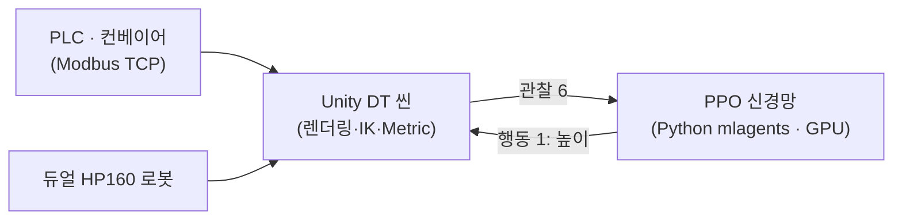
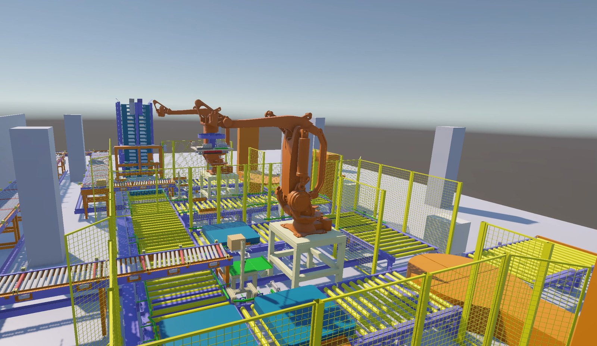
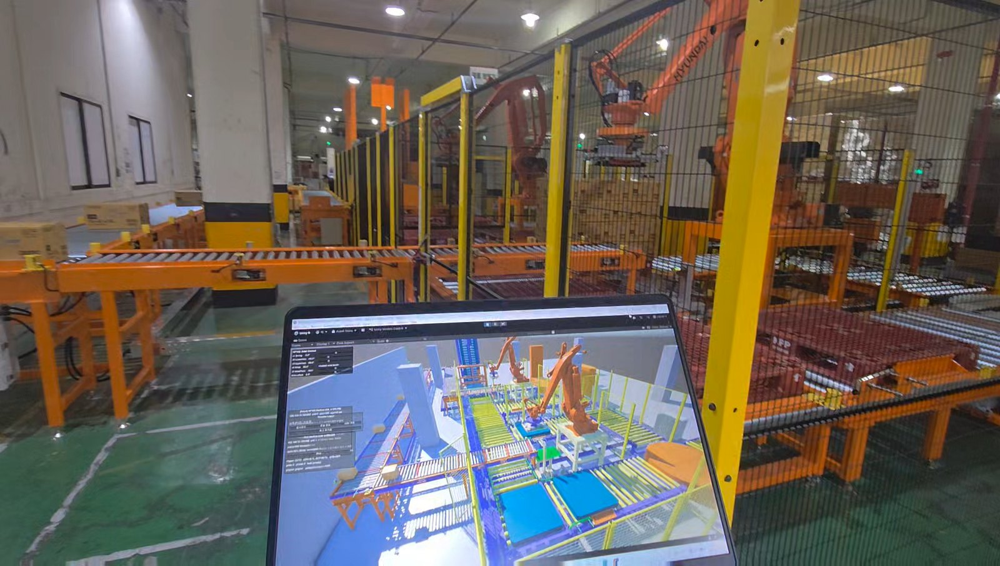
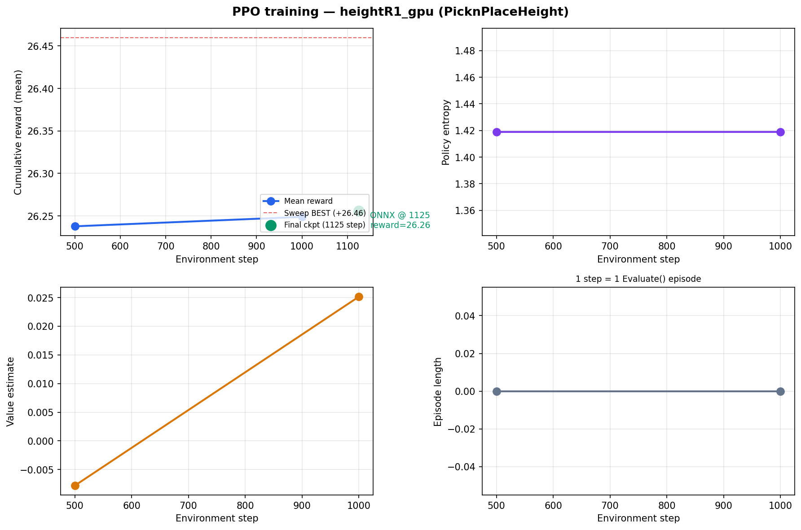
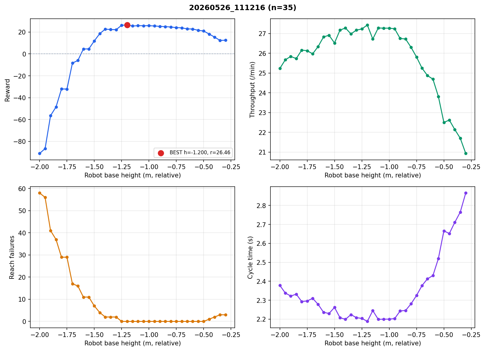

# 🏭 AI 팩토리

> 🧠 **Unity ML-Agents 기반 강화학습 공정 최적화 (유니참 디지털트윈)**
>
> 디지털트윈 환경에서 Pick & Place 로봇의 작업 높이를 강화학습(PPO)으로 최적화하고, PLC·컨베이어·로봇을 Modbus로 연동해 생산성을 시뮬레이션한 과제입니다.

## 📋 프로젝트 개요

| | |
|---|---|
| **대상** | 유니참 디지털트윈(DT) 구축 및 학습 |
| **핵심 기술** | Unity ML-Agents 4.x · PPO 강화학습 · Modbus TCP · 듀얼 HP160 로봇 |
| **담당** | 박하영 (DT 구축·학습 설계·최종보고서) |
| **상태** | 🔵 완료 (최종보고서 2026.05) |

> 📷 **대표 사진 자리** — DT 씨 전경, 학습 진행 영상 캐처 등을 추가로 넣으셔도 좋아요.

## 🎯 기획 배경 — 왜 이 과제를 시작했나

제조 라인의 생산성은 로봇의 작업 자세·높이 같은 파라미터에 크게 좌우됩니다. 하지만 실제 가동 중인 라인에서 로봇 설치 높이를 바꿔가며 반복 실험하는 것은 생산 중단 비용 때문에 사실상 불가능합니다. 그래서 유니참 포장 공정(박스 컨베이어 + 듀얼 HP160 로봇)을 Unity 디지털트윈으로 그대로 재현하고, 그 위에서 강화학습(PPO)으로 로봇 작업 높이를 자동 최적화해 **처리량 ↑ / 에너지 ↓ / 도달 실패 0** 의 균형점을 찾는 것을 목표로 기획했습니다. 단순 보이는 것만 따라하는 DT가 아니라, **실제 PLC 신호체계(Modbus TCP)와 동일한 방식으로 움직이는 검증용 DT**를 만드는 것이 핵심 방향이었습니다.

## 🎬 전체 시나리오

에피소드 1회는 실제 공정의 한 사이클을 그대로 따릅니다.

1. **박스 스폰** — Modbus TCP로 PLC 신호를 받아 컨베이어 입구에 박스 생성 (RUN/센서 신호 분리)
2. **컨베이어 이송** — P069→P07F, P054→P065 총 14구간 체인을 자동 세팅해 박스가 구간별로 순차 이동
3. **로봇 Pick & Place** — 듀얼 HP160이 현재 설정된 높이에서 박스를 집어 팔레타이징 (CCDIK 역기구학으로 도달 가능성 판정)
4. **생산성 평가** — PicknPlaceMetric이 한 사이클의 throughput(boxes/min)·에너지(관절 누적 회전량 °)·reach failure·joint limit hit를 산출
5. **보상 계산 후 종료** — 가중치 적용 보상을 에이전트에 전달하고 EndEpisode() → 에이전트가 다음 높이를 선택해 반복

이 사이클을 그리드 스윙(높이 -2.0m\~-0.3m, 0.05m 간격)으로 전수 평가한 뒤, 같은 환경에서 PPO 에이전트가 스스로 최적 높이를 찾도록 학습시켜 두 결과를 교차 검증했습니다.

## 🧑‍💻 나의 역할 · 기여

디지털트윈 씬 구축과 PLC·로봇 통신 연동부터 강화학습 MDP 설계, 보상 함수 설계, GPU 학습 파이프라인 구성, 결과 분석·최종보고서 작성까지 전 과정을 담당했습니다. 특히 생산성 지표(throughput·energy·reach failure·joint limit)를 하나의 보상 함수로 통합해 단일 파라미터(높이) 최적화 문제로 정식화했습니다.

## 🔧 기술 접근

### 강화학습 MDP 정의

| 구성 | 내용 |
|---|---|
| 상태·관찰 | Vector 6 (직전 높이·reward·throughput·energy·reach failure·joint limit) |
| 행동 | Continuous 1 — 정규화 높이 \[-1, +1\] |
| 보상 함수 | throughput − energy − reach failures − joint limit hits (가중치 1.0 / 0.0005 / 2.0 / 0.1) |
| 알고리즘 | PPO (Behavior: PicknPlaceHeight) |

## 📈 주요 성과

- **높이 최적화 결과** — 씬·IK 정합 후 상대 높이 −1.0m에서 **reach failure 0, reward +21.17** (CCDIK 기준) 달성
- **PLC·컨베이어 연동** — Modbus TCP 기반 박스 스폰·이동, RUN/센서 분리, 14구간 체인 자동 세팅
- **로봇 통신** — 듀얼 HP160 Manual/PLC/Modbus 3모드 테스트 툴, 관절 Modbus·그리퍼 SOL 연동
- **생산성 시뮬** — PicknPlaceMetric 기반 cycle 평가, 그리드 스윕 CSV 출력
- **학습 인프라** — ML-Agents 1.1.0, Python 3.10, PyTorch 2.6.0+cu124 (RTX 3060), TensorBoard 모니터링

## 📎 주요 산출물

- **최종보고서** (DT 및 학습 자료, 260529, PDF·PPTX)
- **유니티 결과영상** — DT 구축·실증·ML-agent 학습 시각화

  

- **학습 결과 그래프** — Reward 수렴 곡선, 높이 수렴 곡선, SWEEP 결과, GPU 그래프

  

  

**학습 산출물** — PicknPlaceHeight.onnx 모델

## 🧰 기술 스택

`Unity ML-Agents` `PPO 강화학습` `PyTorch` `Modbus TCP` `PLC` `디지털트윈` `CCDIK`
