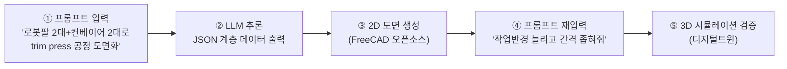

# 🏆 AI 챔피언 — [AutoFactorySketch.AI](http://AutoFactorySketch.AI)

> 🏆 <b>2025 인공지능 챔피언 대회 — LLM 기반 국내 제조현장 수요기반형 로봇 자동화 공정 도면 생성 AI (팀 </b>[<b>AutoFactorySketch.AI</b>](http://AutoFactorySketch.AI)<b>)</b>
>
> 자연어 프롬프트만으로 로봇 자동화 공정 도면을 생성·검증하는 AI를 개발해, 전국 630여 개 팀이 참가한 대회 본대회에서 **TTA 회장상(한국정보통신기술협회장상)** 을 수상한 프로젝트입니다.

> 📷 **사진 자리** — 수상 사진, 시연 화면(프롬프트→도면), 3D 검증 캡처를 넣어주세요.

## 📋 개요

| | |
|---|---|
| **대회** | 2025년 인공지능 챔피언 대회 (전국 630여 팀 참가, 본대회 진출) |
| **수상** | 🏆 TTA 회장상 (한국정보통신기술협회, 2025.11) |
| **팀 / 과제** | [AutoFactorySketch.AI](http://AutoFactorySketch.AI) — LLM 기반 국내 제조현장 수요기반형 로봇 자동화 공정 도면 생성 AI 기술개발 |
| **소속** | 한국전자기술연구원(KETI) 지능로보틱스연구센터 |

## 🎯 기획 배경 — 왜 이 기술을 만들었나

로봇 자동화 시스템 보급이 빠르게 확대되고 있지만, 자동화 검토에 필수적인 **공정 도면은 여전히 전문 엔지니어의 수작업**으로 만들어져 비용과 시간이 큽니다. 동시에 로봇 관련 중대재해(사망사고)가 2017\~2023년 16건 발생하는 등 안전 문제가 반복되고 있습니다. 그래서 두 가지를 기획의 축으로 삼았습니다.

- **접근성의 혁신** — LLM 기반 대화형 인터페이스로 비전문가도 로봇 자동화 도면을 생성할 수 있게 해 도면 생성 비용 절감
- **Safety By AI-Design** — 안전펜스·안전 커튼 등 안전요소가 도면 생성 시 필수 반영되도록 모델·기능 전체에 적용하고, 데이터셋 구축→결과물→검증·평가까지 **전주기에 검증 기능** 반영

KETI가 기보유한 "로봇 자동화 표준공정모델 개발·보급사업" 성과물 도면 데이터셋과 3D 가상 로봇 공장 구축 기술, 테스트베드 검증 기술이 있어 실용화 가능한 결과물을 만들 수 있다는 점이 차별화 포인트였습니다.

## 🎬 전체 시나리오 (시연 흐름)

1. 사용자가 자연어로 원하는 자동화 공정을 입력 (자체 python 패키지·범용 LLM 양쪽 지원)
2. 학습 모델이 구조물 위치·작업 순서·로봇 작업 반경이 담긴 **JSON 계층 데이터**를 출력
3. JSON 결과로 FreeCAD 기반 **2D 도면 자동 생성**
4. 수정 요구를 프롬프트로 재입력하면 반영된 2차 도면 생성 (대화형 반복 설계)
5. 생성 도면을 **3D 시뮬레이션·디지털트윈·실물 테스트베드로 검증**

## 🛠️ 개발 내용

- **LLM + RL 기반 제약충족 도면 생성 레이아웃 AI 엔진** — 수많은 도면을 학습한 모델이 KPI 최적화 지표를 입력받아 로봇 배치와 안전 요소를 반영한 도면 생성
- **학습 DB 구축** — 로봇 자동화 공정 도면을 수집하고 구조물 위치/작업 순서/작업 반경을 분석·데이터화, 최적화된 도면들의 특징을 JSON으로 추출해 학습
- **도면 이미지 → 데이터 변환 AI** — 이미지 처리 기반으로 기존 도면 이미지를 학습용 데이터로 변환해 대규모 데이터셋 확보 (2D 도면의 3D 도면화·디지털 전환 포함)
- **단계별 평가 체계** — 1차(2D 도면 생성 재학습) → 2차(3D 도면화 재학습) → 3차(3D 디지털트윈 구축) → 최종(현장·실물 실증, KPI 달성 검증)

## 🏆 성과

- **TTA 회장상 수상** — 전국 630여 팀 규모 대회에서 입상 (2025.11)
- 본대회 시연 동영상·발표자료 제작, 실사용 시나리오(프롬프트 → 도면 → 3D 검증) 라이브 시연
- **후속 연구 제안 채택 발표** — "한국형 로봇 자동화 도면 파운데이션 모델 구축" 로드맵 제시 (데이터셋 1만 장 확보, 30억원 규모 예산안: 파운데이션 모델 21억·HW 테스트베드 6억·글로벌화 3억)
- 확장 비전 — 제조공정을 넘어 인테리어·식품공장·환경설비 등 **조건 기반 자동 도면 생성 플랫폼**, 클라우드 구독형 서비스 모델 제시

## 🧰 기술 스택

`LLM` `생성형 AI` `강화학습(RL)` `JSON 구조화 출력` `FreeCAD` `디지털트윈 검증` `이미지 처리` `Safety By AI-Design`
