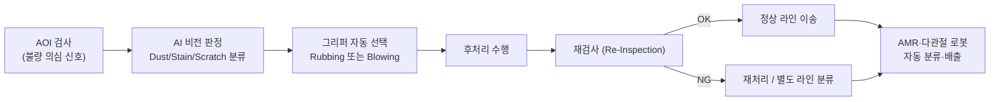

# 🦾 첨단로봇

> 🦾 **제조산업 현장 고도화를 위한 첨단로봇활용 업종별 지능형 공정모델 개발 (RS-2024-00416770)**
>
> 전기·전자·반도체 업종의 **AOI(자동광학검사) 검사 지능형 분류 및 후처리 무인화** 표준공정모델을 개발하는 다년도 국책 과제(2024.04\~2027.12, 산업통상자원부·KEIT)입니다. 저는 2차년도 실무 담당으로 연차보고서·매뉴얼 작성과 AI 비전·DQN 경로계획·디지털트윈 UI 개발을 수행했습니다.

> 📷 **대표 사진 자리** — AOI 공정 시뮬레이션, 후처리 그리퍼, 모니터링 UI 화면 등을 넣어주세요.

## 📋 프로젝트 개요

| | |
|---|---|
| **총괄과제명** | 제조산업 현장 고도화를 위한 첨단로봇활용 업종별 지능형 공정모델 개발 (로봇산업핵심기술개발) |
| **KETI 담당 공정모델** | (전기전자/반도체) AOI 검사 지능형 분류 및 후처리 무인화 첨단로봇 활용 지능형 표준공정모델 |
| **수행기간** | 2024.04.01 \~ 2027.12.31 (3년 9개월) · 현재 2차년도 완료, 3차년도 수행 중 |
| **수행구조** | KETI(공동연구개발기관) · SI 필리퍼 · 수요기업 이수페타시스 등 · 전문기관 KEIT/KIRIA |
| **나의 역할** | 2차년도 연차보고서(v12)·표준공정 매뉴얼 실무 작성 · AI 비전(합성 결함 데이터셋·이상치 분류) · DQN 다중 AMR 경로계획 · 디지털트윈 모니터링 UI(JAVA) 개발 · 주차별 연구노트 관리 |

## 🎯 기획 배경 — 왜 이 공정을 선정했나

PCB·반도체 제조의 AOI 공정은 고해상도 카메라로 표면 결함을 자동 검출하지만, 그 이후가 문제입니다. **결함 후보의 진위 판단(True/False Defect), Blowing·Rubbing 후처리, 분류·배출이 전부 수작업**이라 품질 편차와 생산 변동성이 크고, 특히 먼지·얼룩·반사로 인한 False Defect가 재검사·수작업 판단을 유발해 무인화를 막는 핵심 병목입니다.

2차년도에는 수요조사로 7개 후보 공정(DBC 결합, Tape Mount, FPCB 보강판 부착, AOI 후처리, 적층 레이업, 도금 검사·연마, Wafer 백그라인딩)을 도출하고, AI·모빌리티·고난도·유연생산·디지털트윈 5개 평가 지표로 **AOI 검사 지능형 분류·후처리 무인화 공정을 대상 공정으로 선정**했습니다. 국내 PCB·반도체 AOI 공정 보유 24개 기업 현황을 조사하고, 코리아써키트·뉴프렉스 2개사를 직접 방문해 수작업 공정 보유를 확인·컨설팅했습니다.

## 🎬 전체 시나리오

기존 수작업 공정: 제품 투입 → 장비 1차 검사 → 결함 부위 육안 검사 → False/True Defect 판단 → 수작업 후처리(Blowing·Rubbing) → 2차 확인 후 분류.

이를 다음의 무인화 공정으로 전환합니다.

1. AOI 불량 의심 신호 입력 → AI 비전이 결함 종류(Dust/Stain/Scratch)와 후처리 가능 여부를 판정
2. 판정 결과에 따라 Rubbing/Blowing 그리퍼를 자동 선택해 후처리 수행
3. 재검사(Re-Inspection) 후 OK는 정상 라인, NG는 재처리 또는 별도 라인으로 분류
4. 모바일 매니퓰레이터(AMR+다관절 로봇)가 검사-후처리-이송을 연계해 분류·배출까지 무인화
5. 전 과정을 디지털트윈으로 모니터링하며 데이터 축적 → 공정 최적화

## 🛠️ 개발 내용 — 내가 수행한 것

### 1) AI 비전 — False Defect 판별 모델 구현 (Pcb defect [classification.py](http://classification.py), 2,278 lines — 직접 개발)

DeepPCB 공개 데이터셋을 기반으로 데이터 합성부터 앱상블 분류기, 논문용 비교실험까지 단일 파이프라인으로 구현했습니다.

**① 비임계 영역 감지 기반 합성 False Defect 생성**

- HSV 색공간에서 PCB 녹색 판(H 50\~100) 마스크를 추출하고, 회로 패턴(어두운 트레이스 gray\<80 + 구리/금 패드의 yellow·red 대역)을 감지한 뒤 dilation으로 보호 영역을 확장 — <b>“녹색 판 − 회로 패턴” = 비임계 영역</b>을 모폴로지 연산(open/close)으로 정제해 산출
- 이 비임계 영역에만 dust/scratch/stain 3유형의 가짜 결함을 합성 — 회로 기능에는 영향이 없지만 AOI가 결함으로 오판하는 **False Defect의 물리적 특성을 재현**한 라벨 보증된 학습 데이터를 대량 생성 (이미지당 2개씩, 96×96 bbox 패치 추출)

**② CCT 분류기 직접 구현 (PyTorch)**

- Convolutional Tokenizer(2잍 conv, 7×7 stride2 → 3×3, BN+ReLU+MaxPool) → 위치 임베딩 → Multi-Head Self-Attention 4층(4 heads, embed 128, MLP ratio 4.0, GELU) → Sequence Pooling → 분류 헤드 구조를 모듈 단위(CCTTokenizer/CCTAttention/CCTBlock)로 구현
- 메모리 제약(사용 GPU)을 고려해 경량 구성을 선택하고, 토큰 수-위치임베딩 불일치 시 crop/repeat 대응 로직까지 처리
- 학습: AdamW(lr 1e-4, wd 0.05) + CosineAnnealingLR(T\_max 50) + **AMP(mixed precision)** + 클래스 불균형 보정 가중 CrossEntropy + Early Stopping(patience 10) + OOM 예외 복구 처리

**③ ResNet50 + RBF-SVM 보조 분기 & 앱상블**

- ImageNet 사전학습 ResNet50의 마지막 FC 제거 버전을 특징 추출기로 쓰고, StandardScaler 정규화 후 SVC(RBF, C=1.0, probability=True)로 분류하는 보조 분기 구현
- CCT softmax 확률과 SVM 확률을 가중합(0.5/0.5)하는 앱상블로 최종 True/False Defect 판정 — 귀납적 특징(CCT)과 전이학습 특징(ResNet)의 상호보완 효과

**④ 논문용 비교실험 자동화** — 동일 조건에서 Baseline(원본 데이터만) vs Proposed(합성 데이터 포함) 학습·평가를 자동 수행하는 함수(compare\_baseline\_vs\_proposed)를 구현해 제안 기법의 정확도 우위를 정량 검증 — 이 결과를 ASPEN 2025 AOI 논문 발표자료로 정리

- **이상 작동 탐지 모델** — 타 설비 X-ray 이미지 데이터셋으로 Yolov3 기반 이상 탐지 모델을 개발·테스트 (정밀도·재현율·F1 평가, 임곗값 기준 정상/이상 구분 명확성 확인)
- **적층 어긋남 분류 개선** — 분류 성능 미달(F1 0.71, 목표 0.85↑) 원인을 데이터 편중으로 진단, 수요기업 현장에서 방향별 불량 시편 150개·촬영 600장(상하 45/좌우 42/회전 38/복합 25)을 추가 확보해 2차 학습 투입

### 2) DQN 기반 다중 AMR 경로 최적화

규칙 기반 장애물 회피 알고리즘이 복잡한 실환경에서 비효율적 경로를 만드는 한계를 극복하기 위해 DQN(Deep Q-Network)을 적용했습니다.

- 학습 효율을 높이는 3가지 기법 융합 — **Action Masking**(이동 불가 방향 배제로 무의미한 학습 제거) · **Curriculum Learning**(낮은 난이도부터 점진 학습) · **Safe Greedy Rollout**(제약조건 내 보상·패널티 기반 탐욕적 탐색)
- 가상 복잡 환경의 다중 AMR 실험에서 **Double DQN > DQN > Q-learning** 성능 순위를 에피소드 성과·loss 곡선으로 검증 (500 에피소드 이후 격차 뚜렷)
- 이 연구가 ASPEN 2025 국제학회 발표(별도 페이지)로 이어짐

### 3) 디지털트윈·모니터링 시스템

- AOI 공정의 DT-현실 연동 워크플로우 설계 — 불량 판정 시 사람이 후처리 가능 여부를 확인하던 지연 문제를 DT에서 자동 판단하도록 개선
- **JAVA 기반 실시간 모니터링 UI 직접 개발** — 장비별 가동·유휴 상태와 사이클 타임을 실시간 표시
- 수요기업 현장 2D 레이아웃·장비 배치·공정 파라미터 기반 시뮬레이션 환경 구축, 장애물(obstacle) 분류와 모바일 매니퓰레이터 작업 동선 1차 분석, 불량률·검사 속도·로봇 투입 대수 변화 시나리오 검증 플랫폼 구축

### 4) 후처리 그리퍼·핸들링 (요소기술)

- **Rubbing 그리퍼** — Cloth-textured Pad + 임피던스 제어로 표면 손상 최소화
- **Blowing 그리퍼** — AI 비전으로 이물질 위치 인식 후 국소 영역 Target Blowing
- Vision 기반 자재 3D 회전 파지, Aruco Marker 3D Pose 추정, 비정형·곡면 PCB 대응 능동 제어

### 5) 테스트베드 구축 (진행)

| 설비 | 사양 | 현황 |
|---|---|---|
| 6축 협동로봇 | UR10e, 정격하중 10kg | 반입 완료 |
| 컨베이어 이송 유닛 | 벨트 폭 400mm | 반입 완료 |
| 비전 검사 스테이션 | 산업용 카메라 + 동축 조명 | 캘리브레이션 진행 |
| AMR 인터페이스 게이트 | 무선 통신 모듈 | 입고 예정 |

## 🏆 성과 — 2차년도 KPI 100% 달성

| 평가 항목 | 최종목표 | 해당연도 목표 | 실적 |
|---|---|---|---|
| 개발 공정모델 수 | 4개 | 1개 | ✅ 1개 (AOI 무인화) |
| 공정 시뮬레이션 기반 수작업 대비 생산율 | 120% | 120% | ✅ ≥120% |
| 테스트베드 구축 수 | ≥2개 | 1개 | ✅ 1개 (시뮬레이터 실증) |
| 공정 작업 성공률 | 90% | 90% | ✅ 90% |
| 표준공정 매뉴얼 | 4건 | 1건 | ✅ 1건 작성 |
| 수요기업 컨설팅 | 8건 | 2건 | ✅ 2건 (코리아써키트·뉴프렉스) |

## 📎 주요 산출물

- **2차년도 연차보고서** (v12, 251219) — 실무 작성 담당
- **첨단로봇활용 지능형 공정모델 매뉴얼 보고서** (별첨3, AOI 검사 지능형 분류·후처리 무인화, 251220)
- **주차별 연구노트** (424C5354, 2025.02\~2026.07) — 지능형 공정모델 개발 기록
- **수요기업 컨설팅 보고서 2건** · AOI 공정 보유 24개 기업 현황 조사

> 📷 **사진 자리** — 합성 결함 데이터셋 예시, DQN 성과 그래프, 모니터링 UI, 시뮬레이션 환경

## 🧰 기술 스택

`AOI` `머신비전` `CCT·ResNet-SVM` `합성 데이터셋` `Yolov3` `DQN·Double DQN` `모바일 매니퓰레이터` `디지털트윈` `JAVA UI` `임피던스 제어` `UR10e`
