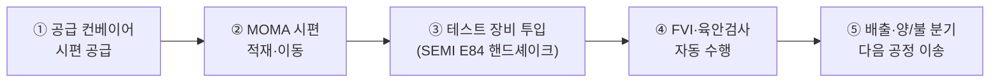

# ⚙️ 로봇장비

> ⚙️ **제조공정 디지털 전환을 위한 로봇-장비 디지털 매뉴팩처링 패키지 표준모델 개발 (2세부 전기전자분야 · 과제번호 20018548)**
>
> 단순 I/O로만 연결되던 로봇과 제조 장비를 유기적으로 연계하고, 생산 데이터를 수집·DB화해 제조공정의 디지털 전환을 이루는 표준공정모델을 개발하는 다년도 국책 과제(2022.04\~2025.12, 총 29.2억원)입니다. 저는 4차년도 실무 담당으로 반도체 패키징·테스트 장비 표준공정모델 매뉴얼과 연차보고서를 작성했습니다.

> 📷 **대표 사진 자리** — 테스트베드, MOMA(이동식 협동로봇), 시뮬레이션 캡처를 넣어주세요.

## 📋 프로젝트 개요

| | |
|---|---|
| **총괄과제명** | 제조공정 디지털 전환을 위한 로봇-장비 디지털 매뉴팩처링 패키지 표준모델 개발 |
| **KETI 과제명** | (2세부) 전기전자분야 로봇-장비 디지털 매뉴팩처링 패키지 표준모델 개발 (20018548) |
| **수행기간·규모** | 2022.04.01 \~ 2025.12.31 (45개월) · 총 2,917,200천원 · TRL 6 → 8 |
| **수행구조** | KETI(주관) · 한국로봇산업진흥원(KIRIA) · 한국PCB&반도체패키징산업협회(KPCA) |
| **나의 역할** | 4차년도 실무 — 연차보고서(v9), 반도체 패키징(별첨5-1)·테스트 장비(별첨5-2) 표준공정모델 매뉴얼 작성, 보급 컨설팅 보고서(별첨3)·업종 분석서(별첨1) 작성, 4차년도 통합워크숍(부산) 자료 |

## 🎯 기획 배경 — 왜 이 과제가 필요한가

국내 전기전자 제조 현장에서는 로봇과 장비가 **기존 단순 I/O 또는 독립적 공정 배치**로 각각 사용되어 유의미한 자동화 솔루션으로 이어지지 못하고 있습니다. 본 과제는 장비 제어기를 통신 서버로, 공정 내 모든 설비(로봇·I/O·주변장치)와 외부 모니터링 SW를 클라이언트로 구성하는 **중앙집중형 제어 계층**을 정립하고, 장비가 수집한 생산 데이터를 모니터링 SW의 DB에 저장해 디지털 전환을 이루는 "로봇-장비 디지털 매뉴팩처링 패키지 표준모델"을 만드는 것이 목표입니다. 자동화 시스템 국산화로 구축 비용을 낮춰 중소 제조업 보급을 확대하고, 고위험 작업을 로봇으로 대체해 산업재해를 줄이는 효과도 함께 노립니다.

## 🎬 전체 시나리오 — 연차별 8종 장비 표준공정모델

| 연차 | 대상 장비 | 핵심 내용 |
|---|---|---|
| 1차년도 (2022) | AOI 검사 장비 · PCB WET 장비 | 표준 네트워크 자료조사, AI 머신비전 연구, 테스트베드 제작 |
| 2차년도 (2023) | PCB 핫프레스 · PCB 드릴링 장비 | 표준 네트워크 1차 개발, Object Detection 딥러닝 모델, 공정관리 플랫폼 1차 |
| 3차년도 (2024) | X-ray/솔더링 검사 · 반도체 가공(쏘잉) 장비 | 표준 네트워크 2차, AI 추론 HW 플랫폼 2종 성능 분석, 논문 2건 발표 |
| 4차년도 (2025) | **반도체 패키징(PMC) · 반도체 테스트(FVI/VM/Packing) 장비** | 표준 네트워크 고도화, Classification 딥러닝 모델, 매뉴얼·컨설팅 — **내가 담당** |

### 4차년도 시나리오 — 반도체 테스트 장비 자동화 (내가 설계·문서화)

기존(As-Is): 시편 공급 → 장비 투입 → 장비 명령 → 검사 → 배출 → 분류·이송이 검사만 빼고 **전부 작업자 수작업**. 개선(To-Be): 검사 외 전 단계를 **이동식 협동로봇(MOMA = AMR + 6축 협동로봇)** 과 통합 제어 장치가 수행.

- 로봇-장비 간 **PIO Sensor 기반 SEMI E84 Protocol** 원격 데이터 송수신으로 장비 상태(검사 중·완료·대기·이상)를 실시간 확인, UPH(시간당 생산량)를 만족하도록 공급·투입·분기 시점을 자동 제어
- MOMA 사양: 협동로봇 가반 10kg·리치 1,300mm·반복정밀도 ±0.1mm / AMR 최대 적재 90kg·주행 1.35m/s / 통신 TCP/IP·SEMI E84·I/O
- Visual Components 기반 디지털트윈 시뮬레이션으로 운영 시나리오 사전 검증

## 🛠️ 개발 내용 — 내가 작성·설계한 것 (4차년도)

### 1) 표준공정모델 매뉴얼 2종 전담 작성

**별첨5-2 반도체 테스트 장비 매뉴얼** — 공정 분석(수작업 문제점 3분류: 생산성·작업자 재해·안전), As-Is/To-Be 공정 전환표, 시스템 구성(MOMA·그리퍼·제어반·통합관리시스템·매거진/버퍼), 장비 상세 스펙(미래산업 모듈 테스트기: 2000 UPH, Tri-temp -10\~+125°C), 공정 설계도·운영 시나리오, 실증기준(디지털 전환 지수: 정보화 4·연동 3·지능화 3), ROI 경제성 분석(인건비 95백만→31.7백만원/년)까지 전 장을 작성했습니다.

**별첨5-1 반도체 패키징(PMC) 장비 매뉴얼** — PMC(Post Mold Cure) 공정의 D.N.A 구조를 설계·문서화했습니다.

- **Data** — PMC 장비 고유 데이터(온도·가동시간·냉각시간) 실시간 수집, 로봇 상태 신호(투입 대기/진행/완료·배출)·지그 인식·그리퍼 동작 데이터의 MES/SCADA(엣지) 수집·저장
- **Network** — Ethernet 산업용 통신 기반 장비-로봇 일원화 제어, 공정 데이터-로봇 컨트롤러 데이터 매칭을 통한 공정 동기화, 다수 장비-다수 로봇(n:m) 대응 네트워크 제어 구조
- **AI** — 센서 데이터 DB화 → 공정 이상 감지 시 설비 정지·대시보드 알림, 누적 데이터 기반 장비 고장 예측·예지보전(PdM) 체계
- **통합 운영 SW** — 로봇-장비 동시 관리, 실시간 모니터링·알람, 데이터 시각화·공정 리포팅

### 2) 보급·확산 문서

- **별첨3 디지털 패키지 표준공정모델 보급 컨설팅 보고서** (v1\~v6) — 수요기업 컨설팅 결과 문서화
- **별첨1 디지털 매뉴팩처링 표준공정모델 적용 업종 자체 분석서** — 업종 분석
- **4차년도 통합워크숍(부산, 251216)** 발표자료 제작 참여 — 매뉴얼은 이 워크숍 발표자료를 기반으로 체계화

### 3) 4차년도 연차보고서 (v9 HY)

연차 목표(표준 네트워크 고도화, Classification 딥러닝 모델, 패키징·테스트 장비 표준공정모델 상세 개발, 테스트베드 개발, 실증 보급체계 안정화) 대비 실적을 정리했습니다.

## 🏆 성과 및 산출물

- 4개년 누적 **8종 장비 표준공정모델** 개발 (AOI·WET·핫프레스·드릴링·X-ray/솔더링·쏘잉·패키징·테스트)
- 로봇-장비 연계 논문 2건 발표(3차년도), KPCA Show 공동홍보관 등 성과 홍보 4건
- 첨단제조로봇 실증사업·자율제조로봇 실증사업(10개 분야 30억)과 보급 연계
- **ROI 근거 확보** — 테스트 장비 자동화 시 연 인건비 약 63백만원 절감 구조 분석
- 산출물: 연차보고서 1\~4차년도, 표준공정모델 매뉴얼(패키징·테스트), 컨설팅 보고서, 업종 분석서, 부산 통합워크숍 자료

> 📷 **사진 자리** — 로봇-장비 시스템 개념도, 공정 설계도, Before/After 레이아웃, 시뮬레이션 화면

## 🧰 기술 스택

`로봇-장비 연계` `MOMA (AMR+협동로봇)` `SEMI E84` `PIO 통신` `MES/SCADA` `예지보전(PdM)` `Visual Components` `디지털 전환 지수` `표준공정모델` `ROI 분석`
