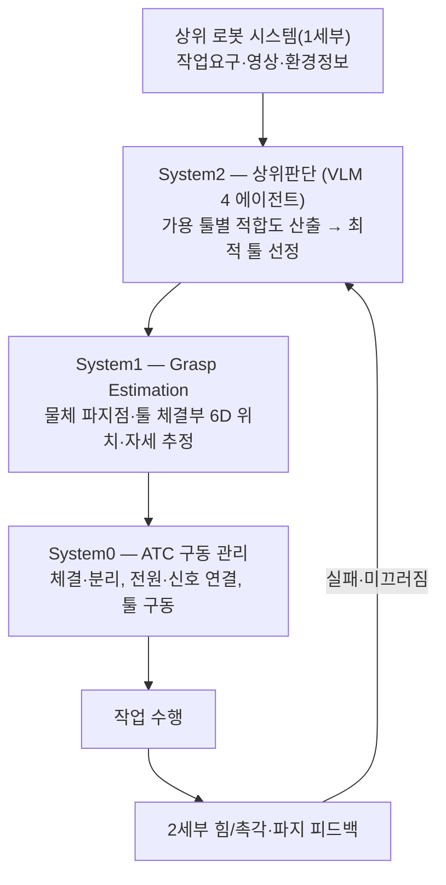

# 🔧 툴링 과제

> 🔧 **AI 로봇용 무동력 자동 툴 교체 기반 Plug & Play 로봇 툴링 플랫폼 개발 (5세부 · RS-2026-25616817)**
>
> 로봇이 전원·동력 없이 다양한 툴·그리퍼를 스스로 갈아 끼우는 무동력 마그네틱 ATC 하드웨어(유엔디 Magbot)에, KETI의 AI 툴링 SW(어포던스 추론 기반 최적 툴 선정·자동교체)를 결합하는 로봇산업핵심기술개발 과제입니다. 저는 KETI 작성분 연구개발계획서를 v23까지 주도적으로 작성했습니다.

> 📷 **대표 사진 자리** — 추진체계도, ATC(Magbot) 이미지, 발표자료 표지 등을 넣어주세요.

## 📋 프로젝트 개요

| | |
|---|---|
| **과제명** | AI 로봇용 무동력 자동 툴 교체 기반 Plug & Play 로봇 툴링 플랫폼 개발 (5세부 로봇툴링플랫폼, 병렬형 세부) |
| **사업** | 로봇산업핵심기술개발 \[RS-2026-25616817\] · 1\~4차년도 |
| **수행구조** | 주관 (주)유엔디(무동력 마그네틱 ATC 'Magbot') · 공동1 KOTMI(한국섬유기계융합연구원) · 공동2 KETI(AI 툴링 SW) |
| **나의 역할** | KETI 작성분 연구개발계획서 총괄 작성 (v1\~v23) — 역할 정의·KPI 설계·연차별 개발내용·특허/표준/시장조사·추진체계도, 발표자료(260724) 작성 |
| **상태** | 🟡 연구개발계획서 제출·발표평가 대응 (2026.07) |

## 🎯 기획 배경 — 왜 이 과제를 기획했나

제조 로봇이 여러 작업을 수행하려면 툴(그리퍼)을 계속 갈아 끼워야 하지만, 기존 ATC는 공압·전기 배선이 필요해 구조가 복잡하고 로봇 기종에 종속적입니다. 사람 손을 흉내 내는 다관절 손(dexterous hand)은 대당 약 USD 20,000 이상으로 중소 제조업체가 도입하기 어렵습니다. 본 과제는 **무전원 영구자석 폐회로 록킹 방식의 마그네틱 ATC**(유엔디 Magbot — UR+ 인증, IR52 장영실상)에 **AI가 스스로 툴을 판단·선정·교체하는 소프트웨어 계층**을 결합해, 수동교체형 ATC를 'AI 자율 판단형 ATC'로 고도화하는 것을 목표로 기획했습니다.

기획 논리의 핵심은 시장 조사로 뒷받침했습니다: 국내 로봇산업 매출 6조 1,695억원(KIRIA 2025) 중 부품·SW가 1.9조원이지만 국산 부품 사업화에는 5대 허들(규격 부재·양산 미비·레퍼런스 부재 등)이 있고, 글로벌 피지컬 AI의 4대 난제(Sim2Real Gap·Embodiment Gap·Action Hallucination·Policy Consistency Gap) 대응에 AI 로봇부품이 "Embodiment Layer"로서 필요하다는 포지셔닝입니다.

## 🎬 전체 시나리오 — AI 툴링 SW의 동작 흐름

1. 상위 로봇 시스템이 작업 요구와 영상·환경 정보를 전달하면, **System2(상위판단)** 가 가용 툴별 적합도를 산출해 최적 툴을 선정합니다.
2. System2는 4개 VLM 에이전트의 협업 구조입니다 — **Task Manager**(작업 이해·계획) → **Affordance Analyst**(어포던스 추론) → **Motion Planner**(동작 추론) → **Execution Inspector**(실행 검사).
3. **System1(Grasp Estimation)** 이 물체 파지점과 툴 체결부의 6D 위치·자세를 추정합니다 (AnyGrasp/GraspNet 베이스라인).
4. **System0(ATC)** 이 무동력 마그네틱 체결·분리, 전원·신호 연결, 툴 구동을 관리합니다.
5. 작업 실패·미끄러짐 등 피드백이 오면 툴을 **재선정·재교체하는 폐루프**로 순환합니다.

검증 대상은 힘 제어 요건(선형/회전 운동, 정속력·임계력)별로 분류한 **10개 산업 도구**이며, 실증은 **물류·빈피킹(다목적 피킹/패킹) · 케이블 하네스 조립 · 가공·후처리(고난이도 공구 작업) · 휴머노이드 정밀조립** 4개 제조환경 시나리오에서 수행합니다.

## 🛠️ 개발 내용 — 내가 작성·설계한 것

### 1) KETI 역할 정의와 KPI 체계 설계

KETI가 담당할 AI 툴링 SW의 역할(위 시나리오의 System2-1-0 + 폐루프)을 정의하고, 평가 가능한 KPI 체계를 설계했습니다: 적합 툴 선정 성공률(%) · 미학습 작업·물체 일반화 성공률(%) · 파지점/체결부 위치 평균절대오차(mm) · 자세 평균 각도오차(°) · AI 추론 응답시간 · 공동 KPI(자동 툴 교체 성공률/소요시간, 피드백 기반 재선정·재교체 성공률). 미학습 일반화를 1차 지표와 분리 관리하도록 설계한 것이 특징입니다.

### 2) 1\~4차년도 개발 로드맵 역산 설계

확정되어 있던 4차년도 최종 모습(듀얼시스템 통합·4개 에이전트·10개 도구·4개 시나리오 실증)에서 역산해 1\~3차년도를 설계했습니다.

| 연차 | 핵심 목표 | 주요 내용 |
|---|---|---|
| 1차년도 | 구조 설계·베이스라인 | System2-1-0 3계층 구조·인터페이스 정의, 4개 VLM 에이전트 역할 정의, 10개 도구 분류체계·4개 시나리오 분석, AnyGrasp/GraspNet 베이스라인 구축, 데이터셋 스키마 설계 |
| 2차년도 | 모듈 프로토타입 | Grasp Estimation 프로토타입, Task Manager·Affordance Analyst 에이전트 프로토타입, ATC 기초 연동, 도구 3\~5개 모듈 시험, 빈피킹 파일럿 데이터셋 |
| 3차년도 | 통합·에이전트 완성 | Motion Planner·Execution Inspector 추가로 4개 에이전트 완성, 듀얼시스템 통합 파이프라인, 폐루프 기능, 10개 도구 전체 검증, 예비 실증, 오차 재학습 루프 적용 |
| 4차년도 | 실증·검증 | 4개 제조환경 실증, 다목적 실증 데이터셋 구축, 오차 재학습 기반 정밀도 향상 루프 검증 |

특히 **"실증 데이터 기반 로봇 학습 데이터셋 구축 및 오차 재학습 정밀도 향상 루프"** 항목을 신규 기획해 4차년도에 추가하고, 이 항목으로 귀결되도록 1\~3차년도에 설계→파일럿→확대 구축 단계를 배치했습니다.

### 3) 특허·표준·시장 조사 (계획서 5-1·5-2 공란 보완)

- **특허 조사** — KIPRIS·Google Patents로 자체 보유 특허(유엔디 마그네틱 4건, KETI 그리퍼 2건 등 9건)와 국내외 경쟁 특허를 조사. 특히 ATI(US10335957B2 마그네틱 활성화형)·Boeing(US10414055B2 스위처블 마그네틱 커플러)·Fetch Robotics(무선 퀵체인지) 특허를 본 과제의 무전원 영구자석 폐회로 방식과 비교 분석해 회피설계·FTO 검토 필요 지점을 명시
- **표준 조사** — ISO 11593(엔드이펙터 자동교환장치)을 핵심 모표준으로 식별하고, KS/ISO 안전표준 3단계 체계(Type A/B/C)와 EU Machinery Regulation 2023/1230, ANSI/RIA R15.06 인증 요건 정리
- **시장 조사** — 글로벌 ATC 시장(2024년 5.19억 달러 → 2032년 11.5억 달러, CAGR 12.3%), 국내 로봇산업 구조와 5대 허들, 피지컬 AI 생태계 3계층(Isaac Sim·π0·GR00T·Optimus 등) 분석

### 4) 추진체계도·발표자료

3개 기관(유엔디·KOTMI·KETI)의 역할과 데이터·요구사항 공유 관계를 색상 화살표로 표현한 종합 추진체계도와 연차별 추진 흐름도를 구성하고, 발표평가용 자료(260724, KOTMI 취합본)를 작성했습니다. 사회적 가치 창출 계획(비수도권 기업—수도권 출연연 협력형 R&D 모델)도 초안을 작성했습니다.

## 🏆 성과 및 산출물

- **연구개발계획서 KETI 작성분 v23** — 역할 정의·KPI·연차 로드맵·특허/표준/시장 분석·추진체계도·사회적 가치 계획을 포함한 완성본
- **발표평가 자료** (260724, 339MB 규모 통합본) — KETI 담당분 작성·취합 참여
- 데이터셋 구축 + 오차 재학습 루프라는 **KETI 주도 신규 연구 항목을 과제에 편입**시켜 KETI의 역할 범위 확대
- 특허 비교 분석으로 무전원 마그네틱 ATC의 **기술 공백(선점 여지)** 을 근거화

> 📷 **사진 자리** — 종합 추진체계도, 연차별 추진 흐름도, Magbot ATC 사진

## 🧰 기술 스택

`무동력 ATC` `마그네틱 체결` `VLA/VLM 에이전트` `어포던스 추론` `Grasp Estimation (6D)` `AnyGrasp/GraspNet` `R&D 기획` `KPI 설계` `특허·표준 분석`
